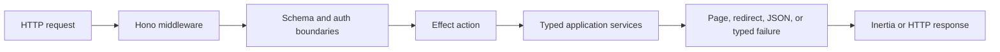

# @popcomputer/web

Effect-native, server-driven web applications on Hono.

`@popcomputer/web` combines the Inertia protocol, Hono routing, Effect programs,
typed request boundaries, optional Better Auth integration, and Drizzle route
model binding. It is designed for applications that want a Laravel-like
request-to-page workflow without giving up explicit dependencies and typed
failures.

```ts
export const showProject = action(
  Effect.gen(function* () {
    const auth = yield* authorize()
    const project = yield* bound('project')

    if (project.userId !== auth.user.id) return yield* notFound('Project')

    return yield* render('Projects/Show', { project })
  })
)
```

## Contents

- [Why this shape](#why-this-shape) · [Installation](#installation) · [Quick start](#quick-start) · [Which API for which task](#which-api-for-which-task) · [Reading the type errors](#reading-the-type-errors)
- Building: [Application services](#application-services) · [Validation and the database](#validation-and-the-database) · [Route model binding](#route-model-binding) · [Auth](#auth) · [Responses and failures](#responses-and-failures) · [JSON endpoints](#json-endpoints) · [Lint rules](#lint-rules)
- Running: [Caching and background work](#caching-and-background-work) · [Scheduled and queued work](#scheduled-and-queued-work) · [Page caching](#page-caching)
- [Testing](#testing) · [Patterns from real applications](#patterns-from-real-applications) · [User input in, files out](#user-input-in-files-out)
- Reference: [Lower-level composition](#lower-level-composition) · [Version values](#version-values) · [Upgrading](#upgrading) · [Migrating from `honertia`](#migrating-from-honertia) · [Tradeoffs and current limits](#tradeoffs-and-current-limits)

## Why this shape

- **Declare once; the rest derives.** `setupWeb` takes each of the
  application's declarations as a value: the database factory, the Drizzle
  schema and the tables route models load from, the signed-in user's schema,
  pages, route paths, shared props and flash. Registering its result once
  types everything else: `bound('project')` is the table's row, `render`
  checks a page's props, `redirect` and `href` fill a path's placeholders, and
  a React page's props follow its schema. A renamed column, prop or
  placeholder is a type error wherever it is used.
- **Actions are ordinary Effect values.** They declare only the services and
  failures they use, so small actions stay small and complex workflows
  compose. `routes` accepts an action only when the setup provides its
  services and handles its failures; otherwise the registration is a type
  error naming the missing service or the unhandled error.
- **External data is parsed at the edge.** Sessions, request input, route
  parameters, database rows, cached values and webhook bodies are checked with
  Effect Schema before application code relies on them, and what reaches the
  browser is encoded through the page's schema.
- **Correct by default where it is easy to get wrong:** cached pages vary on
  cookies and are purged by the records they show, failed forms go back to the
  form with their errors, and a record a visitor may not see is a 404.
- **The standard Inertia protocol.** Existing Inertia clients keep using
  `X-Inertia`, partial reloads, asset versions, error bags and redirects.

## Installation

```bash
bun add @popcomputer/web effect hono
```

Add only the optional integrations your application uses:

```bash
bun add better-auth                         # Better Auth integration
bun add drizzle-orm                         # Drizzle route model binding
bun add @inertiajs/react react react-dom    # React client
```

The application's `tsconfig.json` needs the DOM library and JSX for its React
pages, and Cloudflare's types for its bindings (`bun init` writes neither):

```json
{
  "compilerOptions": {
    "target": "ES2022",
    "module": "ESNext",
    "moduleResolution": "bundler",
    "lib": ["ES2022", "DOM"],
    "jsx": "react-jsx",
    "types": ["bun", "@cloudflare/workers-types"],
    "strict": true,
    "skipLibCheck": true
  }
}
```

The examples read a row from `.returning()` as `const [project] = ...`; with
`noUncheckedIndexedAccess` on, guard the row before using it.

The package's lint rules check what types cannot see, such as an update
without a `where`, a transaction that calls the network, or SQL built from a
string. They run in [Oxlint](https://oxc.rs), with nothing to configure
beyond turning them on:

```bash
bun add -d oxlint
```

```ts
// oxlint.config.ts
import { defineConfig } from 'oxlint'
import { webLint } from '@popcomputer/web/lint'

export default defineConfig(webLint())
```

`bunx oxlint` then reports each mistake with the API to use instead and why;
[Lint rules](#lint-rules) lists them.

Coding agents should read `node_modules/@popcomputer/web/AGENTS.md`, a short
rulebook naming the one API to use for each task. Reference it from the
application's own `AGENTS.md` or `CLAUDE.md`. The same rules ship as a Claude
skill in `skills/popcomputer-web/SKILL.md`; copy that directory into
`~/.claude/skills/` or a project's `.claude/skills/`.

Effect and Hono are peer dependencies so an application owns one Effect runtime
and one Hono type identity. `better-auth` and `drizzle-orm` are optional peers:
an app without them still bundles for Cloudflare Workers. Route model binding
loads `drizzle-orm` when a bound route runs and reports a configuration error
if it isn't installed.
The package supports Effect 4 (`^4.0.0`, tested with 4.0.3), Hono 4.10 or
later 4.x (tested with 4.13.13), Better Auth 1.x (tested with 1.7.7), and
Drizzle ORM 0.30 or later 0.x (tested with 0.45.4). Hono 5 and Drizzle 1.0 are
not supported yet: both change APIs this package uses.

## Quick start

Every type an application uses is declared once, as a value, and the rest of
the application is typed by it: the database client, the Better Auth client,
the signed-in user, route models, pages, shared props and flash data.

### 1. Describe the Worker's bindings

```ts
// src/env.ts
export type Bindings = {
  DATABASE_URL: string
  BETTER_AUTH_SECRET: string
  PAYMENT_WEBHOOK_SECRET: string
  TIME_ZONE?: string
  KV: KVNamespace
}

export type Env = { Bindings: Bindings }
```

### 2. Describe the pages

Each page component's props are an Effect Schema:

```ts
// src/pages.ts
import { Schema as S, Struct } from 'effect'
import { tableSchema } from '@popcomputer/web/schema'
import * as schema from './schema'

// Each page names the columns it shows; the table declares their types.
export const Project = tableSchema(schema.projects).mapFields(
  Struct.pick(['id', 'name', 'userId', 'createdAt'])
)

export const ProjectSummary = tableSchema(schema.projects).mapFields(Struct.pick(['id', 'name']))

export const Task = tableSchema(schema.tasks)

// A page that shows computed values beside columns adds them as fields.
export const ProjectCard = tableSchema(schema.projects).mapFields((fields) => ({
  ...Struct.pick(fields, ['id', 'name']),
  openTasks: S.Number,
}))

// The row a list page ends with, from which the next page continues.
export const ProjectCursor = S.Struct({ beforeAt: S.Date, beforeId: S.String })

export const pages = {
  'Projects/Index': S.Struct({ projects: S.Array(ProjectSummary), next: S.NullOr(ProjectCursor) }),
  'Projects/Show': S.Struct({ project: Project }),
  'Auth/Login': S.Struct({}),
  Dashboard: S.Struct({}),
}
```

`render('Projects/Show', props)` accepts only a registered page and props
matching its schema, and encodes the props as JSON through it, so `createdAt`
reaches the browser as an ISO string. The React component takes its props from
the same schema:

```tsx
// src/pages/Projects/Show.tsx
import type { WebPage } from '@popcomputer/web/react'

const Show: WebPage<'Projects/Show'> = ({ project, auth, errors }) => (
  <main>
    <h1>{project.name}</h1>
    <p>Created {new Date(project.createdAt).toLocaleDateString()}</p>
    {auth.user && <p>Signed in as {auth.user.name}</p>}
    {errors.name && <p role="alert">{errors.name}</p>}
  </main>
)

export default Show
```

The client resolves each page by name. A map of every page to its component,
typed `{ readonly [Name in PageName]: WebPage<Name> }` (`PageName` from
`@popcomputer/web/effect`), makes a page without a component a type error. The
resolver checks a name with a guard, `(name): name is PageName => name in
components`, and falls back to the error page, which is not a registered page:
`createInertiaApp({ resolve: (name) => (isPage(name) ? components[name] :
ErrorPage) })`. A page component typed `WebPage<'Name'>` is a React function
component; type the error page `WebErrorPage` from `@popcomputer/web/react`.

A component a page renders takes its props from the same declaration:
`PagePropsFor<'Projects/Show'>['project']` from `@popcomputer/web/react` is the
`project` prop as the browser receives it.

A form's fields derive from the schema its action validates them with:
`useForm<FormInput<typeof CreateProject>>({ ... })`, `FormInput` from
`@popcomputer/web/react`, so a renamed field is a type error in the form as
well as the action, and `const errors: FormErrors<typeof CreateProject> =
props.errors` types the errors the form reads by the same fields. Keep form
schemas in a module both sides import, `src/forms.ts`, and import them in
React with `import type`, so no server code reaches the browser.
[Write the client](#5-write-the-client) shows a form page, the error page and
the client's page map.

A renamed prop, a missing page or a `Date` used as a `Date` in the browser is a
type error on the side that drifted.

A row joined from several tables spreads `columnsOf` for each table, which
takes the fields that table has: `{ ...columnsOf(stockLevels, StockLine),
...columnsOf(products, StockLine) }`. A field both tables have, such as `id`,
comes from the later one, so leave it out of the other table's:
`columnsOf(products, MovementRow.mapFields(Struct.omit(['id'])))`.

A query reads exactly the columns a page shows with `columnsOf`, which takes
them from the page's schema, beside any values it computes:

```ts
import { count, eq } from 'drizzle-orm'
import { columnsOf } from '@popcomputer/web/schema'
import { ProjectCard } from '../pages'
import { tasks } from '../schema'

const projectCards = dbQuery((db) =>
  db.select({ ...columnsOf(projects, ProjectCard), openTasks: count(tasks.id) })
    .from(projects)
    .leftJoin(tasks, eq(tasks.projectId, projects.id))
    .groupBy(projects.id)
)
```

### 3. Configure the application once, and register it

```ts
// src/app.ts
import { Hono } from 'hono'
import { Schema as S, Struct } from 'effect'
import {
  createTemplate,
  createVersion,
  setupWeb,
} from '@popcomputer/web'
import { betterAuthSession } from '@popcomputer/web/auth'
import { tableSchema } from '@popcomputer/web/schema'
import { createAuth } from './auth'
import { createDb } from './db'
import manifest from '../dist/manifest.json'
import type { Env } from './env'
import { pages } from './pages'
import { paths } from './paths'
import * as schema from './schema'

export const web = setupWeb(new Hono<Env>(), {
  version: createVersion(manifest),
  render: createTemplate({
    title: 'Projects',
    scripts: [manifest['src/main.tsx']?.file].filter(Boolean),
    styles: manifest['src/main.tsx']?.css ?? [],
  }),
  database: (c) => createDb(c.env.DATABASE_URL),
  schema,
  bindings: { project: schema.projects, task: schema.tasks, organization: schema.organizations },
  pages,
  paths,
  auth: {
    client: (c, { db, backgroundTasks }) => createAuth({
      db,
      secret: c.env.BETTER_AUTH_SECRET,
      baseURL: new URL(c.req.url).origin,
      advanced: { backgroundTasks },
    }),
    // The user's fields are the user table's; pages see only `share`'s.
    session: betterAuthSession(tableSchema(schema.user)),
    share: tableSchema(schema.user).mapFields(Struct.pick(['id', 'name', 'image'])),
  },
  shared: S.Struct({ unreadCount: S.Number }),
  flash: S.Struct({ success: S.String }),
  errors: { component: 'Error' },
})

declare module '@popcomputer/web' {
  interface Register {
    web: typeof web
  }
}

export const { app, routes } = web
export default app
```

Registering `setupWeb`'s result is the one declaration the rest of the
application reads its types from:

| Declared in `setupWeb` | Types |
| --- | --- |
| `new Hono<Env>()` | `BindingsService`, Effect `Config`, `testEnv`'s bindings |
| `database` | `DatabaseService` and the `db` in `dbQuery`, `dbMutation`, `dbBatch` |
| `schema`, `bindings` | `bound('project')`, its keys and the model's row type |
| `auth.client` | `AuthService`, and the endpoints `betterAuthRedirect` and `betterAuthCall` call |
| `auth.session` | `authorize()`, `currentUser`, `AuthUserService`, `signedIn` |
| `auth.share` | `auth.user` in `SharedProps` and `WebPage` (default: `id`, `name`, `image`) |
| `pages` | `render`, `jsonOrRender`, `WebPage`, `readPage` |
| `paths` | the paths `routes.get(...)` and the other registrations accept |
| `shared`, `flash` | `shareProps(effect)`, `share(key, value)`, `flash(key, value)`, `SharedProps`, `FlashData` |

Each value reaches the browser encoded through its schema, so a field the
schema does not name, such as the user's email, never leaves the server.
Inertia's own `usePage()` reads the same types from one more declaration:

```ts
// src/inertia.d.ts
import type { FlashData, SharedProps } from '@popcomputer/web/react'

declare module '@inertiajs/core' {
  interface InertiaConfig {
    sharedPageProps: SharedProps
    flashDataType: FlashData
  }
}
```

The database and Better Auth come from two small factories. On Postgres,
through Hyperdrive in production:

```ts
// src/db.ts
import type { PgDatabase, PgQueryResultHKT } from 'drizzle-orm/pg-core'
import { drizzle } from 'drizzle-orm/postgres-js'
import postgres from 'postgres'
import * as schema from './schema'

// Drizzle's driver-independent Postgres database: a PGlite client in tests
// has this type too, so testEnv accepts it in place of Hyperdrive's.
export type Database = PgDatabase<PgQueryResultHKT, typeof schema>

export function createDb(url: string): Database {
  return drizzle(postgres(url), { schema })
}
```

```ts
// src/auth.ts
import { betterAuth, type BetterAuthOptions } from 'better-auth'
import { drizzleAdapter } from 'better-auth/adapters/drizzle'
import type { Database } from './db'
import * as schema from './schema'

export interface CreateAuthOptions {
  readonly db: Database
  readonly secret: string
  readonly baseURL: string
  readonly advanced?: BetterAuthOptions['advanced']
}

// Better Auth's tables (user, session, account, verification, rateLimit)
// belong in ./schema: `npx @better-auth/cli generate` writes them.
export function createAuth(options: CreateAuthOptions) {
  return betterAuth({
    database: drizzleAdapter(options.db, { provider: 'pg', schema }),
    secret: options.secret,
    baseURL: options.baseURL,
    emailAndPassword: { enabled: true },
    // Limit signing in and up per client, counted in the database so every
    // Worker isolate shares the count. Better Auth turns its limits on only
    // when NODE_ENV is 'production', which a Worker does not set.
    rateLimit: { enabled: true, storage: 'database' },
    advanced: {
      ...options.advanced,
      ipAddress: { ipAddressHeaders: ['cf-connecting-ip', 'x-forwarded-for'], ...options.advanced?.ipAddress },
    },
  })
}

export interface CreateStatelessAuthOptions {
  readonly secret: string
  readonly advanced?: BetterAuthOptions['advanced']
}

// Better Auth without a database, for an application without accounts of its own.
export function createStatelessAuth(options: CreateStatelessAuthOptions) {
  return betterAuth({ secret: options.secret, advanced: options.advanced })
}
```

On Cloudflare D1, `createDb` takes the binding instead,
`drizzle(c.env.DB, { schema })` from `drizzle-orm/d1`, and the adapter's
`provider` is `'sqlite'`; `npx @better-auth/cli generate` writes Better Auth's
tables for either. Type the database as `ReturnType<typeof createDb>` or
Drizzle's `DrizzleD1Database<typeof schema>`: either way `dbTransaction` is a
type error on D1, which has no interactive transactions.

The configuration is deliberately flat. `setupWeb({ web: { ... } })` would
repeat the framework boundary without clarifying ownership.

Database-backed auth receives the database as an explicit dependency. The
following examples are alternative configurations; choose the shape that
matches the application. None require placeholders or explicit generics.

```ts
const version = createVersion(manifest)
const template = createTemplate({ title: 'Projects' })

// Public application
setupWeb(app, { version, render: template })

// Database without auth
setupWeb(app, {
  version,
  render: template,
  database: (c) => createDb(c.env.DATABASE_URL),
})

// Stateless auth
setupWeb(app, {
  version,
  render: template,
  auth: {
    client: (c, { backgroundTasks }) => createStatelessAuth({
      secret: c.env.BETTER_AUTH_SECRET,
      advanced: { backgroundTasks },
    }),
  },
})
```

The `backgroundTasks` object has Better Auth's
`advanced.backgroundTasks` shape. Passing it through makes session refreshes,
email callbacks, and plugin work part of the request lifecycle: Workers use
`waitUntil`, while local and test runtimes finish the work before teardown.

Actions call Better Auth with `betterAuthRedirect` and `betterAuthCall`, as
[Signing in and out](#signing-in-and-out) shows: they name the endpoint and
send the call through Better Auth's request handler, so its rate limits,
origin checks and plugins' hooks apply. An action reads the signed-in user
with `authorize()` or `currentUser`, never with a `getSession` call. Code
outside an action that must ask Better Auth itself, such as a Durable Object
reading the session from the headers a request handed it, wraps the concrete
instance once and keeps plugin-added endpoint types:

```ts
// src/session-reader.ts
import { effectifyBetterAuth } from '@popcomputer/web/auth'
import type { createAuth } from './auth'

// A Durable Object reads the session from the headers a request handed it.
export const sessionFrom = (auth: ReturnType<typeof createAuth>, headers: Headers) => {
  const authEffect = effectifyBetterAuth(auth)

  return authEffect.api.getSession({ headers })
}
```

The raw Better Auth instance remains available as `authEffect.raw`. Expected
API failures stay typed in Effect, including cookies Better Auth attached while
processing a rejected request. Better Auth's conditional return-mode overloads
can lose precision when mirrored through the Effect mapped type; use
`authEffect.raw.api` when TypeScript does not retain an `asResponse`,
`returnHeaders`, or `returnStatus` result precisely.

`setupWeb` installs the middleware stack and shared error boundary on the app
and returns `{ app, routes }`. For manual Hono composition, see
[Lower-level composition](#lower-level-composition).

### 4. Write actions and register routes

Each route's path is declared once, and every URL to it is built from that
declaration: the route registration, a server redirect and a client link. The
module holds only data, so server and React code both import it, and
`setupWeb`'s `paths` takes it, so `routes` registers only on declared paths,
and a path literal given to `redirect`, `back`, `href` or `intendedUrl` must
be one of them or an absolute URL: a misspelled path is a type error. A URL
computed at runtime, such as one `href` built, is a string and passes.

```ts
// src/paths.ts
export const paths = {
  login: '/login',
  logout: '/logout',
  authApi: '/api/auth/*',
  dashboard: '/dashboard',
  billing: '/billing',
  pricing: '/pricing',
  explore: '/explore',
  projects: '/projects',
  project: '/projects/{project}',
  projectName: '/projects/{project}/name',
  projectBySlug: '/p/{project:slug}',
  organizationMembers: '/orgs/{organization:slug}/members',
  organizationMember: '/orgs/{organization:slug}/members/{member}',
  task: '/projects/{project}/tasks/{task}',
  apiProjects: '/api/projects',
  apiProject: '/api/projects/{project}',
  apiDescription: '/api/openapi.json',
} as const
```

```ts
// src/actions/projects/show.ts
import { Effect } from 'effect'
import {
  action,
  authorize,
  bound,
  notFound,
  render,
} from '@popcomputer/web/effect'

export const showProject = action(
  Effect.gen(function* () {
    const auth = yield* authorize()
    const project = yield* bound('project')

    // Another member's project answers 404, so its existence stays private.
    if (project.userId !== auth.user.id) return yield* notFound('Project')

    return yield* render('Projects/Show', { project })
  })
)
```

```ts
// src/routes.ts
import { routes } from './app'
import { paths } from './paths'
import { showProject } from './actions/projects/show'

routes.get(paths.project, showProject, { name: 'projects.show' })
```

`redirect(paths.project, { project: project.id })` and, in React,
`href(paths.project, { project: project.id })` from `@popcomputer/web/paths` fill
the path's placeholders; the parameters are typed from them, so a renamed
placeholder is a type error at every URL built from it.

`routes` accepts an action only when the setup provides every service the
action uses and the action fails only with the package's errors. Otherwise the
registration is a type error that names the problem, for example
`missingServices: "@popcomputer/web/Database"` when no `database` is
configured, `unhandledErrors: "PaymentDeclined"` for a domain error the
action has not handled, or `missingRouteModels: "project"` for an action that
calls `bound('project')` on a path without `{project}`. `routes.provide(layer)`
adds services for the routes registered through it.

Routes that share a path prefix and a guard are grouped with
`routes.prefix(...)`. The prefix's placeholders bind models for every route
under it, so a guard layer provided on the group reads them with `bound()`,
and each route under it is registered with its whole declared path. A path
under a prefix that is not declared, or does not start with it, is a type
error. [Roles belong to memberships](#roles-belong-to-memberships-read-by-a-guard)
groups an organization's routes this way.

`action` does not hide another execution model. It preserves the Effect's
success, error, and requirement channels, while documenting that the program is
an HTTP action.

Props every page shows, such as a header's unread count, are declared in
`setupWeb`'s `shared` and computed by `shareProps`, provided on the routes
whose pages show them. It runs when a page renders, never for a redirect or a
JSON response, and returns any of the declared props; an action can also set
one with `share(key, value)`. When it fails, such as when the database is
unavailable, the failure is reported to `EffectErrorObserverService` and the
page renders without those props, which pages treat as optional.

```ts
const sharedRoutes = routes.provide(shareProps(Effect.gen(function* () {
  const viewer = yield* currentUser

  return viewer ? { unreadCount: yield* Effect.succeed(3) } : {}
})))
```

### 5. Write the client

Each form's fields are a schema in a module the action and the page both
import. The action validates with it; the page imports it with `import type`,
so no server code reaches the bundle, and types its form with `FormInput`:

```ts
// src/forms.ts
import { Schema as S } from 'effect'
import { alphaDash, coercedDate, email, nullable, nullableString, requiredString } from '@popcomputer/web/schema'

export const CreateProject = S.Struct({
  name: requiredString,
  slug: alphaDash,
  description: nullableString,
})

export const RenameProject = S.Struct({ name: requiredString })

// The query the project list reads: a search, and where the page starts.
export const ProjectFilters = S.Struct({
  q: nullableString,
  beforeAt: nullable(coercedDate),
  beforeId: nullableString,
})

export const SignIn = S.Struct({ email, password: requiredString })
```

A page reads its props, the shared props and `errors` from its declaration in
`src/pages.ts`, and its flash values from `usePage()`. A failed post comes
back to the page it was sent from, with the field errors in the form's
`errors`:

```tsx
// src/pages/Projects/Index.tsx
import { Link, useForm, usePage } from '@inertiajs/react'
import type { FormEvent } from 'react'
import { href } from '@popcomputer/web/paths'
import type { FormInput, WebPage } from '@popcomputer/web/react'
import { RenameProjectForm } from '../../components/RenameProjectForm'
import type { CreateProject } from '../../forms'
import { paths } from '../../paths'

const Index: WebPage<'Projects/Index'> = ({ projects, next }) => {
  const { flash } = usePage()
  const form = useForm<FormInput<typeof CreateProject>>({ name: '', slug: '', description: null })

  const submit = (event: FormEvent) => {
    event.preventDefault()
    form.post(paths.projects, { onSuccess: () => form.reset() })
  }

  return (
    <main>
      {flash.success && <p role="status">{flash.success}</p>}

      <ul>
        {projects.map((project) => (
          <li key={project.id}>
            <Link href={href(paths.project, { project: project.id })}>{project.name}</Link>
            <RenameProjectForm project={project} />
          </li>
        ))}
      </ul>
      {next && <Link href={href(paths.projects, {}, next)}>Older projects</Link>}

      <form onSubmit={submit}>
        <label>
          Name
          <input value={form.data.name} onChange={(event) => form.setData('name', event.target.value)} />
        </label>
        {form.errors.name && <p role="alert">{form.errors.name}</p>}

        <label>
          Slug
          <input value={form.data.slug} onChange={(event) => form.setData('slug', event.target.value)} />
        </label>
        {form.errors.slug && <p role="alert">{form.errors.slug}</p>}

        <label>
          Description
          <textarea
            value={form.data.description ?? ''}
            onChange={(event) => form.setData('description', event.target.value === '' ? null : event.target.value)}
          />
        </label>

        <button type="submit" disabled={form.processing}>Create project</button>
      </form>
    </main>
  )
}

export default Index
```

```tsx
// src/pages/Auth/Login.tsx
import { useForm } from '@inertiajs/react'
import type { FormEvent } from 'react'
import type { FormInput, WebPage } from '@popcomputer/web/react'
import type { SignIn } from '../../forms'
import { paths } from '../../paths'

const Login: WebPage<'Auth/Login'> = () => {
  const form = useForm<FormInput<typeof SignIn>>({ email: '', password: '' })

  const submit = (event: FormEvent) => {
    event.preventDefault()
    form.post(paths.login, { onFinish: () => form.reset('password') })
  }

  return (
    <form onSubmit={submit}>
      <label>
        Email
        <input type="email" value={form.data.email} onChange={(event) => form.setData('email', event.target.value)} />
      </label>
      {form.errors.email && <p role="alert">{form.errors.email}</p>}

      <label>
        Password
        <input type="password" value={form.data.password} onChange={(event) => form.setData('password', event.target.value)} />
      </label>

      <button type="submit" disabled={form.processing}>Sign in</button>
    </form>
  )
}

export default Login
```

Shared props, such as the unread count `shareProps` computes, arrive on every
page beside its own props. A route that does not provide them leaves them
out, so a page reads them as optional:

```tsx
// src/pages/Dashboard.tsx
import type { WebPage } from '@popcomputer/web/react'

const Dashboard: WebPage<'Dashboard'> = ({ auth, unreadCount }) => (
  <main>
    <h1>{auth.user ? `Welcome back, ${auth.user.name}` : 'Welcome'}</h1>
    {unreadCount !== undefined && <p>{unreadCount} unread</p>}
  </main>
)

export default Dashboard
```

The error page is setupWeb's `errors.component`. The boundary renders it for
every failure a page visit ends with, a 404, a 403 or a 500, with the
failure's status, title and message; in development it adds a hint:

```tsx
// src/pages/Error.tsx
import type { WebErrorPage } from '@popcomputer/web/react'
import { paths } from '../paths'

const ErrorPage: WebErrorPage = ({ status, title, message, hint, auth }) => (
  <main>
    <h1>{status}: {title}</h1>
    <p>{message}</p>
    {hint && <pre>{hint}</pre>}
    <a href={auth.user ? paths.dashboard : paths.login}>{auth.user ? 'Back to your dashboard' : 'Sign in'}</a>
  </main>
)

export default ErrorPage
```

The client maps every registered page to its component. The map's type makes
a page without a component a type error, and the error page, which is not a
registered page, answers any other name:

```tsx
// src/main.tsx
import { createInertiaApp } from '@inertiajs/react'
import type { PageName } from '@popcomputer/web/effect'
import type { WebPage } from '@popcomputer/web/react'
import Login from './pages/Auth/Login'
import Dashboard from './pages/Dashboard'
import ErrorPage from './pages/Error'
import ProjectsIndex from './pages/Projects/Index'
import ProjectsShow from './pages/Projects/Show'

const components: { readonly [Name in PageName]: WebPage<Name> } = {
  'Projects/Index': ProjectsIndex,
  'Projects/Show': ProjectsShow,
  'Auth/Login': Login,
  Dashboard,
}

const isPage = (name: string): name is PageName => name in components

void createInertiaApp({
  resolve: (name) => (isPage(name) ? components[name] : ErrorPage),
})
```

`createTemplate`'s `scripts` loads this module, built by Vite or another
bundler; `createVersion(manifest)` changes with every build, so a visitor on
an old build reloads into the new one.

### 6. Wire the Worker

A route is registered when the module that registers it runs, so the
Worker's entry imports every module of registrations. A module nothing
imports leaves its routes answering 404, with no error to say why. Point
Wrangler's `main` at the entry, `"main": "src/worker.ts"` in
`wrangler.jsonc`:

```ts
// src/worker.ts
import { app } from './app'
import './routes'
import './auth-routes'
import './api-routes'

export default app
```

A Worker that also runs Cron Triggers or a Queue consumer exports their
handlers beside `fetch`, as [Scheduled and queued work](#scheduled-and-queued-work)
shows. A test imports the same modules, or the entry itself, before its first
request.

Each file of the application declares one thing, and the rest reads it:

| File | Declares | Read by |
| --- | --- | --- |
| `src/env.ts` | the Worker's bindings | `new Hono<Env>()`, `config`, `testEnv`'s bindings |
| `src/schema.ts` | the Drizzle tables | `bindings`, `tableSchema`, `columnsOf`, cache tags, Better Auth |
| `src/db.ts`, `src/auth.ts` | the database and Better Auth clients | `setupWeb`'s `database` and `auth.client` |
| `src/paths.ts` | every route's path | `routes`, `redirect`, `back`, `href`, endpoint contracts |
| `src/pages.ts` | each page's props | `render`, `WebPage`, `readPage` |
| `src/forms.ts` | each form's fields | `validateRequest` in actions, `FormInput` in React |
| `src/endpoints.ts` | each JSON endpoint's contract | `action(endpoint, ...)`, `routes.endpoint`, `call`, `openApi` |
| `src/services.ts` | application services and their layers | `setupWeb`'s `services` |
| `src/app.ts` | `setupWeb(...)` and its registration | every type above |
| `src/routes.ts` and other route modules | the registrations | `src/worker.ts` |
| `src/actions/**` | one action per route | the route modules |
| `src/pages/**`, `src/main.tsx` | the React pages and the page map | the browser bundle |

The browser bundle may import `src/paths.ts`, `src/forms.ts` and
`src/endpoints.ts`, which import only `effect`, the validators and the paths.
Everything else is server code: a React page reads its props through
`WebPage`, which takes them from the registration, never by importing
`src/pages.ts`, which reads the tables.

## Which API for which task

Each task has one API. When the one you need is not here, the type checker
and the lint rules name it where an action reaches for something else.

**Requests and responses**

| Task | Use | See |
| --- | --- | --- |
| Read form, query or JSON input | `validateRequest(Schema)` | [Validation](#validation-and-the-database) |
| Read a header, or the raw body a webhook signs | `RequestService`'s `header(name)` and `raw()` | [Webhooks](#webhooks-verify-the-raw-body-then-record-the-event-once) |
| Accept a file | `upload({ types, maxBytes })` in the schema | [User input in, files out](#user-input-in-files-out) |
| Render a page | `render('Projects/Show', props)` | [Quick start](#4-write-actions-and-register-routes) |
| Redirect after a write | `redirect(paths.project, { project: id })` | [Responses](#responses-and-failures) |
| Go back to the page the request came from | `back(paths.projects)` | [Responses](#responses-and-failures) |
| Send the visitor elsewhere from a helper or a guard | `redirectNow(paths.onboarding)` | [Responses](#responses-and-failures) |
| Show a domain error beside a form field | `invalid({ amount: 'Too low.' })` | [Rules live in services](#rules-live-in-services-actions-decide-what-a-failure-means) |
| Hand a message to the next page | `flash('success', 'Saved.')` | [Flash and failed forms](#flash-messages-and-failed-forms) |
| Answer a JSON API | an `endpoint` contract, implemented with `action(endpoint, handler)` | [JSON endpoints](#json-endpoints) |
| Answer JSON from a page's action | `json(Schema, value)` or `jsonOrRender('Page', props)` | [JSON responses](#json-responses-declared-by-a-schema) |
| Answer a failure with a body a client reads | `httpError(status, message, Schema, body)` | [Failures a client reads](#failures-a-client-reads) |
| Hide a record the visitor may not see | `notFound('Project')` | [Route model binding](#route-model-binding) |
| Refuse a visitor who can see the record | `authorize((auth) => rule)`, or `forbidden(message)` | [Auth](#auth) |
| Serve a file or a download | `file(body, { contentType, filename })` | [User input in, files out](#user-input-in-files-out) |
| Answer a poll that has nothing new | `ifChanged(etag, response)` | [Files, headers and polling](#files-headers-and-polling) |
| Add a header to every response of some routes | `responseHeader(name, value)` in a guard layer | [Files, headers and polling](#files-headers-and-polling) |
| Keep a value in the visitor's browser | `cookie(name, Schema, options)`, declared once | [Cookies](#cookies) |
| Answer a CORS preflight | `routes.options(path, action(noContent(headers)))` | [Files, headers and polling](#files-headers-and-polling) |

**Routes, models and pages**

| Task | Use | See |
| --- | --- | --- |
| Declare a URL, and build links to it | `paths` in `src/paths.ts`, `href(paths.project, params)` | [Quick start](#4-write-actions-and-register-routes) |
| Load the record a URL names | `bindings: { project: schema.projects }`, then `bound('project')` | [Route model binding](#route-model-binding) |
| Guard a group of routes | `routes.provide(layer)`, such as `RequireAuthLayer` | [A layer guards a group of routes](#a-layer-guards-a-group-of-routes) |
| Show the same props on every page | `shared` in `setupWeb`, computed by `shareProps(effect)` | [Quick start](#4-write-actions-and-register-routes) |
| Declare a page's props | a schema in `src/pages.ts`, typed in React as `WebPage<'Name'>` | [Describe the pages](#2-describe-the-pages) |
| Take a page's fields from a table | `tableSchema(table).mapFields(Struct.pick([...]))` | [Describe the pages](#2-describe-the-pages) |
| Type a form | `useForm<FormInput<typeof Schema>>`, `FormErrors<typeof Schema>` | [Write the client](#5-write-the-client) |
| Type the error page | `WebErrorPage` | [Write the client](#5-write-the-client) |

**Auth**

| Task | Use | See |
| --- | --- | --- |
| Require a signed-in user | `authorize()` | [Auth](#auth) |
| Read the user when signing in is optional | `currentUser` | [Auth](#auth) |
| Sign in or sign up | `validateRequest`, then `betterAuthRedirect('signInEmail', { body }, { redirectTo, errors })` | [Signing in and out](#signing-in-and-out) |
| Return to the page the visitor wanted | `intendedUrl(fallback)` | [Signing in and out](#signing-in-and-out) |
| Call Better Auth for a result | `betterAuthCall('enableTwoFactor', { body }, { errors })` | [Signing in and out](#signing-in-and-out) |
| Sign out | `betterAuthLogoutAction({ redirectTo, clear })` | [Signing in and out](#signing-in-and-out) |
| Add a field to the user | a column on the user table, with `betterAuthFields` | [Auth](#auth) |
| Authenticate an API key | a layer failing with `new UnauthorizedError({ message, challenge: 'Bearer' })` | [Caching an API](#caching-an-api-that-authenticates-each-request) |

**The database**

| Task | Use | See |
| --- | --- | --- |
| Read | `dbQuery((db) => ...)` | [Validation and the database](#validation-and-the-database) |
| Write | `dbMutation((db) => ...)` | [Validation and the database](#validation-and-the-database) |
| Write several things together (Postgres, MySQL, libsql) | `dbTransaction(Effect.gen(...))` | [Validation and the database](#validation-and-the-database) |
| Write several things together on Cloudflare D1 | `dbBatch((db) => [...])` | [Constraints](#constraints-keep-invariants-that-concurrent-requests-would-break) |
| Insert only while a condition holds, on D1 | `db.insert(table).select(db.select(rowOf(table, values))...)` | [Constraints](#constraints-keep-invariants-that-concurrent-requests-would-break) |
| Keep a rule concurrent requests could break | a constraint (`CHECK`, unique, exclusion, trigger) | [Constraints](#constraints-keep-invariants-that-concurrent-requests-would-break) |
| Show a duplicate beside its field | `uniqueFieldErrors({ slug: 'Taken.' })` | [Validation and the database](#validation-and-the-database) |
| Show a named rule beside its fields | `constraintFieldErrors({ name: { field: message } })` | [Constraints](#constraints-keep-invariants-that-concurrent-requests-would-break) |
| Select exactly the columns a page shows | `columnsOf(table, Schema)` | [Describe the pages](#2-describe-the-pages) |

**Services, background work and caching**

| Task | Use | See |
| --- | --- | --- |
| Provide a service | `services: { app, request }` in `setupWeb` | [Application services](#application-services) |
| Read a var or a secret | `config.string('NAME')`, `config.redacted('KEY')` | [Application services](#application-services) |
| Work after the response | `background('name', effect)` | [Caching and background work](#caching-and-background-work) |
| Run a Cron Trigger or a Queue consumer | `routes.scheduled(job)`, `routes.queue(Schema, handle)` | [Scheduled and queued work](#scheduled-and-queued-work) |
| Cache computed data | `cache(key, effect, Schema, { ttl, tags })`, with `kvCache` in `services` | [Caching and background work](#caching-and-background-work) |
| Cache a public page for a time | the route's `cache` option | [Workers Cache](#time-based-caching-with-workers-cache) |
| Refresh cached pages and data after a write | `purges: true`, `purgeCache(recordCacheTag(table, id))` | [Workers Cache](#time-based-caching-with-workers-cache) |
| Tag a cached page with records it read | `tagCache(recordCacheTag(table, id))` | [Workers Cache](#time-based-caching-with-workers-cache) |

**Testing**

| Task | Use | See |
| --- | --- | --- |
| Run a request through the application | `app.request(path, init, testEnv(layer, bindings, { database }))` | [Testing](#testing) |
| Sign a request in | `signedIn(user)` in `testEnv`'s layer | [Testing](#testing) |
| Read a page, JSON, a failure or a cookie | `readPage`, `readJson`, `readError`, `readErrorPage`, `readCookie` | [Reading a response](#reading-a-response) |
| Make several requests as one visitor, or follow a redirect | `testBrowser(app, env)` and its `follow(res)` | [One visitor](#one-visitor-across-requests) |
| Replace a service that reaches another system | `Layer.succeed(Service, fake)` in `testEnv`'s layer | [Fakes](#fakes-for-other-systems) |
| Move time | `testClock()` | [Time](#time) |
| Use the production database family | PGlite or Miniflare's D1, migrated with `applyMigrations` | [A database for tests](#a-database-for-tests) |
| Run a Queue consumer | `testBatch(bodies)` | [Scheduled and queued work](#scheduled-and-queued-work) |

## Reading the type errors

The framework reports most mistakes as type errors where they are made, and
each names what is wrong. Fix the first error in a file before reading the
rest: one error inside an action or `setupWeb`'s configuration can make
TypeScript give up on the types that later errors are about.

| Where, and what it says | What it means | What to do |
| --- | --- | --- |
| A registration, `missingServices: "@popcomputer/web/Database"` | The action uses a service the setup does not provide | Configure it in `setupWeb` (`database`, `auth.client`, `services`), or `routes.provide(layer)` |
| A registration, `unhandledErrors: "PaymentDeclined"` | The action can fail with an error the boundary cannot answer | Turn it into a response with `Effect.catchTag`: `invalid`, `notFound`, `httpError`, `flash` then `back` |
| A registration, `missingRouteModels: "project"` | The action, or a guard it is registered under, calls `bound('project')`, and the path has no `{project}` | Register it on a path with the placeholder, or read the record by an id from `validateRequest` |
| A registration or `action(...)`, `Effect<..., unknown, unknown>` or `missingServices: "unnamed service"` | An earlier type error inside the action made its type unknown | Fix the first error inside the action |
| `render(...)`, props not assignable | The page's name or props differ from `src/pages.ts` | Change the props, or the page's schema |
| A path literal, `Not one of setupWeb's paths`, with `declaredPaths` | The path is not declared | Declare it in `src/paths.ts` and pass `paths.x` |
| `bound('...')`, `config.string('...')`, a key not assignable | A misspelled binding, or a var the bindings type does not declare | Use a name the error lists, or declare the var in `src/env.ts` |
| `Effect.catchTag('X', ...)`, `not assignable to parameter of type 'readonly [never, ...never[]]'` | The Effect no longer fails with `X` | Remove the handler |
| `Effect.catchTags({ X: ... })`, `not assignable to type '{ X: never; }'` | The same, for one of the handlers | Remove that handler |
| A `catchTag` in a helper written apart from its Effect, `{ readonly _tag: unknown }` not assignable | TypeScript cannot see the errors the helper handles | Write it inside `.pipe(...)`, or use `Effect.catchIf((error) => error instanceof X, ...)` |
| `export const web = setupWeb(...)`, `'web' implicitly has type 'any'` (TS7022) | A layer in `services` has no type and uses a type `setupWeb` declares, such as `dbQuery`'s | Give the layer its type, as [Application services](#application-services) shows |
| Inside `setupWeb(...)`, many errors naming `DatabaseNotConfigured`, or `(c) => never` at `database` | One value in the configuration has a type error, so TypeScript infers none of its types | Fix the first error inside the `setupWeb` call |
| A database result, `This result's type is any` | The driver's types name Cloudflare's global types, which the program cannot find | Add `@cloudflare/workers-types`, or the file `wrangler types` writes, to `compilerOptions.types` |
| `dbTransaction(...)`, `Use dbBatch for atomic writes, or a driver with transactions.` | The database has no interactive transactions: Cloudflare D1, or a synchronous driver such as `bun:sqlite` | Write the statements as one `dbBatch` |
| A `dbBatch` on D1, `Drizzle cannot run db.run(sql) with parameters in a Cloudflare D1 batch` | Drizzle's D1 batch fails at runtime on a raw statement | Write the statement with the query builder |

What types cannot see, such as an update without a `where` or a network call
inside a transaction, the [lint rules](#lint-rules) report.

## Data flow



`setupWeb` builds the request-scoped Effect runtime and provides only the
services configured for that request. A missing database or auth service is
reported as a configuration error rather than being silently replaced with an
untyped value.

## Application services

Services an action needs beyond the framework's go in `setupWeb`'s
`services`, as Effect layers. Their types join the services `routes` accepts.

```ts
// src/services.ts
import { Config, Context, DateTime, Effect, Layer } from 'effect'
import { config } from '@popcomputer/web/effect'

export class Clock extends Context.Service<Clock, {
  readonly today: Effect.Effect<string>
  readonly timeZone: string
}>()('app/Clock') {}

// config reads the Worker's bindings, named as src/env.ts declares them:
// here the TIME_ZONE var. A layer setupWeb takes states its type.
export const ClockLive: Layer.Layer<Clock, Config.ConfigError> = Layer.effect(Clock, Effect.gen(function* () {
  const timeZone = yield* config.string('TIME_ZONE').pipe(Config.withDefault('UTC'))
  // An unknown zone is a deployment mistake: the layer fails to build, naming it.
  const zone = yield* DateTime.zoneMakeNamedEffect(timeZone).pipe(Effect.orDie)

  return Clock.of({
    // DateTime.now reads Effect's Clock, so testClock moves today as well.
    today: Effect.map(DateTime.now, (now) => DateTime.formatIsoDate(DateTime.setZone(now, zone))),
    timeZone,
  })
}))

export class AuditLog extends Context.Service<AuditLog, {
  readonly record: (event: string) => Effect.Effect<void>
}>()('app/AuditLog') {}

export const auditLogFor = (kv: KVNamespace) => Layer.succeed(AuditLog, AuditLog.of({
  record: (event) => Effect.promise(() => kv.put(`audit:${event}`, event)),
}))
```

```ts
setupWeb(app, {
  version,
  render: template,
  services: {
    app: ClockLive,
    request: (c) => auditLogFor(c.env.KV),
  },
})
```

`services.app` is built once, on the first request an isolate serves, and
shared by every later request: configuration, clients that open no connection
until used, in-memory caches. `config` from `@popcomputer/web/effect` is
Effect `Config` named by the bindings `src/env.ts` declares, so a misspelled
name is a type error: it reads the Worker's bindings in both kinds of service
and in actions, and `config.redacted('PAYMENT_WEBHOOK_SECRET')` reads a
secret. A missing binding fails the request with a configuration error that
names it in development. `services.request` is built for each request from
its context and bindings. Anything holding a request's I/O, such as a D1, KV or
Hyperdrive binding, belongs in `services.request`: Workers forbid using it from
another request. A request service replaces an application service with the
same tag. For services only some routes need, use `routes.provide(layer)`.

Give every layer passed to `services` its type. `setupWeb`'s type includes its
services, and the types `dbQuery`, `config` and `bound` read come from
`setupWeb`, so a layer whose inferred type depends on them refers to itself and
TypeScript reports `'web' implicitly has type 'any' because it ... is
referenced directly or indirectly in its own initializer` (TS7022), at `web`
rather than at the layer. A layer passed to `routes.provide` is outside
`setupWeb`'s type and needs no annotation.

```ts
import { eq } from 'drizzle-orm'

type Project = typeof projects.$inferSelect

export class Projects extends Context.Service<Projects, {
  readonly ownedBy: (
    userId: string
  ) => Effect.Effect<ReadonlyArray<Project>, DatabaseError, DatabaseService>
}>()('app/Projects') {}

export const ProjectsLive: Layer.Layer<Projects> = Layer.succeed(Projects, Projects.of({
  ownedBy: (userId) =>
    dbQuery((db) => db.select().from(projects).where(eq(projects.userId, userId))),
}))
```

## Validation and the database

```ts
import { Effect } from 'effect'
import {
  action,
  authorize,
  dbMutation,
  redirect,
  validateRequest,
} from '@popcomputer/web/effect'
import { CreateProject } from '../forms'
import { paths } from '../paths'
import { projects } from '../schema'

export const createProject = action(
  Effect.gen(function* () {
    const auth = yield* authorize()
    const input = yield* validateRequest(CreateProject)

    const [project] = yield* dbMutation((db) =>
      db.insert(projects)
        .values({ ...input, id: crypto.randomUUID(), userId: auth.user.id })
        .returning()
    )

    return yield* redirect(paths.project, { project: project.id })
  })
)
```

`validateRequest` reads route params, query and body, and returns the decoded
input with every key the schema does not declare removed. A body sent as JSON
is read as JSON whatever its media type, as `fetch` sends a string as
`text/plain`, and a form post's fields are nested. A key that two
sources provide with different values fails validation, so a body field cannot
replace a route parameter; pass `request: { order: ['body'] }` to read only the
body.

Dates and times have strict validators: `isoDate` accepts a calendar day
written `YYYY-MM-DD` and keeps it as that string, since a day has no time
zone, and `isoDateTime` accepts a moment with its zone,
`2030-05-01T09:00:00Z`, as a `Date`. Each refuses a day the calendar lacks,
and `isoDateTime` a time without a zone, which `coercedDate` would read in the
server's zone. The form validators coerce, since a form sends every value as
a string: `coercedNumber` accepts `"12"`. A JSON endpoint's contract, whose
clients send JSON's own types, declares numbers with Effect's schemas,
`S.Int.check(S.isGreaterThan(0))`, so a string is refused and the published
description says what the endpoint accepts.

A multipart form's files reach the schema as `File` values. Check them with
`upload({ types: ['image/png', 'image/jpeg'], maxBytes: 5_000_000 })`, or
`nullableUpload(...)` when the file is optional; a file input left empty is
no file. [User input in, files out](#user-input-in-files-out) shows serving
one back. Headers and the
raw body, such as an `Idempotency-Key` or a webhook signature, are read from
`RequestService`'s `header()` and `raw()`.

The database operations read the request's client from `DatabaseService` and
give their callback the application's Drizzle client with its own types:

| Operation | Use |
| --- | --- |
| `dbQuery((db) => ...)` | Reads. |
| `dbMutation((db) => ...)` | One write, or writes that need not be atomic. |
| `dbTransaction(effect)` | An Effect whose database operations must succeed together, on a driver with asynchronous transactions (Postgres, MySQL, libsql). |
| `dbBatch((db) => [...])` | Writes that must succeed together on Cloudflare D1, libsql or Neon HTTP: every statement applies, or none. |

Inside `dbTransaction`, `DatabaseService` is the transaction, so every
`dbQuery` and `dbMutation` the Effect runs takes part, including those of the
services it calls. Domain logic between the writes stays ordinary Effect code:
the transaction commits when the Effect succeeds, and rolls back when it fails
with the Effect's own typed error.

```ts
// src/actions/projects/destroy.ts
import { eq } from 'drizzle-orm'
import { Effect } from 'effect'
import {
  action,
  authorize,
  bound,
  dbMutation,
  dbTransaction,
  flash,
  notFound,
  redirect,
} from '@popcomputer/web/effect'
import { paths } from '../../paths'
import { projects, tasks } from '../../schema'

export const destroyProject = action(
  Effect.gen(function* () {
    const auth = yield* authorize()
    const project = yield* bound('project')

    if (project.userId !== auth.user.id) return yield* notFound('Project')

    yield* dbTransaction(Effect.gen(function* () {
      yield* dbMutation((db) => db.delete(tasks).where(eq(tasks.projectId, project.id)))
      yield* dbMutation((db) => db.delete(projects).where(eq(projects.id, project.id)))
    }))
    yield* flash('success', 'Project deleted.')

    return yield* redirect(paths.projects)
  })
)
```

`dbTransaction` is a type error on Cloudflare D1, which rejects interactive
transactions, and on synchronous drivers such as `bun:sqlite`, which commit
before an awaited write runs. On D1, use `dbBatch`. A batch cannot decide
from a read, so a rule such as "at most 100 open tasks" belongs in the write
itself (`INSERT ... SELECT ... WHERE (SELECT count(*) ...) < 100`, then check
the number of rows changed); a count followed by an insert lets concurrent
requests pass the limit together.

A write that breaks a constraint fails with `DatabaseConstraintViolation`,
which names the constraint kind (`unique`, `foreign-key`, `not-null`, `check`)
and, when the driver reports them, its `columns`. Any other failure is a
`DatabaseError`. `uniqueFieldErrors` turns a unique violation into field errors
the form shows:

```ts
yield* dbMutation((db) => db.insert(projects).values(newProject)).pipe(
  uniqueFieldErrors({ slug: 'A project with this slug already exists.' })
)
```

## Route model binding

Name each model's Drizzle table once, in `setupWeb`'s `bindings`, then use
Laravel-style route placeholders:

```ts
routes
  .get(paths.project, showProject)
  .get(paths.projectBySlug, showProjectBySlug)
  .get(paths.task, showTask)
```

Inside `showTask`, both models from the nested route are available by name:

```ts
const project = yield* bound('project')
const task = yield* bound('task')
```

### What a model is

`bound('task')` is the table's row, checked against the table's columns as it
loads: their types, nullability and enum values. A parameter name need not
match its table: `bindings: { author: schema.users }` loads `{author}` from
`users`. A JSON column, or a text column narrowed with `$type<Role>()`, is
typed but not checked by its column: name an Effect Schema for the binding,
such as `tableSchema(schema.contacts, { custom: CustomValues })`, whose
overrides check those columns and derive the rest; the binding loads from the
table the schema was built from.

### When a model loads

A route loads its models the first time the action calls `bound()`, so a
guard or `authorize()` that runs first decides before any database lookup,
and a signed-out visitor cannot tell an existing record from a missing one.
A missing row fails `bound()` with `NotFoundError`, which renders a 404. The
route's models load together, so a missing one is a 404 whichever the action
asks for.

`{post}` looks the record up by the table's `id` column, or, for a table
without one, its primary key. `{post:slug}` names the column by its property
key in the table (`certificateToken`, not the SQL `certificate_token`), and a
column the table lacks fails when the route is registered.

To lock a bound record inside `dbTransaction`, read it again by its id with
`.for('update')`, as [Rules live in services](#rules-live-in-services-actions-decide-what-a-failure-means)
shows; the bound row was read before the transaction began.

### Nested models are scoped to their parent

A nested binding is scoped to the binding before it. Drizzle's metadata
finds the relationship when the child's column references the parent's
(`.references(() => projects.id)`) or a relation declares it, so
`bindings: { project: schema.projects, task: schema.tasks }` loads only the
project's tasks: another project's task under this one's path is a 404.
Name the relationship with `routeBinding` when the metadata has none, or to
scope a binding to an earlier one than the binding before it, such as a
project's flag under one of the project's environments,
`/projects/{project}/environments/{environment}/flags/{flag:key}`. `setupWeb`
checks each scope's binding and columns when it is called:

```ts
import * as schema from '../schema'

const routeBindings = {
  task: routeBinding(schema.tasks, {
    scope: {
      project: { foreignKey: 'projectId' },
    },
  }),
}
```

This fails closed when a child lookup cannot be safely scoped to its parent.

### A lookup names one record

A lookup column must name one record within the route's scope: a slug unique
only within an organization belongs under it, as
`/orgs/{organization:slug}/events/{event:slug}`. When the column matches more
than one row, `bound()` fails (`WEB_RTE_605_BINDING_AMBIGUOUS`) instead of
picking one. A tenant the route takes from the signed-in user rather than
its path, such as a member's company, does not scope a lookup: put the tenant
in the path (`/c/{company:slug}/shops/{shop:code}`), which also keeps links
to another tenant's records from loading, or make the column unique across
tenants.

### Plain parameters

A placeholder without a binding is a plain parameter: the action reads it
with `validateRequest`, beside the route's models. In
`/teams/{team}/invites/{token}`, `bound('team')` loads the team and `token`
arrives with the request's input, to be looked up like any other input,
scoped by the team. A page that answers when a record is missing, such as an
article that falls back to another locale, takes that parameter as a plain
parameter too, queries with it scoped by its bound parent, and tags its
cached response with what it read using `tagCache`.

### Reading a model outside the action

`bound('project')` needs a route whose path, or prefix, has `{project}`: the
types track it as the Effect requirement `RouteModel<'project'>`, which only
such a route provides. An action, or a guard layer, that reads a model its
route does not bind fails to type-check where the route is registered, with
`missingRouteModels: "project"`. A helper that reads a model states the
requirement in its type, `BoundRequirements<'project'>`, so every action that
uses it carries it:

```ts
import type { BoundModelError, BoundRequirements } from '@popcomputer/web/effect'

type Project = typeof projects.$inferSelect

// The route's project, or a 404 for anyone but its owner.
export const ownProject = (
  userId: string
): Effect.Effect<Project, BoundModelError, BoundRequirements<'project'>> =>
  Effect.gen(function* () {
    const project = yield* bound('project')

    if (project.userId !== userId) return yield* notFound('Project')

    return project
  })
```

An action calls it after `authorize()`, `const project = yield* ownProject(auth.user.id)`,
and only a route with `{project}` accepts that action.

A test that runs such a helper outside a route provides
`BoundModels.fromModels({ project })`, which binds the models it holds.

Route model binding is currently Drizzle-specific even though the basic
`DatabaseService` can hold any application database client.

## Auth

The Better Auth helpers cover session loading, authenticated and guest routes,
form actions, logout, and public user projection.

`authorize()` can be called in two ways. Use it without a predicate when the
route only requires a signed-in user:

```ts
const auth = yield* authorize()
```

Pass a predicate when the route has an additional authorization rule. The
helper still returns the parsed `{ user, session }` value when the predicate
succeeds:

```ts
const auth = yield* authorize(
  ({ user }) => user.emailVerified
)
```

If there is no signed-in user, both forms fail with `UnauthorizedError`. If the
predicate returns `false`, the second form fails with `ForbiddenError`.

`auth.session` decodes Better Auth's session response into the signed-in
user, so a dependency response is never trusted because it looks
session-shaped. `betterAuthSession(tableSchema(schema.user))` takes the user
from the `user` table, so a field the application adds, such as a `role`, is
declared in the table, and `authorize()`, `currentUser` and `signedIn`
follow. Better Auth learns of the field from the same table:
`user: { additionalFields: betterAuthFields(schema.user, { role: { input: false } }) }`
in `createAuth` takes each field's type, enum values and whether it is
required from its column, and `input` says whether a visitor may set it at
sign-up. Give a narrowed column an enum, so the session checks its values, and
take it from the Effect schema the application validates input with, so the
role is declared once: `text('role', { enum: Role.literals })` for
`const Role = S.Literals(['admin', 'member'])`. The session token is `Redacted`, so
serializing the auth user never exposes it; read it with `Redacted.value`
where it is needed. `auth.share` names the fields pages receive as
`auth.user`.

Machine clients, such as a door scanner calling a JSON API, authenticate with
Better Auth's `bearer()` plugin: a request with `Authorization: Bearer
<token>` loads its user as a session cookie does, with no setup of the
framework's own.

### Signing in and out

Sign-in, sign-up and sign-out are ordinary routes on the `routes` setupWeb
returns. `routes.provide(layer)` guards every route registered through it:
`RequireGuestLayer` sends a signed-in member home, and `RequireAuthLayer`
sends a signed-out visitor to `auth.signInPath` (default `/login`), as
`authorize()` does. A sign-in action validates its form like any action, then
calls a Better Auth endpoint, by its name on `auth.api`, through
`betterAuthRedirect`, which answers with a redirect carrying the session
cookie:

```ts
// src/actions/auth.ts
import { Effect } from 'effect'
import { action, intendedUrl, validateRequest } from '@popcomputer/web/effect'
import { betterAuthRedirect } from '@popcomputer/web/auth'
import { SignIn } from '../forms'
import { paths } from '../paths'

export const signIn = action(
  Effect.gen(function* () {
    const input = yield* validateRequest(SignIn)
    const redirectTo = yield* intendedUrl(paths.projects)

    return yield* betterAuthRedirect('signInEmail', { body: input }, {
      redirectTo,
      errors: (error) => ({ email: error.message }),
    })
  })
)
```

The call goes through Better Auth's request handler, as its own client's
calls do, so its rate limits, origin checks and plugins' hooks apply to the
form as they do to its routes; a call to `auth.api` from server code skips
them, which leaves a sign-in form open to password guessing. Better Auth's
types name the endpoints, including those its plugins add, and type each
one's body and result, so a misspelled endpoint or a missing password is a
type error. A sign-in refused for its rate limit fails with
`AuthRateLimitError`, which the error page answers with a 429; show it on the
form instead with
`Effect.catchTag('AuthRateLimitError', (error) => invalid({ email: \`Too many attempts. Try again in ${error.retryAfterSeconds} seconds.\` }))`.
In tests, each `testBrowser` is a client at its own address, so the limits
count each browser apart.

```ts
// src/auth-routes.ts
import { action, render, RequireAuthLayer, RequireGuestLayer } from '@popcomputer/web/effect'
import { betterAuthLogoutAction } from '@popcomputer/web/auth'
import { routes } from './app'
import { signIn } from './actions/auth'
import { showDashboard } from './actions/dashboard'
import { paths } from './paths'

routes
  .provide(RequireGuestLayer)
  .get(paths.login, action(render('Auth/Login')))
  .post(paths.login, signIn)

routes.provide(RequireAuthLayer).get(paths.dashboard, showDashboard)

routes.post(paths.logout, betterAuthLogoutAction({ redirectTo: paths.login }))
```

A signed-out visit to a guarded page goes to the sign-in path with the page as
`?redirect=`, and `intendedUrl(fallback)` returns there after signing in; it
returns only paths on this site. A rejection, such as a wrong password or a
registered email, goes back to the form with the field errors `errors` returns; rate limits and Better Auth
failures stay separate typed errors. Sign-up works the same way with
`'signUpEmail'`, after whatever else the action does with the input.

Better Auth writes the new user itself, so records the application creates
for a new user, such as a provider's profile, are a second write: create them
in `redirectTo`'s Effect, which runs after the user exists, and make them
idempotent (`onConflictDoNothing`), or create them on first use, so a failure
between the two writes leaves nothing the next request cannot repair. Fields
the server sets rather than the form, such as a role or a team, are `input:
false` in `betterAuthFields`, so a sign-up cannot send them: set them in that
Effect, or keep them in the application's own table, such as a membership,
which a guard layer reads. `redirectTo` given a function receives the
endpoint's result, sign-up's `{ token, user }`, so it reads the new user's id
as `result.user.id`.

A Better Auth call whose result the action uses, such as enabling two-factor
(which returns the secret) or checking a password, goes through
`betterAuthCall('enableTwoFactor', { body }, { errors })` from
`@popcomputer/web/auth`, which sends it as `betterAuthRedirect` does, maps its
failures the same way and returns the result. A link
Better Auth emails, such as a reset link, points at its own `/api/auth/*`
endpoint; build the application's own link from the token with `href`, so it
lands on a page of the application. A failure Better Auth answers with a
redirect, such as a used magic link, reaches the action as `AuthRedirect`.
Better Auth keeps its own time: its token and session expiry follow the wall
clock, not `testClock`, so a test of them starts the test clock at the
present and the application's own rules read Effect's `Clock`. `signedIn`
signs a request in without a Better Auth session, so a Better Auth endpoint
that needs one, such as deleting the account, is tested after a real sign-in
through `testBrowser`.

A signed-out visitor to a guarded page is redirected with 302 on a page load
and 303 on an Inertia visit, as Inertia requires; a test asserts the
`Location`, `/login?redirect=...`, rather than the status. A form posted
while signed out, as after a session expires, cannot be replayed, so
`?redirect=` names the page the form was on, and a JSON client gets a 401.

`betterAuthHandler` forwards a request to Better Auth's own API, for browser
code that calls it directly (Better Auth's client SDK, OAuth callbacks):
`routes.all(paths.authApi, betterAuthHandler)`, with `authApi: '/api/auth/*'`
among the paths. Register it only if the
application needs it: it exposes every endpoint Better Auth and its plugins
define, so user fields declared with `input: true` become settable by anyone
who signs up.

A guard can be any layer that fails. Turn an authorization rule into one for a
group of routes with `Layer.effectDiscard`:

```ts
import { Layer } from 'effect'
import { authorize } from '@popcomputer/web/effect'

const RequireVerified = Layer.effectDiscard(authorize(({ user }) => user.emailVerified))

routes.provide(RequireVerified).get(paths.billing, showDashboard)
```

An application that authenticates some other way, such as API keys, provides
its own user service through a layer that fails with `UnauthorizedError`:
`routes.provide(ApiKeyAuth)` runs it before the action, so every route
registered through it can read the service.

## Responses and failures

Choose the helper that matches the current action branch. These are alternative
endings, not statements to run in sequence:

| Intent | Action ending |
|---|---|
| Render a page | `return yield* render('Dashboard', { stats })` |
| Redirect | `return yield* redirect(paths.project, { project: project.id })` |
| Redirect to the page the request came from | `return yield* back(paths.project, { project: project.id })`, falling back to that path |
| Redirect from a helper or guard layer, ending the action | `yield* redirectNow(paths.dashboard)` |
| Return JSON declared by a schema, encoded as page props are | `return yield* json(ProjectList, { projects })` |
| Return JSON no client decodes, such as a webhook's acknowledgement | `return yield* json({ received: true })` |
| Return JSON when requested, otherwise render a page | `return yield* jsonOrRender('Projects/Index', { projects })` |
| Fail with `NotFoundError` | `return yield* notFound('Project', projectId)` |
| Fail with `ForbiddenError` | `return yield* forbidden('You cannot edit this project')` |
| Send a form back with field errors | `return yield* invalid({ name: 'That name is taken.' })` |

### Flash messages and failed forms

`yield* flash('success', 'Project saved.')` before any of them hands a value to
the next page the user sees, as Inertia's page `flash` field: the page a
redirect renders, or the page the same request renders.

A form submission that fails validation, whether in `validateRequest` or as a
`ValidationError` the action fails with, redirects back (303) to the page it
came from: the path of its same-origin `Referer`, or `/` without one. A
`ValidationError` with `redirectTo` goes to that page instead, such as a
wizard's earlier step. That page renders with all of its own props and the
field errors as `errors`; a form that names an Inertia error bag gets them
under its name.

Errors and flash values travel in a short-lived `HttpOnly` cookie that the
next page to render reads and clears. A request that only redirects, such as
a home page sending visitors to their dashboard, passes them on, so a failed
form whose `Referer` was missing still shows its errors where it lands. The
cookie is readable, not encrypted: never flash a secret, such as a new API key
shown once; render the page with it from the action instead.

A JSON client gets a 422 instead of the redirect. Invalid query parameters on
a page visit render the error page with 422, with the invalid fields as
`errors`; `readErrorPage(res)` from `@popcomputer/web/testing` reads it in a
test.

### Cookies

An application cookie, such as a guest's cart, is declared once with the
schema of its value, and actions read, set and clear it through the
declaration. The response carries what they set, beside flash, so a set
cookie survives the redirect after a form:

```ts
import { Option } from 'effect'
import { cookie } from '@popcomputer/web/effect'

export const cartCookie = cookie('cart', S.Struct({ id: S.String }), { maxAge: '30 days', path: '/r' })

export const addToCart = action(Effect.gen(function* () {
  const cart = Option.getOrElse(yield* cartCookie.read, () => ({ id: crypto.randomUUID() }))

  yield* cartCookie.set(cart)

  return yield* redirect(paths.dashboard)
}))
```

A value the browser sends that the schema rejects reads as none, and setting
one the schema rejects is a defect naming the cookie, so check limits first.
A value whose JSON form is a string, such as a token, is stored as it is, so a
cookie written by hand before reads the same.

Reading a cookie renders the page afresh for each request, and a cached page
whose path a cookie covers is rendered afresh for every visitor carrying it,
so scope a cookie to the paths that read it: `path: '/r/{restaurant}/'` takes
its placeholder from the route that sets it, and covers `/r/acme/cart` but
not the menu at `/r/acme`.

Cookies are `HttpOnly`, `SameSite=Lax`, and `Secure` over HTTPS. An unsigned
cookie holds whatever a visitor sends, so it suits a preference or a pointer
the server checks. One the server must trust is declared with
`signed: { secret: 'COOKIE_SECRET' }`, naming the binding that holds the
secret, and a value without a valid signature reads as none. A secret the
bindings lack fails when the cookie is first read or set, so set a signed
cookie before the writes it goes with.

`betterAuthLogoutAction({ clear: [impersonationCookie] })` clears such
cookies on sign-out. A cookie set before the action fails is still sent with
the failure's response. A test reads the value a response set with
`readCookie(res, cartCookie)` from `@popcomputer/web/testing`.

### Files, headers and polling

`file(body, { contentType, filename })` answers with a file, such as an export
or a feed: text, bytes, or an Effect `Stream` sent as it is produced. A
`filename` offers it as a download. [User input in, files out](#user-input-in-files-out)
shows serving an upload back safely.

`json` and `text` take `{ status, headers }` as well as a status, and an
`etag` naming the version of what they hold, such as a counter the writes
bump: a client polling with `If-None-Match` gets `304 Not Modified` with no
body until it changes,
``json(KitchenOrders, orders, { etag: `orders-${version}` })``. When building
the body costs a query, `ifChanged(etag, response)` answers the 304 before
running the response's Effect at all.

A guard layer adds a header to every response of its routes, failures
included, with `responseHeader('Deprecation', 'true')`, as for an API's
rate-limit headers. An `HttpError` adds its own `headers` to the response, as
`HttpError.rateLimited(30)` adds `Retry-After`. `routes.options(path, action)`
answers a CORS preflight, with `noContent(headers)` for its 204.

### JSON clients

A JSON client gets every failure in one envelope, whatever its status. A
request is a JSON client when it asks for JSON or sends a JSON body, or when
it asks for no HTML while sending an `Accept` header, as `fetch` does with
`*/*`, or an `Authorization` header, as an API client with a bearer token
does. Browsers ask for HTML on every visit and form post, so they get pages,
a signed-out visitor goes to sign in, and a failed form goes back to the
form; a signed-out JSON client gets a 401 instead. `prefersJson` and
`jsonOrRender` decide the same way.

```json
{
  "code": "WEB_VAL_004_SCHEMA_MISMATCH",
  "tag": "ValidationError",
  "message": "This field is required",
  "httpStatus": 422,
  "errors": { "name": "This field is required" }
}
```

An API whose clients may send neither header, such as a scanner that forgot
its key, registers its routes on `routes.jsonApi()`, with their declared
paths, `routes.jsonApi().provide(ApiKeyAuth).get(paths.apiInvoices, listInvoices)`:
every request to them is a JSON client. An API that rejects query parameters
it does not declare passes `validateRequest(Query, { request: { order:
['query'] }, parseOptions: { onExcessProperty: 'error' } })`; reading only
the query keeps the route's own parameters from counting as excess.

### JSON responses declared by a schema

A JSON API declares each endpoint as a contract, as
[JSON endpoints](#json-endpoints) shows, and its actions return values the
contract encodes. An ordinary action that answers JSON, such as a page's
`jsonOrRender`, declares its response as an Effect Schema and answers with
`json(Schema, value)`: the value is checked against the schema and encoded
through its JSON form, so a `Date` leaves as an ISO string. A test reads it
back with `readJson(res, Schema)` from `@popcomputer/web/testing`, and a
client decodes it with the same schema,
`S.decodeUnknownSync(S.toCodecJson(Schema))(await res.json())`, so the shape
is declared once. `Jsonify<typeof Schema.Type>` from
`@popcomputer/web/effect` types a JSON response as React reads it.

A schema a client imports is bundled with it. Declare a response schema that
a separate client decodes, such as a CLI's or an SDK's, apart from the
Drizzle tables, unlike a page schema, which React reads only as a type: read
its columns with `columnsOf(table, Schema)` and answer with
`json(Schema, rows)`, where a field whose column changes type fails to
type-check. The same holds for a page answered with `jsonOrRender` that such
a client decodes.

### Failures a client reads

The envelope's `errors` names each invalid field's message, as a form's page
receives them. `ErrorResponse` from `@popcomputer/web/schema` is the
envelope's schema, which imports only `effect`, so a client decodes a failure
with it; `readError(res)` from `@popcomputer/web/testing` reads it in a test.

An `HttpError` with a body adds it as `body`. A body a client reads is
declared by a schema, as a JSON response is:
`httpError(409, 'Some lines are short of stock.', ShortOfStock, { lines })`
checks and encodes it, a test reads it with `readError(res, ShortOfStock)`,
and a client decodes the whole failure with `errorResponseWith(ShortOfStock)`.
A body without a schema,
`httpError(409, 'Already checked in.', { code: 'ticket_already_used' })`,
reaches the client as
`{ ..., "httpStatus": 409, "body": { "code": "ticket_already_used" } }`.

Answer a record the client may not see with `notFound(...)`, which is what a
missing bound record answers, rather than an `httpError(404, ...)` with a body
of its own, so a client cannot tell which ids exist. Production replaces the
message of a 5xx or an internal failure with a generic one. Test the envelope
a client receives with `ENVIRONMENT: 'production'` in the test bindings.

### Reporting failures

Typed failures, defects, Hono exceptions, and not-found responses share the
configured error boundary. Use `EffectErrorObserverService` as the integration
point for Sentry, PostHog, or another reporting system; observation does not
change the failure channel.

### The error page

The error page is rendered by the boundary, after the action, so it receives
`auth.user` and flash values but not the props `shareProps` computes; give
its layout defaults for them. A value a guard layer `share()`s before the
action does reach it, so a banner every page must show, such as "viewing as
Ada", is shared there. [Write the client](#5-write-the-client) shows the
component.

## JSON endpoints

A JSON API declares each endpoint once, as a contract: its method, its path
from `src/paths.ts`, the query, body and headers it reads, the body of a
success with its status, and the failures it declares, each with the status
it answers. Everything else derives from the contract, so nothing about an
endpoint is written twice: the action receives its input decoded and returns
the success value, the route takes its method and path from it, a client or a
test calls it with typed input and reads a typed result, and `openApi`
describes every endpoint for a published reference. The module imports only
`effect`, the validators and the paths, so a React bundle or a separate
client imports it without the server.

An application that is only an API leaves `version` and `render` out of
`setupWeb`: without a template it answers only JSON, every failure an unknown
path's included, whatever the client asks for, and rendering a page is a
configuration error.

```ts
// src/endpoints.ts
import { Schema as S } from 'effect'
import { endpoint } from '@popcomputer/web/endpoint'
import { alphaDash, coercedNumber, nullableString, requiredString } from '@popcomputer/web/schema'
import { paths } from './paths'

export const ApiProject = S.Struct({
  id: S.String,
  name: S.String,
  slug: S.String,
  createdAt: S.Date,
})

export class SlugTaken extends S.TaggedError<SlugTaken>()('SlugTaken', {
  slug: S.String,
  message: S.String,
}) {}

export const endpoints = {
  listProjects: endpoint.get(paths.apiProjects, {
    summary: 'List your projects, newest first.',
    auth: true,
    query: S.Struct({ limit: coercedNumber, q: nullableString }),
    success: S.Struct({ data: S.Array(ApiProject) }),
  }),
  createProject: endpoint.post(paths.apiProjects, {
    summary: 'Create a project.',
    auth: true,
    body: S.Struct({ name: requiredString, slug: alphaDash }),
    success: ApiProject,
    status: 201,
    errors: { 409: SlugTaken },
  }),
  showProject: endpoint.get(paths.apiProject, { auth: true, success: ApiProject }),
  deleteProject: endpoint.delete(paths.apiProject, { auth: true }),
}
```

`action(endpoint, handler)` implements one. The handler receives `params`
(the path's placeholders), the signed-in user as `auth` when the contract has
`auth: true`, and the `query`, `body` and `headers` the contract declares,
already decoded. A contract with `auth: true` is answered 401 for a client
that is not signed in, before its input is read, so the requirement is
declared once, where the API's description reads it too. Input that does not
decode is answered `422`, with each invalid field's message in `errors`,
before the handler runs. The handler returns
the success value, which the response encodes through the `success` schema,
so only the fields the schema declares leave the server, whatever the row
holds; an endpoint without `success` answers `204`. A failure the contract
declares is answered with its status in the error envelope, its `tag` the
failure's `_tag` and its fields in `body`. The package's own failures,
`notFound`, `forbidden`, `authorize()`'s 401 and the rest, are answered as
everywhere else, and every response of an endpoint is JSON, failures
included. `bound('project')` loads the model a placeholder in the contract's
path names, as in any action, and `responseHeader` adds a header such as a
created record's `Location`.

```ts
// src/actions/api/projects.ts
import { and, desc, eq, ilike } from 'drizzle-orm'
import { Effect } from 'effect'
import {
  action,
  bound,
  dbMutation,
  dbQuery,
  notFound,
  responseHeader,
} from '@popcomputer/web/effect'
import { href } from '@popcomputer/web/paths'
import { endpoints, SlugTaken } from '../../endpoints'
import { paths } from '../../paths'
import { projects } from '../../schema'

export const listProjects = action(endpoints.listProjects, ({ auth, query }) =>
  Effect.gen(function* () {
    const data = yield* dbQuery((db) =>
      db.select().from(projects)
        .where(and(eq(projects.userId, auth.user.id), query.q === null ? undefined : ilike(projects.name, `%${query.q}%`)))
        .orderBy(desc(projects.createdAt))
        .limit(Math.min(query.limit, 100))
    )

    return { data }
  })
)

export const createProject = action(endpoints.createProject, ({ auth, body }) =>
  Effect.gen(function* () {
    const [project] = yield* dbMutation((db) =>
      db.insert(projects)
        .values({ id: crypto.randomUUID(), name: body.name, slug: body.slug, userId: auth.user.id })
        .returning()
    ).pipe(
      Effect.catchTag('DatabaseConstraintViolation', (violation) =>
        Effect.fail(violation.constraint === 'unique'
          ? new SlugTaken({ slug: body.slug, message: `The slug ${body.slug} is taken.` })
          : violation)
      )
    )

    yield* responseHeader('Location', href(paths.apiProject, { project: project.id }))

    return project
  })
)

export const showProject = action(endpoints.showProject, ({ auth }) =>
  Effect.gen(function* () {
    const project = yield* bound('project')

    if (project.userId !== auth.user.id) return yield* notFound('Project')

    return project
  })
)

export const deleteProject = action(endpoints.deleteProject, ({ auth }) =>
  Effect.gen(function* () {
    const project = yield* bound('project')

    if (project.userId !== auth.user.id) return yield* notFound('Project')

    yield* dbMutation((db) => db.delete(projects).where(eq(projects.id, project.id)))
  })
)
```

`routes.endpoint(action)` registers it on the method and path its contract
declares, with the route options other registrations take. A failure the
contract does not declare is an `unhandledErrors` type error at the
registration, as for any action, so the contract lists every failure a client
can tell apart. Group endpoints with `.provide(...)`, or under a prefix their
declared paths start with, `routes.prefix('/api/orgs/{org}')`.

```ts
// src/api-routes.ts
import { openApi } from '@popcomputer/web/endpoint'
import { action, json } from '@popcomputer/web/effect'
import { routes } from './app'
import { createProject, deleteProject, listProjects, showProject } from './actions/api/projects'
import { endpoints } from './endpoints'
import { paths } from './paths'

routes
  .endpoint(listProjects)
  .endpoint(createProject, { name: 'api.projects.store' })
  .endpoint(showProject)
  .endpoint(deleteProject, { purges: true })

const description = openApi(endpoints, {
  title: 'Projects API',
  version: '1',
  security: { session: { type: 'apiKey', in: 'cookie', name: 'better-auth.session_token' } },
})

routes.get(paths.apiDescription, action(json(description)))
```

`openApi(endpoints, info)` is an OpenAPI 3.1 document: each endpoint named
by its key, with its path and query parameters, headers, body, success and
declared failures; the `422` of an endpoint that reads input, the `401` of
one with `auth: true`, and the `404` of one whose path names a record. Give
`security` the ways a client signs in, as OpenAPI security schemes, and each
endpoint with `auth: true` lists them, so a generated client knows to send
the session cookie or a bearer token. A validator that accepts form posts as
well as JSON, such as `coercedNumber`, is described as the JSON a client
sends, a number, with the limits its checks add, such as a `maxLength`. Serve
it from a route, as above, or write it to a file in a build step.

`call(endpoint, input, options)` sends a request built from the contract and
reads the answer: `{ ok: true, value }` with the success decoded, so dates
are `Date`s again, or `{ ok: false, error }`, where `error` is a declared
failure, decoded as the failure itself, or an `EndpointFailure` holding the
envelope, such as a 422's `errors`. Both narrow on `_tag`. In the browser it
uses `fetch` and the page's origin; a test passes the application as `fetch`,
so the test reads as a client does:

```ts
// src/api.test.ts
import { expect, test } from 'bun:test'
import { call } from '@popcomputer/web/endpoint'
import { signedIn, testEnv } from '@popcomputer/web/testing'
import app from './app'
import './api-routes'
import { endpoints } from './endpoints'
import { testBindings } from './test-bindings'

const as = (id: string) => ({
  fetch: (request: Request) => app.request(request, undefined, testEnv(signedIn({ id }), testBindings)),
})

test('a slug is taken once', async () => {
  const created = await call(endpoints.createProject, { body: { name: 'Launch', slug: 'launch' } }, as('user-1'))
  const again = await call(endpoints.createProject, { body: { name: 'Again', slug: 'launch' } }, as('user-1'))

  expect(created.ok && created.value.slug).toBe('launch')
  expect(!again.ok && again.error._tag).toBe('SlugTaken')
})

test("another member's project is not found", async () => {
  const shown = await call(endpoints.showProject, { params: { project: 'project-1' } }, as('user-2'))

  expect(shown.status).toBe(404)
})
```

The input is encoded through the contract's schemas without their checks, so
a form that calls an endpoint shows the server's messages for each invalid
field. A page's form posts stay ordinary actions with `validateRequest`; an
endpoint serves a client that reads JSON, such as a search box, a mobile app
or another service.

## Lint rules

The type checker reports what the framework can see in types: a service the
setup does not provide, a failure an action leaves unhandled, a path that is
not declared. The rules in `@popcomputer/web/lint` report the mistakes types
cannot see, the ones a reviewer has to know to look for. They apply where a
file uses the framework: the action rules to files that import `action`, the
database rules inside `dbQuery`, `dbMutation`, `dbTransaction` and `dbBatch`.
The README's and AGENTS.md's examples pass them.

| Rule | Reports | Use instead |
| --- | --- | --- |
| `no-unscoped-write` | An `update` or `delete` with no `.where(...)`, which changes every row | `.where(...)` scoped by the bound model or the signed-in user |
| `no-write-in-db-query` | An `insert`, `update` or `delete` in `dbQuery` (fixable) | `dbMutation`, whose failures are typed |
| `no-external-work-in-transaction` | `fetch`, `background`, the cache, `Effect.sleep` or `Effect.promise` inside `dbTransaction` | The call before or after the transaction |
| `no-sql-interpolation` | `sql.raw(text)` or SQL built from a string with values in it | Drizzle's builder, or `` sql`... ${value}` ``, which binds values |
| `no-database-service-in-action` | `DatabaseService` or `$client` in an action module | `dbQuery`, `dbMutation`, `dbTransaction`, `dbBatch` |
| `no-raw-request-input` | `RequestService`'s `json()`, `parseBody()`, `query()` or `params()` | `validateRequest(Schema)`, or the endpoint's contract |
| `no-hono-context-in-action` | Hono's `c.req`, `c.env` or `c.json` inside an action | `validateRequest`, `config.string`, response helpers |
| `no-effect-runner-in-action` | `Effect.runPromise` and the other runners | `yield*` the Effect |
| `no-catch-all-in-action` | `Effect.catch`, `orDie`, `ignore` and the like over the database, `authorize()`, `bound()` or `validateRequest`, called or piped | `Effect.catchTag` for the failures the action answers |
| `no-raw-response-in-action` | `new Response(...)` | `json`, `text`, `file` (which serves uploads with `nosniff`), `noContent` |
| `no-provision-in-action` | `Effect.provide` in an action module | `services` in `setupWeb`, or `routes.provide(layer)` |
| `require-background` | `waitUntil(...)` | `background('name', effect)` |
| `no-validation-in-endpoint` | `validateRequest` or `json` in an endpoint's action | The handler's argument, and the returned value |
| `prefer-checked-config` | Effect's `Config.String('NAME')` and its siblings in an application of the framework | `config.string('NAME')`, which checks the name against the Worker's bindings |
| `no-auth-api-in-action` | `auth.api.signInEmail(...)` and Better Auth's other endpoints called from an action, which skips its rate limits | `betterAuthRedirect('signInEmail', { body }, ...)` or `betterAuthCall(...)` |

A line that breaks a rule on purpose says why, as
`// oxlint-disable-next-line popcomputer-web/no-sql-interpolation -- the values are constants`.
`webLint({ 'no-catch-all-in-action': 'warn' })` changes a rule's severity, and
`webLint()` spreads into a larger configuration,
`defineConfig({ ...webLint(), ignorePatterns: ['dist'] })`.

## Caching and background work

### The data cache

The data cache keeps computed values in a store, checked against an Effect
Schema when read. Provide a store with `kvCache` in `services.request`; KV
keeps an entry at least 60 seconds, its shortest expiry, and `cache` still
treats it as fresh only for its `ttl`:

```ts
import { kvCache } from '@popcomputer/web/cache'

setupWeb(app, {
  version,
  render: template,
  services: { request: (c) => kvCache(c.env.KV) },
})
```

Then wrap a computation in `cache`:

```ts
import { eq } from 'drizzle-orm'
import { Duration, Effect, Schema as S } from 'effect'
import { action, authorize, dbQuery, render } from '@popcomputer/web/effect'
import { cache } from '@popcomputer/web/cache'
import { columnsOf } from '@popcomputer/web/schema'
import { projects } from '../schema'

export const listProjects = action(Effect.gen(function* () {
  const auth = yield* authorize()

  const summaries = yield* cache(
    `users:${auth.user.id}:projects`,
    dbQuery((db) =>
      db.select(columnsOf(projects, ProjectSummary)).from(projects).where(eq(projects.userId, auth.user.id))
    ),
    S.Array(ProjectSummary),
    { ttl: Duration.minutes(5), swr: Duration.minutes(1), version: true }
  )

  return yield* render('Projects/Index', { projects: summaries, next: null })
}))
```

The computation is any Effect, here a `dbQuery`; it runs only when the entry
is missing or stale, and its result is stored through the schema's JSON form, so a `Date` comes back as
a `Date`.

### Tagging cached data

A value that depends on records takes their cache tags, the names a route's
`purges` and `purgeCache` use (see [Time-based caching with Workers
Cache](#time-based-caching-with-workers-cache)). A route that purges one of
them after a write invalidates the value as well as the cached responses, so
what changed is stated once, by the write:

```ts
const summary = yield* cache(
  `projects:${project.id}:summary`,
  summarizeProject(project.id),
  ProjectSummary,
  { ttl: Duration.minutes(5), tags: [recordCacheTag('projects', project.id)] }
)
```

A tag gets a generation in the store when an entry first uses it, and each
purge of the tag replaces it, so an entry stored under an older one is a miss.
A tagged read costs one store read per tag besides the entry's own; a purge of
a tag no entry uses costs a read and no write. KV accepts one write a second
to a key and takes up to a minute to show a write everywhere, so tag data by
the records it reads rather than by a table written many times a second.

### When the store fails

`cache` never fails because of the store: an unreachable store or an entry that
no longer matches the schema computes the value instead, and the failure goes
to `EffectErrorObserverService`. `cacheGet` and `cacheSet` fail with
`CacheError`, which renders as 503. `cacheInvalidate` and
`cacheInvalidatePrefix`, which follow a write that has already happened,
report a store failure instead of failing the request; the entry stays until
it expires.
Stale-while-revalidate refreshes in the background when the request has an
execution context and inline otherwise.

### Work after the response

For runtime-owned work that must outlive a response, name the work and pass
the Effect. The name identifies the work in error reports:

```ts
yield* background('audit.send', sendAuditEvent(event))
```

In a Worker, background work starts at once and runs beside the rest of the
action: the response does not wait for it, and the Worker's execution context
keeps it alive after the response. Without an execution context, as in tests,
it runs where it is called, before the response returns, so a test sees its
effects but not a race between them; pass an execution context as
`app.request`'s fourth argument to test concurrent behaviour.

### Scheduled and queued work

A Cron Trigger's and a Queue consumer's work runs with the application's
services, as an action does: the database, `services`, `Config` and
`background()`, and the layers a builder was given with `provide`.
`routes.scheduled(job)` and `routes.queue(Schema, handle)` return the Worker's
`scheduled` and `queue` handlers, and type-check the job as a registration
does, so one that needs a service the routes do not provide is a
`missingServices` error.

```ts
import { lt } from 'drizzle-orm'
import { DateTime } from 'effect'
import { orders } from '../schema'

const forgetAbandonedOrders = Effect.gen(function* () {
  const cutoff = DateTime.toDateUtc(DateTime.subtract(yield* DateTime.now, { days: 30 }))

  yield* dbMutation((db) => db.delete(orders).where(lt(orders.paidAt, cutoff)))
})

// What the queue carries is declared once, as a schema.
const Reminder = S.Struct({ orderId: S.String })

export default {
  fetch: app.fetch,
  scheduled: routes.scheduled((event) => event.cron === '0 3 * * *' ? forgetAbandonedOrders : Effect.void),
  queue: routes.queue(Reminder, (reminder) => Effect.log('reminder', reminder.orderId)),
}
```

A scheduled job that fails rejects, so the platform records a failed run. The
queue handler decodes each message's body with the schema and handles the
messages one at a time: one whose work succeeds is acknowledged, and one whose
body does not decode, or whose work fails, is logged and left for the queue
to retry, after which the queue drops it or moves it to its dead-letter
queue. The handler also receives the message's `id` and `attempts`, for work
that must happen once however often a message is delivered.

A test calls the handlers as the platform does, with `testEnv`'s bindings, so
its fakes, clock and database apply. `testBatch` from
`@popcomputer/web/testing` makes a batch that records which messages were
acknowledged and which were left to retry:

```ts
import { testBatch, testEnv } from '@popcomputer/web/testing'

const worker = {
  scheduled: routes.scheduled(() => Effect.log('nightly sweep')),
  queue: routes.queue(S.Struct({ orderId: S.String }), (reminder) => Effect.log(reminder.orderId)),
}

const time = await testClock()
await worker.scheduled({ cron: '0 3 * * *', scheduledTime: Date.now() }, testEnv(time.layer, testBindings))

const batch = testBatch([{ orderId: 'order-1' }, { orderId: 42 }])
await worker.queue(batch, testEnv(testBindings))
batch.acked() // [{ orderId: 'order-1' }]
batch.retried() // [{ orderId: 42 }], which does not decode
```

`routes.run(effect, env, ctx)` runs any other Effect the same way, such as a
one-off job from a script, resolving with its value.

### Page caching

Pages are cached at Cloudflare's edge by default. `setupWeb` serves a page from
Cloudflare's Cache API, skipping database, auth and rendering work, when
producing it read nothing request-specific. A page becomes dynamic, and renders
on every request, when it reads:

- a binding on `c.env` (D1, KV, R2, Durable Objects, service bindings, AI,
  Hyperdrive), which covers database queries however they are made;
- a request header or request state through `RequestService` or
  `RequestStateService`;
- a route model binding.

Cached pages are keyed by deploy. Bind the version metadata so each deploy
starts from an empty cache:

```jsonc
// wrangler.jsonc
"version_metadata": { "binding": "CF_VERSION_METADATA" }
```

Without it, pages are keyed by the asset version and expire after five minutes,
so server-only changes still appear.

- Signed-in requests, requests with `Authorization` or app cookies, partial
  reloads, stale Inertia versions and development never use the cache. Analytics
  and Cloudflare cookies such as `_ga` and `__cf_bm` don't count as app cookies.
- Signed-in responses that set no `Cache-Control` get `no-store`, and every
  other response that sets none gets `private, no-cache`: Workers Cache, once
  enabled, would otherwise keep a page rendered per request and serve it to
  other visitors.
- Browsers always revalidate cached pages. A page is stored only if the final
  response, after all middleware, still allows it: no `Set-Cookie`, and no
  other `Cache-Control`.
- The `X-Popweb-Cache` response header reports `BYPASS` on any request the
  page cache skips, such as a signed-in one, and `HIT`, `MISS` or `DYNAMIC`
  on the pages the default page cache considers; a route with a `{param}`
  placeholder, or with a `cache` option of its own, is not one of them.
- A test of the default page cache stubs the Cache API
  (`Reflect.set(globalThis, 'caches', { default: store })`) and reads each response's body
  before the next request: a page is stored once its body has streamed. A test
  request signed in with `signedIn` sends no session cookie, so it can be
  served a guest's cached page; send the session cookie a browser would.

The framework can't see data a page gets another way, such as an external
`fetch()` or the current time. Give those routes `cache: 'private'`: each
request renders the page, and only the visitor's browser keeps it, checking
back each time (`Cache-Control: private, no-cache`). Give a page only its link
should show, such as a signed preview, `cache: 'no-store'`, which keeps it
out of every cache, the browser's included. `pageCache: false` in `setupWeb`
turns page caching off for the whole application.

### Time-based caching with Workers Cache

To cache pages that do read data for a fixed time, set the route's `cache`
option and enable Workers Cache (`"cache": { "enabled": true }` in Wrangler
config). The option emits Workers Cache headers and tags. It does not publicly
cache authenticated, cookie-setting, partial, failed, or mutating responses.

```ts
routes.get(paths.pricing, showPricing, {
  name: 'pricing.show',
  cache: { maxAge: 300, staleWhileRevalidate: 3600 },
})
```

Pages, meaning HTML documents and Inertia page objects, belong to the deploy
that rendered them: the HTML names that build's hashed assets. For pages the
option sends `Cache-Control: public, max-age=0, must-revalidate`, so browsers
revalidate every visit, and puts `maxAge` and `staleWhileRevalidate` in
`Cloudflare-CDN-Cache-Control`, which only Cloudflare reads. Every cached page
carries the `PAGE_CACHE_TAG` Cache-Tag (`popweb:page`). Workers Cache keys
entries by Worker version, so each deploy starts from an empty cache. If you
enable `cross_version_cache`, purge the tag after each deploy:

```ts
const cache = yield* ResponseCacheService
yield* cache.purge({ tags: [PAGE_CACHE_TAG] })
```

Other cached responses, such as JSON APIs and text, use `maxAge` and
`staleWhileRevalidate` in `Cache-Control` for every cache.

Workers Cache answers a hit before the Worker runs, so cached responses vary
on `Cookie`: visitors without cookies share the cached copy, and a request
with any cookie renders afresh. A signed-in member sees their own `auth.user`,
a form that redirects back keeps its flashed errors, and neither response is
stored. Visitors carrying only analytics cookies also miss the cache, so the
option pays off for traffic that arrives without cookies, such as first visits
and crawlers.

A bound route's cached page carries the Cache-Tag of each record it reads,
`recordCacheTag(table, primaryKey)` such as `projects:project-1`, whichever
column the route looks the record up by. Tags name tables by their key in the
schema, `planPrices` rather than the SQL name `plan_prices`, and the route
options, `purgeCache` and `cache` take only those and record tags, so a
misspelled table is a type error. `purges` removes cached entries after
a successful write. `purges: true` purges the records the route's bindings name
and the table of its last binding, so a write by id purges the page read by
slug, and the table's tag purges an index that declares it:

```ts
routes
  .get(paths.explore, showPricing, { cache: { maxAge: 300, tags: ['projects'] } })
  .get(paths.projectBySlug, showProjectBySlug, { cache: { maxAge: 300 } })
  .put(paths.project, updateProject, { purges: true })
```

A list of one parent's records, such as a workspace's templates, tags itself
with the child table and the parent, `` `templates:workspace-${workspace.id}` ``,
and the routes that write templates purge that tag with `purgeCache`. Tagging
it with the parent's record instead purges it on every write under the
parent, and with the table on every write to any parent's templates.

`purges: true` names only the route's own records, which for a route that
creates a record under its parent, such as `POST /threads/{thread}/posts`,
are the parent and its table (`threads`), not the new post's. When an action
creates or changes another record, such as a reply's post or the listing an
accepted offer sold, it adds that record's tag with `purgeCache`. The route purges it after the action
succeeds, together with its own `purges` if it has any, and not at all when
the action fails:

```ts
yield* purgeCache(recordCacheTag('projects', 'project-1'), 'projects')
```

A cached page that reads records beyond its route's bindings, such as the
translation a fallback shows, adds their tags to its response with
`tagCache`, so writes that purge them refresh it:

```ts
yield* tagCache(recordCacheTag('projects', 'project-1'))
```

`purgeCache` works the same in an Effect run by `routes.run`, such as a
queue consumer that changes a record: the purge runs once the Effect succeeds.

### Caching an API that authenticates each request

The route `cache` option never stores a response to a request with an
`Authorization` header: it answers `no-store`. Workers Cache answers a hit
before the Worker runs, so a stored response would reach a revoked key and
skip the key's rate limit. Authenticate every request and cache the data the
response is built from instead, keyed by what it depends on, such as the
project an API key belongs to, so every key of that project shares one entry.
Tag it with the records it reads, and the writes that purge them invalidate
it: `purges: true` on `PUT /projects/{project}/tasks/{task}` purges the
project's tag.

```ts
export const projectTasks = action(Effect.gen(function* () {
  // The key's project, or new UnauthorizedError({ message: 'This API key is not valid.', challenge: 'Bearer' }),
  // which a JSON client receives as a 401 with WWW-Authenticate: Bearer.
  const project = yield* apiKeyProject

  const tasks = yield* cache(
    `projects:${project.id}:tasks`,
    loadTasks(project.id),
    S.Array(Task),
    { ttl: Duration.seconds(30), tags: [recordCacheTag('projects', project.id)] }
  )

  return yield* json(S.Struct({ tasks: S.Array(Task) }), { tasks })
}))
```

## Testing

### A request through the application

Test routes through the application itself. `app.request` runs the real
middleware, route and action; `testEnv(layer, bindings)` builds the request
env. Services in the layer replace the ones the request would otherwise get,
and a layer a route registers with `.provide()` still takes precedence for
that route.

`signedIn(user)` signs the request in without a session cookie. A user given
only an `id` is named `Test User`; when the user table has columns of its
own, the whole row is required, so pass the seeded row. Its session id is
`test-session`; pass `{ user, session }` for another.

```ts
// src/routes.test.ts
import { describe, expect, test } from 'bun:test'
import { signedIn, testEnv } from '@popcomputer/web/testing'
import app from './app'
import './routes'
import { testBindings } from './test-bindings'

describe('GET /projects/{project}', () => {
  test('shows a project to its owner', async () => {
    const res = await app.request(
      '/projects/project-1',
      { headers: { 'X-Inertia': 'true' } },
      testEnv(signedIn({ id: 'user-1' }), testBindings)
    )

    expect(res.status).toBe(200)
    expect(await res.json()).toMatchObject({
      component: 'Projects/Show',
      props: { project: { id: 'project-1' } },
    })
  })

  test("answers 404 for another member's project", async () => {
    const res = await app.request(
      '/projects/project-1',
      {},
      testEnv(signedIn({ id: 'user-2' }), testBindings)
    )

    expect(res.status).toBe(404)
  })
})
```

`testBindings` is the application's test configuration: here, the URL of a
migrated test database with `project-1` owned by `user-1`, an auth secret and a
KV namespace. An `X-Inertia` request returns the page object as JSON, so tests
assert on the component and props rather than HTML.

An action is an Effect, so a test can also run it directly and provide the
services it reads, for example `Effect.provide(signedIn({ id: 'user-1' }))`.

### Reading a response

`readPage` reads a page response typed by the page registry, and rejects with
what the response was instead when it is not that page:

```ts
import { readPage, signedIn, testEnv } from '@popcomputer/web/testing'

const res = await app.request(
  '/projects/project-1',
  { headers: { 'X-Inertia': 'true' } },
  testEnv(signedIn({ id: 'user-1' }), testBindings)
)
const page = await readPage(res, 'Projects/Show')

page.props.project.createdAt // a string: the JSON the browser receives
```

The other readers work the same way, each typed and each saying what the
response was when it is not what the test expected: `readJson(res, Schema)`
for a JSON response, `readError(res)` for a failure's envelope (and
`readError(res, Schema)` for a body declared by a schema), `readErrorPage(res)`
for the error page a visit rendered, and `readCookie(res, cookie)` for the
value a response set for a declared cookie.

### One visitor across requests

A test that makes several requests as one visitor, such as adding to a cart
and then checking out, uses `testBrowser(app, env)`. It keeps the cookies
responses set, sends them to the paths they cover, names the page it last
showed as the `Referer` of a form it posts, and follows redirects with
`browser.follow(res)`; `browser.setCookie(name, value, path)` gives it a
cookie.

A form's next page receives its `flash` values and field errors through a
cookie the redirect sets. `testBrowser(app, env).follow(res)` requests the
redirect's `Location` as the browser would, with that cookie, whether the
browser sent the form or the test posted it with `app.request`. Post with a
`Referer`, as a browser does, so a failed form goes back to it:

```ts
import { readPage, signedIn, testBrowser, testEnv } from '@popcomputer/web/testing'

const env = testEnv(signedIn({ id: 'user-1' }), testBindings)
const failed = await app.request(
  '/projects',
  {
    method: 'POST',
    headers: { 'Content-Type': 'application/json', Referer: 'http://localhost/projects' },
    body: JSON.stringify({ name: '' }),
  },
  env
)
const form = await readPage(await testBrowser(app, env).follow(failed), 'Projects/Index')

form.props.errors.name // 'This field is required'
```

### Fakes for other systems

Replace a service that reaches another system, such as a mailer or a payment
provider, with a fake that records what it was asked to do, and give it to
`testEnv` with the signed-in user. `Layer.succeed(Service, fake)` swaps any
service the application provides:

```ts
import { Context, Effect, Layer } from 'effect'
import { signedIn, testEnv } from '@popcomputer/web/testing'

class Mailer extends Context.Service<Mailer, {
  readonly send: (to: string, subject: string) => Effect.Effect<void>
}>()('app/Mailer') {}

const sent: Array<{ readonly to: string; readonly subject: string }> = []
const FakeMailer = Layer.succeed(Mailer, Mailer.of({
  send: (to, subject) => Effect.sync(() => { sent.push({ to, subject }) }),
}))

const env = testEnv(Layer.merge(signedIn({ id: 'user-1' }), FakeMailer), testBindings)
```

A test checks what a write purges by replacing `ResponseCacheService` with a
recorder:

```ts
import { Effect, Layer } from 'effect'
import { ResponseCacheService, type ResponseCachePurgeInput } from '@popcomputer/web/effect'
import { signedIn, testEnv } from '@popcomputer/web/testing'

const purged: ResponseCachePurgeInput[] = []
const RecordPurges = Layer.succeed(ResponseCacheService, {
  isAvailable: true,
  purge: (input) => Effect.sync(() => { purged.push(input) }),
})

const env = testEnv(Layer.merge(signedIn({ id: 'user-1' }), RecordPurges), testBindings)
```

The application's own `services` are still built, so the test bindings
include the vars and secrets those layers read even when a fake replaces
them. Effect `Config` reads the request's bindings, so a test sets a var or
secret in `testEnv`'s bindings. `services.app` is built once per test
process, from the first request's bindings: a test that needs another value
for an application service gives it a layer in `testEnv` instead.

### Time

Rules that depend on the time, such as an invitation that expires after seven
days, read it from Effect's `Clock` (`DateTime.now`, `Clock.currentTimeMillis`)
rather than `new Date()`. `testClock(start)` gives a test one clock that every
request it makes reads, and the test moves it between requests:

```ts
import { Layer } from 'effect'
import { signedIn, testClock, testEnv } from '@popcomputer/web/testing'

const time = await testClock(new Date('2026-03-01T09:00:00Z'))
const env = testEnv(Layer.merge(signedIn({ id: 'user-1' }), time.layer), testBindings)

await time.advance('8 days')
const expired = await app.request('/invites/abc', {}, env)

// A request that waits on the clock, such as a delivery retrying with
// Schedule.exponential: settle moves the clock until it answers.
const delivered = await time.settle(app.request('/webhooks/deliver', { method: 'POST' }, env))
```

### What test files share

Bun runs every test file in one module registry, so a clock or a test
database created at the top of a shared support module is shared by all the
files. A file that moves the clock sets it back in `beforeEach` (`await
time.set(start)`), and a file that writes rows seeds and reads its own. A job
that reads every tenant's rows, such as a monthly invoicing cron, sees other
files' seeds too, so seed through the application's own writes (or keep
counters and sequences consistent), and give such a test its own database.

### A database for tests

Test against the database family production uses, so transactions, batches
and constraint errors behave the same:

- **Postgres** (including through Hyperdrive): an in-process
  [PGlite](https://pglite.dev) database with `drizzle-orm/pglite`. Apply the
  migrations drizzle-kit generates with `applyMigrations('./drizzle', (sql) =>
  client.exec(sql))`, and pass the Drizzle client as `testEnv`'s `database`. It
  replaces setupWeb's `database` factory for that request, so the database
  operations, route model binding and Better Auth all use it. PGlite runs one
  transaction at a time, so a test of concurrent requests passes even when
  the code races; test locking against a real Postgres, passing a postgres.js
  Drizzle client as `database` the same way, in a test that runs when a
  database URL is set.
- **Cloudflare D1**: Miniflare's real D1 runs under Bun. Create
  `new Miniflare({ modules: true, script: 'export default {}', d1Databases:
  ['DB'] })`, migrate `await miniflare.getD1Database('DB')` with
  `applyMigrations('./drizzle', (sql) => d1.prepare(sql).run())`, and pass it
  as the `DB` binding. `getKVNamespace` and `getR2Bucket` give the other
  bindings the same way; their types differ slightly from
  `@cloudflare/workers-types`', so provide a KV store to the data cache as
  `kvCache(kv)` in the test layer rather than as a binding, and type a binding
  an application service reads by the methods it calls (`KVNamespaceLike`
  from `@popcomputer/web/cache`, or a small interface of the R2 methods), so
  both objects fit. A Miniflare
  created once at the top of a shared module is disposed of once, in a file
  `bunfig.toml`'s `preload` names: Bun shares modules between test files, so
  an `afterAll` in that module disposes of it while other files still use
  it. A Miniflare each test file creates for itself can use `afterAll`.

`bun:sqlite` is a synchronous driver: it can stand in for neither, since
`dbTransaction` and `dbBatch` are type errors for it.

An application on D1 adds Cloudflare's types to `tsconfig.json`'s
`compilerOptions.types` (`"@cloudflare/workers-types"`, or the file
`wrangler types` writes), or imports a type from them, such as
`import type { D1Database } from '@cloudflare/workers-types'` in `src/env.ts`. Drizzle's D1 results name them, and without them a
result is `any`, which the database operations report as a type error.

```ts
// src/test-db.ts
import { PGlite } from '@electric-sql/pglite'
import { drizzle } from 'drizzle-orm/pglite'
import { applyMigrations } from '@popcomputer/web/testing'
import type { Database } from './db'
import * as schema from './schema'

const client = new PGlite()
await applyMigrations('./drizzle', (sql) => client.exec(sql))

export const testDb: Database = drizzle(client, { schema })
```

```ts
const env = testEnv(signedIn({ id: 'user-1' }), testBindings, { database: testDb })
```

A test whose visitors sign in through the application, as a `testBrowser`
does, needs no layer: `testEnv(testBindings, { database: testDb })`.

A request built with `testEnv` renders failures with their development
details unless its bindings set `ENVIRONMENT`; pass `ENVIRONMENT: 'production'`
to test the production error page. `services.app` is built once per test
process, from the first request's bindings: replace an application service in
a test with a layer in `testEnv` rather than different bindings. A failed
build is retried by the next request.

## Patterns from real applications

These patterns come from applications built on the package, most of them by
coding agents. Each replaces a first attempt that compiled and then
misbehaved.

### Rules live in services; actions decide what a failure means

Put a business rule in an Effect service whose methods fail with
`Schema.TaggedError` errors, and let the action turn each failure into a
response with `Effect.catchTags`: `invalid(...)` for an error that belongs
beside a form field, `notFound(...)` or `forbidden(...)` for access, and
`flash(...)` then `back(...)` for a refusal the visitor should read. A failure
the action leaves unhandled is a type error at its registration, naming it in
`unhandledErrors`.

The transaction can live in the service, as below, or in the action that
calls several services' methods inside one `dbTransaction`; either way, a
typed failure after a write, such as a rule a later step checks, rolls that
write back.

A limit checked by counting and then inserting lets two concurrent requests
both pass the count. Inside `dbTransaction`, lock the row the limit belongs to
first (`for('update')` on Postgres), so the second request counts after the
first one writes.

```ts
import { count, eq } from 'drizzle-orm'
import type { DatabaseWriteError } from '@popcomputer/web/effect'
import { requiredString } from '@popcomputer/web/schema'
import { tasks } from '../schema'

export class TaskLimitReached extends S.TaggedError<TaskLimitReached>()('TaskLimitReached', {
  limit: S.Number,
}) {}

export class Tasks extends Context.Service<Tasks, {
  readonly add: (
    projectId: string,
    title: string
  ) => Effect.Effect<void, TaskLimitReached | DatabaseWriteError, DatabaseService>
}>()('app/Tasks') {}

export const TasksLive: Layer.Layer<Tasks> = Layer.succeed(Tasks, Tasks.of({
  add: (projectId, title) =>
    dbTransaction(Effect.gen(function* () {
      yield* dbQuery((db) => db.select().from(projects).where(eq(projects.id, projectId)).for('update'))
      const [row] = yield* dbQuery((db) =>
        db.select({ tasks: count() }).from(tasks).where(eq(tasks.projectId, projectId))
      )

      if ((row?.tasks ?? 0) >= 100) return yield* new TaskLimitReached({ limit: 100 })

      yield* dbMutation((db) => db.insert(tasks).values({ id: crypto.randomUUID(), projectId, title }))
    })),
}))

export const addTask = action(Effect.gen(function* () {
  const auth = yield* authorize()
  const project = yield* bound('project')

  if (project.userId !== auth.user.id) return yield* notFound('Project')

  const input = yield* validateRequest(S.Struct({ title: requiredString }))
  const service = yield* Tasks

  return yield* service.add(project.id, input.title).pipe(
    Effect.andThen(redirect(paths.project, { project: project.id })),
    Effect.catchTags({
      TaskLimitReached: (error) => invalid({ title: `A project holds at most ${error.limit} tasks.` }),
    })
  )
}))
```

### Constraints keep invariants that concurrent requests would break

A rule the database can state is safest stated there: a `CHECK (stock >= 0)`
on the stock column, a unique index on an order's idempotency key, a unique
event id for a webhook. A write that would break one fails with
`DatabaseConstraintViolation`, whose `constraint` says which kind
(`'unique'`, `'check'`, `'foreign-key'`, `'not-null'`, `'exclusion'`,
`'trigger'`) and `constraintName` which one, and the whole `dbTransaction`,
or the whole `dbBatch` on Cloudflare D1, is undone. A rule no `CHECK` or
unique index can state, such as no two interviews of one interviewer
overlapping, is an exclusion constraint on Postgres (`EXCLUDE USING gist`,
which on a text or uuid column needs `CREATE EXTENSION IF NOT EXISTS
btree_gist` in a custom drizzle-kit migration, and PGlite in tests
`new PGlite({ extensions: { btree_gist } })` from
`@electric-sql/pglite/contrib/btree_gist`) and a trigger on SQLite and D1
(`SELECT RAISE(ABORT, 'interviewer_double_booked')`, in a migration from
`drizzle-kit generate --custom`; a time window it counts compares the rows'
own timestamps with the new row's, `NEW.created_at`, rather than
`unixepoch()`, so the test clock moves it), whose raised text is
the `constraintName`. `constraintFieldErrors({ leases_no_overlap: {
startDate: 'Another lease covers these dates.' } })` shows a named rule of any
kind beside the fields it covers. The same action works on both, with no
count-then-write race:

```ts
import { eq, sql } from 'drizzle-orm'
import { positiveInt, requiredString } from '@popcomputer/web/schema'
import { orders, products } from '../schema'

const Order = S.Struct({ productId: requiredString, quantity: positiveInt })

export const placeOrder = action(Effect.gen(function* () {
  const auth = yield* authorize()
  const request = yield* RequestService
  const input = yield* validateRequest(Order)
  // The client sends one key per checkout, so a double submit repeats it.
  const idempotencyKey = request.header('Idempotency-Key') ?? crypto.randomUUID()

  return yield* dbTransaction(Effect.gen(function* () {
    yield* dbMutation((db) => db.insert(orders).values({
      id: crypto.randomUUID(),
      userId: auth.user.id,
      idempotencyKey,
      ...input,
    }))
    yield* dbMutation((db) =>
      db.update(products)
        .set({ stock: sql`${products.stock} - ${input.quantity}` })
        .where(eq(products.id, input.productId))
    )
  })).pipe(
    Effect.andThen(flash('success', 'Order placed.')),
    Effect.andThen(redirect(paths.dashboard)),
    Effect.catchTag('DatabaseConstraintViolation', (violation) => Effect.gen(function* () {
      if (violation.constraint === 'check') {
        return yield* invalid({ quantity: 'There are not that many left.' })
      }

      // The first submit already placed this order.
      if (violation.constraint === 'unique') return yield* redirect(paths.dashboard)

      return yield* violation
    }))
  )
}))
```

A handler whose branches end differently, as this one does, branches inside
`Effect.gen`: TypeScript combines the branches of one generator, but not a
plain function that returns a different Effect from each branch.

`columns` names the columns as the database reports them: snake_case SQL
names on D1 (`['idempotency_key']`), which `uniqueFieldErrors` matches against
the schema's camelCase keys too. An index on an expression, such as
`lower(email)`, reports no columns, only its name: `uniqueFieldErrors({ email:
'A contact has this email.' }, { constraints: { contacts_email_lower_unique:
'email' } })` puts it on its field. SQLite and D1 report a constraint by its
columns instead, so name a composite key that belongs on another field by
them, in any order and in either case: `{ constraints: { 'org_id,user_id':
'email' } }`. A composite key reports each of its columns, so a message keyed
by one of them, `{ sku: 'Taken.' }` for a key on `(company_id, sku)`, already
matches; `constraints` is for a field that is not one of them. In
development, the error page of a violation no mapping matched shows the
`constraints` entry that would map it.

An update of a row that is not there changes nothing and fails nothing: read
`meta.changes` on D1, or `.returning()`, to tell. SQLite checks a `CHECK`
before an upsert's conflict, so `INSERT ... ON CONFLICT DO UPDATE` whose
inserted values break the check fails even when the row exists; insert a
starting row with `onConflictDoNothing()` and update it after, in the same
batch.

On D1, write the same statements as one `dbBatch((db) => [...])`. They run
in order and the first that breaks a constraint undoes the batch, so it is
the one whose violation the action sees: put the statement a retry depends
on, such as an optimistic lock's unique sequence, first. A violation the
action does not map answers 409. A batch can also be a list
built at run time, such as one statement per line of a form,
`dbBatch((db) => lines.map((line) => db.update(...)))`, whose results are a
list; a helper that returns statements for a batch takes the `db` the batch
passes it, typed `DatabaseType` from `@popcomputer/web/effect`, and types them
`BatchStatement`. A batch
cannot branch on an earlier statement's result, so a write that depends on
one carries its condition in its own `WHERE`: an insert selects its row,
`rowOf(table, values)` from `@popcomputer/web/drizzle`, from a query that
returns no row when the condition fails, and an update adds
`WHERE EXISTS (...)`. `rowOf` gives every column of the table in its order,
the values given bound as their columns encode them, and the columns left out
their defaults, so a misnamed column is a type error; a value may be SQL or
a column of the table the insert selects from. An inserting
statement's `.returning()`, or an update's `meta.changes`, tells the action
whether it applied:

```ts
import { and, eq, lt, sql } from 'drizzle-orm'
import { rowOf } from '@popcomputer/web/drizzle'
import { tasks } from '../schema'

// Adds the task only while its project holds fewer than 100; returns no row otherwise.
const addTaskIfRoom = (projectId: string, title: string) =>
  dbMutation((db) =>
    db.insert(tasks).select(
      db.select(rowOf(tasks, { id: crypto.randomUUID(), projectId, title }))
        .from(projects)
        .where(and(
          eq(projects.id, projectId),
          lt(sql`(select count(*) from ${tasks} where ${tasks.projectId} = ${projects.id})`, 100)
        ))
    ).returning({ id: tasks.id })
  )
```

When a limit cannot be a constraint, a guarded update such as
`UPDATE ... WHERE (SELECT count(*) ...) < 100` that changed no row
(`meta.changes === 0`) is the limit refusing it. A statement can depend on
the one before it through SQLite's `changes()`, the rows the previous
statement changed: ``sql`changes() = 1` `` in an insert-select's `WHERE`
writes a log row only after an update that applied, in the same batch.

A value the database computes, such as the next ticket number in an
organization, belongs in the insert:
``sql`(SELECT coalesce(max(number), 0) + 1 FROM tickets WHERE organization_id = ${organizationId})` ``.
Pass the outer row's value as a parameter, as here: in a select list Drizzle
writes a column without its table, so ``${organizations.id}`` inside that
subquery names the subquery's own table and silently computes the wrong
value. Name it in full, ``${organizations}.${sql.identifier('id')}``, when it
must be a column; in a `WHERE` Drizzle qualifies columns itself. Write every
statement with the query builder: Drizzle's D1 batch fails at runtime on
`db.run(sql)` with parameters, which is a type error there. D1
binds at most 100 parameters to a statement, so an `IN (...)` over many ids,
or an insert of many rows, goes in chunks.

### A layer guards a group of routes

A rule every route in a group shares, such as "only the project's owner", is a
layer that fails, provided to the routes it guards. It runs before each
action, may read the route's models with `bound()`, and answers the way the
action would have. A record the visitor may not see answers 404, so its
existence stays private:

```ts
const OwnProject = Layer.effectDiscard(Effect.gen(function* () {
  const auth = yield* authorize()
  const project = yield* bound('project')

  if (project.userId !== auth.user.id) return yield* notFound('Project')
}))

routes.provide(OwnProject).get(paths.project, showProject)
```

A guard that finds something the actions need, such as the visitor's
membership of an organization, provides it as a service instead of discarding
it, so every action in the group, and a `shareProps` provided after it, reads
it without querying again:

```ts
class CurrentProject extends Context.Service<CurrentProject, {
  readonly project: typeof projects.$inferSelect
}>()('app/CurrentProject') {}

const OwnedProject = Layer.effect(CurrentProject, Effect.gen(function* () {
  const auth = yield* authorize()
  const project = yield* bound('project')

  if (project.userId !== auth.user.id) return yield* notFound('Project')

  return CurrentProject.of({ project })
}))

routes.provide(OwnedProject).get(paths.task, action(Effect.gen(function* () {
  const { project } = yield* CurrentProject

  return yield* render('Projects/Show', { project })
})))
```

### Roles belong to memberships, read by a guard

A role a user holds in one organization, such as admin, is not a field of the
user: the same user may be an admin of one organization and a member of
another, and a `role` column on the user table makes an admin anywhere an
admin everywhere. Keep the role on a membership row, one per user and
organization, and read it in a guard layer for the organization's routes.
The guard answers a visitor who is not a member with 404, so the
organization's existence stays private, and provides the membership as a
service, so actions and `shareProps` read it without querying again:

```ts
// src/memberships.ts
import { and, eq } from 'drizzle-orm'
import { Context, Effect, Layer } from 'effect'
import { authorize, bound, dbQuery, forbidden, notFound } from '@popcomputer/web/effect'
import { memberships } from './schema'

type Membership = typeof memberships.$inferSelect

export class CurrentMember extends Context.Service<CurrentMember, Membership>()('app/CurrentMember') {}

export const RequireMember = Layer.effect(CurrentMember, Effect.gen(function* () {
  const auth = yield* authorize()
  const organization = yield* bound('organization')
  const [membership] = yield* dbQuery((db) =>
    db.select().from(memberships).where(and(
      eq(memberships.organizationId, organization.id),
      eq(memberships.userId, auth.user.id)
    ))
  )

  if (membership === undefined) return yield* notFound('Organization')

  return CurrentMember.of(membership)
}))

// A member who can see the organization but lacks the role gets a 403.
export const requireRole = (...roles: ReadonlyArray<Membership['role']>) =>
  Effect.gen(function* () {
    const member = yield* CurrentMember

    if (!roles.includes(member.role)) return yield* forbidden('Your role in this organization does not allow that.')

    return member
  })
```

An action states the role it needs, and scopes its write by the membership's
organization rather than by anything the request sends:

```ts
// src/actions/organizations/change-role.ts
import { and, eq, ne } from 'drizzle-orm'
import { Effect, Schema as S } from 'effect'
import { action, back, bound, dbMutation, flash, notFound, validateRequest } from '@popcomputer/web/effect'
import { requiredString } from '@popcomputer/web/schema'
import { requireRole } from '../../memberships'
import { paths } from '../../paths'
import { memberships } from '../../schema'

// {member} is a plain parameter: the member's user id.
const ChangeRole = S.Struct({ member: requiredString, role: S.Literals(['admin', 'member']) })

export const changeRole = action(Effect.gen(function* () {
  const admin = yield* requireRole('owner', 'admin')
  const organization = yield* bound('organization')
  const input = yield* validateRequest(ChangeRole)

  const [changed] = yield* dbMutation((db) =>
    db.update(memberships)
      .set({ role: input.role })
      .where(and(
        eq(memberships.organizationId, admin.organizationId),
        eq(memberships.userId, input.member),
        // An owner's role changes only by transferring ownership.
        ne(memberships.role, 'owner')
      ))
      .returning()
  )

  if (changed === undefined) return yield* notFound('Member')

  yield* flash('success', 'Role changed.')

  return yield* back(paths.organizationMembers, { organization: organization.slug })
}))
```

The organization's routes share its path prefix and the guard, so they are
grouped under `routes.prefix(...)`. Each is registered with its whole
declared path, which must start with the prefix:

```ts
import { changeRole } from '../actions/organizations/change-role'
import { RequireMember } from '../memberships'

routes
  .prefix('/orgs/{organization:slug}')
  .provide(RequireMember)
  .put(paths.organizationMember, changeRole, { name: 'organizations.members.role' })
```

`changeRole` reads `CurrentMember`, which only `RequireMember` provides, so
registering it without the guard is a `missingServices` type error, and the
guard reads `bound('organization')`, so its routes need `{organization}` in
their path or prefix. A membership's role is an enum column, `text('role', { enum:
['owner', 'admin', 'member'] })`, so a misspelled role is a type error in
`requireRole` and in the update. A test seeds a membership for the user it
signs in with `signedIn`, and checks a stranger gets 404 and a member 403.

### Webhooks verify the raw body, then record the event once

A webhook's signature covers the exact bytes sent, so read the raw body with
`RequestService`'s `raw()` rather than `validateRequest` (read
`raw().clone().text()` when `validateRequest` reads the body afterwards),
verify it with Web Crypto (`crypto.subtle.verify` compares in constant time), and only then decode
it. Read the secret with `config.redacted`, which reads the Worker's binding
and keeps it out of logs. Providers retry, so record each event id under a
unique key and treat a duplicate as already handled. On D1, insert the event
id in the same `dbBatch` as the writes it causes, so a replay's unique
violation undoes the whole batch:

```ts
import { eq } from 'drizzle-orm'
import { DateTime, Redacted } from 'effect'
import { orders, webhookEvents } from '../schema'

const PaymentEvent = S.Struct({ id: S.String, orderId: S.String })

async function verifySignature(secret: string, body: string, signature: string) {
  const encoder = new TextEncoder()
  const key = await crypto.subtle.importKey(
    'raw', encoder.encode(secret), { name: 'HMAC', hash: 'SHA-256' }, false, ['verify']
  )
  const bytes = Uint8Array.from(signature.match(/../g) ?? [], (pair) => parseInt(pair, 16))

  return crypto.subtle.verify('HMAC', key, bytes, encoder.encode(body))
}

export const paymentWebhook = action(Effect.gen(function* () {
  const request = yield* RequestService
  const secret = yield* config.redacted('PAYMENT_WEBHOOK_SECRET')
  const body = yield* Effect.promise(() => request.raw().text())
  const signature = request.header('X-Signature') ?? ''

  if (!(yield* Effect.promise(() => verifySignature(Redacted.value(secret), body, signature)))) {
    return yield* httpError(401, 'Invalid signature')
  }

  const event = yield* S.decodeUnknownEffect(S.fromJsonString(PaymentEvent))(body).pipe(
    Effect.catchTag('SchemaError', () => httpError(400, 'Malformed event'))
  )

  const paidAt = DateTime.toDateUtc(yield* DateTime.now)

  return yield* dbTransaction(Effect.gen(function* () {
    yield* dbMutation((db) => db.insert(webhookEvents).values(event))
    yield* dbMutation((db) => db.update(orders).set({ paidAt }).where(eq(orders.id, event.orderId)))
  })).pipe(
    Effect.andThen(noContent()),
    Effect.catchTag('DatabaseConstraintViolation', (violation) => Effect.gen(function* () {
      if (violation.constraint !== 'unique') return yield* violation

      // A replay of an event already recorded.
      return yield* noContent()
    }))
  )
}))
```

A refusal answers through `httpError`, so the provider gets the same JSON
envelope as every other client, and an acknowledgement needs no body: any
`2xx` tells the provider to stop retrying.

### User input in, files out

A filter form sent with GET carries every field, empty or not, so read each
filter with `nullable(...)` or `nullableString`, which read an empty or absent
field as `null`; `S.optional(coercedNumber)` rejects `?minAmount=`. Limits
take the message the form shows, through Effect's checks. An upload names the
types it accepts: a family such as `image/*` leaves out SVG, which a browser
runs script in, and the type is the one the browser declares for the file:

```ts
import { Schema as S } from 'effect'
import { coercedNumber, nullable, nullableString, requiredString, upload } from '@popcomputer/web/schema'

const ClaimFilters = S.Struct({
  stage: nullable(S.Literals(['approver', 'finance'])),
  minAmount: nullable(coercedNumber),
  search: nullableString,
})

const ReceiptForm = S.Struct({
  description: requiredString.check(S.isMaxLength(200, { message: 'Keep it under 200 characters.' })),
  receipt: upload({ types: ['image/png', 'image/jpeg', 'application/pdf'], maxBytes: 5_000_000 }),
})
```

Serve an upload back with `file(bytes, { contentType, filename })`: the
`filename` makes it a download, and `file` always sends
`X-Content-Type-Options: nosniff`, so the browser keeps to the declared type,
and shows an HTML, SVG or XML body without a file name only under
`Content-Security-Policy: sandbox`. Check who may read the file before
serving it, as for any record.

`setupWeb` refuses a state-changing request whose `Origin` (or `Referer`)
names another site with 403, through the error boundary, so a visit gets the
error page and a JSON client the envelope, beside the `SameSite` cookies
Better Auth sets. A request without either header, such as a webhook, passes,
and so does one with an `Authorization` header, which a browser never adds to
a cross-site request by itself. A native app or
another site that posts to the application is listed in
`security: { verifyOrigin: { allowedOrigins: ['https://admin.example'] } }`.

A body field named like one of the route's placeholders, such as `claim` on
`PUT /claims/{claim}`, must carry the same value or the request fails
validation, whether or not the schema reads it; leave such fields out of the
form.

### Lists page through with a cursor

A list that grows pages through it by the last row shown, not by an offset: a
row added or removed between two requests shifts every offset, and the
database counts and skips every row before one. Order by a column that orders
the rows and a unique one that breaks ties, read one row more than the page
holds to learn whether another page follows, and render the cursor of the
last row shown as the page's `next`. The query decodes through
`validateRequest`, so a malformed cursor is a 422 rather than a database
error, and an empty search box is `null`:

```ts
// src/actions/projects/list.ts
import { and, desc, eq, ilike, lt, or } from 'drizzle-orm'
import { Effect } from 'effect'
import { action, authorize, dbQuery, render, validateRequest } from '@popcomputer/web/effect'
import { ProjectFilters } from '../../forms'
import { projects } from '../../schema'

const PAGE_SIZE = 25

export const listProjects = action(Effect.gen(function* () {
  const auth = yield* authorize()
  const filters = yield* validateRequest(ProjectFilters)
  const after = filters.beforeAt !== null && filters.beforeId !== null
    ? { at: filters.beforeAt, id: filters.beforeId }
    : null

  const rows = yield* dbQuery((db) =>
    db.select({ id: projects.id, name: projects.name, createdAt: projects.createdAt })
      .from(projects)
      .where(and(
        eq(projects.userId, auth.user.id),
        filters.q === null ? undefined : ilike(projects.name, `%${filters.q}%`),
        after === null ? undefined : or(
          lt(projects.createdAt, after.at),
          and(eq(projects.createdAt, after.at), lt(projects.id, after.id))
        )
      ))
      .orderBy(desc(projects.createdAt), desc(projects.id))
      .limit(PAGE_SIZE + 1)
  )

  const shown = rows.slice(0, PAGE_SIZE)
  const last = shown.at(-1)

  return yield* render('Projects/Index', {
    projects: shown,
    next: rows.length > PAGE_SIZE && last !== undefined ? { beforeAt: last.createdAt, beforeId: last.id } : null,
  })
}))
```

The page links to the next one with `href(paths.projects, {}, next)`, as
[Write the client](#5-write-the-client) shows; a search carries on through the
pages when the link adds it, `{ ...next, q }`. The page's schema drops
`createdAt` from each row it shows, since `ProjectSummary` does not name it.
An index on the order's columns, `(user_id, created_at, id)`, lets each page
start where the last one ended.

On Postgres, declare a cursor's timestamp as
`timestamp('created_at', { precision: 3, withTimezone: true })`. The cursor
travels as a JavaScript `Date`, which holds milliseconds, while a plain
`timestamp` holds microseconds, so a row created within the same millisecond
as the last one shown, but before it, falls between the pages and is never
listed. A `timestamp` without a time zone also reads in the process's zone:
Workers run in UTC, but a test on a machine in another zone shifts every
cursor by its offset.

### Several forms on one page keep their errors apart

A failed form goes back to its page with the field errors in `errors`, keyed
by field. When the page holds several forms with a field of the same name,
such as the project list's create form and the rename form on each row, every
form would show the one that failed. An Inertia error bag keeps them apart:
the form names a bag when it submits, the request carries it as
`X-Inertia-Error-Bag`, and the errors come back under that name, which only
that form reads. The action needs nothing of its own; `validateRequest` and
`invalid` put the errors in the bag the request names:

```ts
// src/actions/projects/rename.ts
import { eq } from 'drizzle-orm'
import { Effect } from 'effect'
import { action, authorize, back, bound, dbMutation, flash, notFound, validateRequest } from '@popcomputer/web/effect'
import { RenameProject } from '../../forms'
import { paths } from '../../paths'
import { projects } from '../../schema'

export const renameProject = action(Effect.gen(function* () {
  const auth = yield* authorize()
  const project = yield* bound('project')

  if (project.userId !== auth.user.id) return yield* notFound('Project')

  const input = yield* validateRequest(RenameProject)

  yield* dbMutation((db) => db.update(projects).set({ name: input.name }).where(eq(projects.id, project.id)))
  yield* flash('success', 'Project renamed.')

  return yield* back(paths.projects)
}))
```

```ts
import { renameProject } from '../actions/projects/rename'

routes.put(paths.projectName, renameProject, { name: 'projects.rename', purges: true })
```

Each row's form names its own bag, so a rename that fails shows its error on
its own row, and the create form, which names none, shows only its own:

```tsx
// src/components/RenameProjectForm.tsx
import { useForm } from '@inertiajs/react'
import type { FormEvent } from 'react'
import { href } from '@popcomputer/web/paths'
import type { FormInput, PagePropsFor } from '@popcomputer/web/react'
import type { RenameProject } from '../forms'
import { paths } from '../paths'

type Project = PagePropsFor<'Projects/Index'>['projects'][number]

export function RenameProjectForm({ project }: { readonly project: Project }) {
  const form = useForm<FormInput<typeof RenameProject>>({ name: project.name })

  const submit = (event: FormEvent) => {
    event.preventDefault()
    form.put(href(paths.projectName, { project: project.id }), { errorBag: `rename-${project.id}` })
  }

  return (
    <form onSubmit={submit}>
      <input
        aria-label={`New name for ${project.name}`}
        value={form.data.name}
        onChange={(event) => form.setData('name', event.target.value)}
      />
      {form.errors.name && <p role="alert">{form.errors.name}</p>}
      <button type="submit" disabled={form.processing}>Rename</button>
    </form>
  )
}
```

The page's `errors` prop holds the bag as well, `errors['rename-project-1']`,
for a component that reads errors without `useForm`; a test reads it there
with `readPage`. Name one bag per form that can fail beside another, such as
approve and reject on each row of an inbox.

### Other patterns

- **State machines**: model a record's states as a `Schema.TaggedUnion`
  (build a state with `.cases.Draft.make(...)`) and its transitions as one
  function returning an Effect that fails with a typed error for an illegal
  one; the action maps those errors, all of them with one handler when they
  answer alike (`Effect.catchTag(['ClaimLocked', 'AlreadyPaid'], refuse)`),
  and a page schema built from the union lets React switch over the states
  exhaustively.
- **Services that join transactions**: keep `DatabaseService` in a service
  method's requirements (`Effect.Effect<A, E, DatabaseService>`) instead of
  providing it inside the service, so a method called in `dbTransaction`
  takes part in it.
- **Forms built per record**, such as a quiz's answers: build the schema from
  the record (`S.Struct({ answers: S.Tuple(questions.map(answerSchema)) })`)
  and annotate its type, since a tuple built from a runtime array infers as
  empty; errors arrive keyed by position, as `answers.3`. A schema built from
  the validators also serves as a page's props schema, so a filter form's
  query and the page that shows it share one.
- **Lists in forms**: decode a list with `S.Array(Item)`; a failing item's
  errors are keyed by its path, as `items.2.amount`. A JSON body, a form post
  and a multipart post (which Inertia sends for a form with a file) all
  decode the same: form fields named `items[2][amount]` or `items.2.amount`
  nest into the list, and every value of a `tags[]` field, in a form or a
  query string, is a list. Read them in React from
  the page's `errors` prop, ``errors[`items.${index}.amount`]``, which takes any
  path; Inertia's `useForm().errors` is keyed by the form's top-level fields
  only, so reading a nested path from it needs a cast. A wizard whose final
  submit carries every step's fields validates each step's part with
  `validateRequest(Step, { redirectTo: href(paths.applyStep, { step }) })`, so
  a failure goes back to that step with its errors.
- **Forms whose fields depend on earlier answers**, such as a survey's
  conditional questions: validate in two passes, `validateRequest(Envelope)`
  for what decides the rest, then `validateRequest(schemaFor(envelope))`; the
  body is read once and kept. Give an optional nested group `nullable(Group)`,
  which reads a group whose every field is blank as `null`, or
  `S.optionalKey(Group)`, not a decoding default: in effect 4.0.3 a struct
  with a decoding default reports its first missing field and drops its
  siblings' errors.
- **Counts in the header**, such as unread messages: declare them in
  `shared` and compute them with `shareProps`, which runs only when a page
  renders.
- **Public pages that read data**: the `cache` route option, with
  `purges: true` on the routes that change their records, `purgeCache(...)`
  for other records an action changes, and the table's key in the schema in
  an index page's `tags`. Signed-in visitors render their own page, so the
  same route serves both.
- **Work after the response**, such as a confirmation email:
  `background('order-email', mailer.send(...))`. Its failure is reported, not
  shown to the visitor, so it must not be the only record of something the
  visitor needs.

## Lower-level composition

Most applications should use `setupWeb`. The lower-level APIs are available
when another composition root owns part of the middleware stack:

```ts
// src/manual-app.ts
import { Hono } from 'hono'
import {
  createTemplate,
  createVersion,
  web,
  webContext,
  webServices,
} from '@popcomputer/web'
import { effectBridge } from '@popcomputer/web/effect'
import manifest from '../dist/manifest.json'
import { createDb } from './db'
import type { Bindings } from './env'

type Env = { Bindings: Bindings }

const app = new Hono<Env>()

app.use('*', web({
  version: createVersion(manifest),
  render: createTemplate({ title: 'Projects' }),
}))
app.use('*', webServices<Env>((c) => ({
  db: createDb(c.env.DATABASE_URL),
})))
app.use('*', effectBridge())

app.use('/admin/*', async (c, next) => {
  const { authUser } = webContext(c)
  if (!authUser) return c.redirect('/login')
  await next()
})
```

Add `pageCache({ version })` before `webServices()` to keep the default page
cache; on a hit it answers before database and auth setup.

Register routes with `effectRoutes(app)`. It cannot see which services the
hand-written middleware provides, so it accepts actions that use any framework
service and reports an unconfigured one at runtime, as a configuration error.
Pass extra service types it should accept as `effectRoutes<Env, Mailer>(app)`.

Plain Hono handlers can render through `c.var.web`:

```ts
app.get('/', (c) => c.var.web.render('Home'))
```

Effect actions normally use the higher-level `render` helper. The underlying
service is available as `PageService` when direct composition is useful.

## Version values

Three different versions may appear around an application:

| Value | Meaning | Change it when | Effect of changing it |
|---|---|---|---|
| npm package version | Version of `@popcomputer/web` | You upgrade the dependency | Selects framework code and public API |
| `setupWeb({ version })` | Inertia asset version | Client assets or their manifest change | The next mismatched GET receives an Inertia location response and reloads the current assets |
| cache `version` | Namespace for one cached value shape | The cached schema or interpretation changes | Reads and writes use a fresh cache key |

`createVersion(manifest)` derives the Inertia asset version from manifest asset
paths. It is unrelated to the npm package version. An application without a
client build yet, or a test, passes a constant (`version: '1'`) and changes it
when the client does; export it so tests send the same `X-Inertia-Version`.

## Upgrading

### Upgrading from 0.7

These steps take an application on the 0.7.0 release to 1.0.0. Each shows
the 0.7 code it replaces; skip a step whose 0.7 code the application never
had. The [changelog](CHANGELOG.md), shipped in the package as
`node_modules/@popcomputer/web/CHANGELOG.md`, lists every change, with a
section per pre-release, so an application already on a `1.0.0-next`
pre-release reads only the sections newer than its installed version. A
build packed as `0.8.0-next.N` is `1.0.0-next.N`.

Run `tsc --noEmit` after each step: the type errors name what is left. The
changes no type error points at are listed after the steps.

**1. Import each name from its one entrypoint.** `@popcomputer/web/effect` no
longer re-exports the validators, the data cache or the Better Auth
integration, and synonyms are gone:

```diff
- import { requiredString, email } from '@popcomputer/web/effect'
- import { cache } from '@popcomputer/web/effect'
- import { betterAuthLogoutAction } from '@popcomputer/web/effect'
+ import { email, requiredString } from '@popcomputer/web/schema'
+ import { cache } from '@popcomputer/web/cache'
+ import { betterAuthLogoutAction } from '@popcomputer/web/auth'

- yield* requireAuth()
+ yield* authorize()
- const signedIn = yield* isAuthenticated
+ const signedIn = (yield* currentUser) !== null
- const value = yield* validate(Schema, input)
+ const value = yield* validateUnknown(Schema, input)
- description: optionalString,
+ description: nullableString,
- import { S } from '@popcomputer/web/schema'
+ import { Schema as S } from 'effect'
```

The `Honertia*` aliases are gone too; [Migrating from `honertia`](#migrating-from-honertia)
lists each replacement. Error codes start `WEB_` instead of `HON_`.

**2. Register the setup instead of augmenting.** The types the augmentations
restated now come from the values `setupWeb` takes, and `setupWeb`'s
`routes` replaces `effectRoutes(app)`:

```diff
- // src/web-types.ts
- declare module '@popcomputer/web/effect' {
-   interface WebBindingsType { type: Bindings }
-   interface WebDatabaseType { type: ReturnType<typeof createDb>; schema: typeof schema }
-   interface WebAuthType { type: ReturnType<typeof createAuth> }
-   interface WebRouteBindingsType { type: typeof routeBindings }
- }
-
- const app = new Hono<Env>()
- const application = setupWeb(app, { version, render, database, schema, bindings: routeBindings, auth })
- export default app
+ // src/app.ts
+ export const web = setupWeb(new Hono<Env>(), { version, render, database, schema, bindings, pages, paths, auth })
+
+ declare module '@popcomputer/web' {
+   interface Register {
+     web: typeof web
+   }
+ }
+
+ export const { app, routes } = web
+ export default app
```

A layer passed to `services` that reads the database, `config` or `bound`
states its type, as [Application services](#application-services) shows.

**3. Declare the user, shared props and flash as schemas.** The signed-in
user comes from the user table, and pages receive only the fields `share`
names. Shared props are declared in the setup instead of an augmentation of
`SharedProps`, and computed by `shareProps`:

```diff
  auth: {
    client,
-   session: AuthSession, // a hand-written copy of Better Auth's user and session
-   share: ({ user }) => ({ id: user.id, name: user.name, image: user.image }),
+   session: betterAuthSession(tableSchema(schema.user)),
+   share: tableSchema(schema.user).mapFields(Struct.pick(['id', 'name', 'image'])),
  },
+ shared: S.Struct({ unreadCount: S.Number }),
+ flash: S.Struct({ success: S.String }),

- declare module '@popcomputer/web/react' {
-   interface SharedProps { unreadCount: number }
- }
```

The session token is `Redacted<string>`: read it with `Redacted.value`. A user
field the application adds, such as a role, is a column, and Better Auth reads
it from there: `additionalFields: betterAuthFields(schema.user, { role: { input: false } })`.

**4. Declare paths, bindings and pages.** Paths move to `src/paths.ts`,
bindings name their tables, and each page's props are a schema in
`src/pages.ts`:

```diff
- effectRoutes(app).get('/projects/{project}', showProject, { name: 'projects.show' })
+ routes.get(paths.project, showProject, { name: 'projects.show' })

- return yield* redirect(`/projects/${project.id}`, 303)
+ return yield* redirect(paths.project, { project: project.id })

- <Link href={`/projects/${project.id}`}>
+ <Link href={href(paths.project, { project: project.id })}>

- const routeBindings = { project: Project } // an Effect Schema of the row
+ bindings: { project: schema.projects },

- const Show: WebPage<WithSharedProps<{ project: Project }>> = ({ project }) => ...
+ const Show: WebPage<'Projects/Show'> = ({ project }) => ...
```

`redirect` always answers 303; its status argument is gone.

**5. Move services and the data cache.** `services.request` replaces
`effect.services`, `services.app` holds services built once, and the data
cache's store is provided rather than found in a binding named `KV`:

```diff
- effect: {
-   services: (c) => auditLogFor(c.env.KV),
- },
+ services: {
+   app: ClockLive,
+   request: (c) => Layer.merge(auditLogFor(c.env.KV), kvCache(c.env.KV)),
+ },
```

Read vars and secrets with `config.string('NAME')` and
`config.redacted('KEY')`, whose names are checked against the bindings type.

**6. Validate inside the action, and let failed forms go back.** The route
options `body`, `query` and `validateBody` and `validatedBody<T>()` are gone;
`errorComponent` is gone because a failed form now redirects back to the page
it came from, which renders with all its props and the field errors:

```diff
- effectRoutes(app).post('/projects', createProject, { body: CreateProject })
- const input = yield* validatedBody<CreateProject>()
+ routes.post(paths.projects, createProject)
+ const input = yield* validateRequest(CreateProject)

- const input = yield* validateRequest(UpdateProject, { errorComponent: 'Projects/Edit' })
+ const input = yield* validateRequest(UpdateProject)

- return yield* Effect.fail(new ValidationError({ errors: { amount: 'Too low.' }, component: 'Listings/Show' }))
+ return yield* invalid({ amount: 'Too low.' })

- validateRequest(Filters, { request: { profile: 'laravel' } })
+ validateRequest(Filters, { request: { order: ['query', 'body'] } })
```

`flash('success', 'Saved.')` before a redirect replaces a message passed by
hand to the next page.

**7. Use the new database operations.** The callback receives the
application's own Drizzle client, so Drizzle checks every column; `asTrusted`
and the database argument are gone, and a transaction runs an Effect:

```diff
- const db = yield* DatabaseService
- yield* dbMutation(db, asTrusted({ ...input, userId: auth.user.id }), (tx, values) =>
-   tx.insert(projects).values(values)
- )
+ yield* dbMutation((db) =>
+   db.insert(projects).values({ ...input, id: crypto.randomUUID(), userId: auth.user.id })
+ )

- yield* dbTransaction(db, async (tx) => {
-   await tx.delete(tasks).where(eq(tasks.projectId, project.id))
-   await tx.delete(projects).where(eq(projects.id, project.id))
- })
+ yield* dbTransaction(Effect.gen(function* () {
+   yield* dbMutation((db) => db.delete(tasks).where(eq(tasks.projectId, project.id)))
+   yield* dbMutation((db) => db.delete(projects).where(eq(projects.id, project.id)))
+ }))

- Effect.catchTag('DatabaseMutationFailed', ...)
+ Effect.catchTag('DatabaseError', ...)
```

Reads use `dbQuery((db) => ...)`. On Cloudflare D1, where `dbTransaction` is
now a type error, write with `dbBatch((db) => [...])`.

**8. Move auth routes onto `routes`.** A sign-in action validates its form
like any action and returns `betterAuthRedirect`; the pages are ordinary
routes behind `RequireGuestLayer`:

```diff
- effectAuthRoutes(app, {
-   loginComponent: 'Auth/Login',
-   loginAction: betterAuthFormAction({
-     schema: SignIn,
-     errorComponent: 'Auth/Login',
-     call: (auth, input, request) => auth.api.signInEmail({ body: input, headers: request.headers, asResponse: true }),
-     errorMapper: (error) => ({ email: error.message }),
-     redirectTo: '/projects',
-   }),
-   logoutAction: betterAuthLogoutAction({ redirectTo: '/login' }),
- })
+ routes
+   .provide(RequireGuestLayer)
+   .get(paths.login, action(render('Auth/Login')))
+   .post(paths.login, signIn)
+ routes.post(paths.logout, betterAuthLogoutAction({ redirectTo: paths.login }))
+ routes.all(paths.authApi, betterAuthHandler) // only if browser code calls Better Auth directly
```

[Signing in and out](#signing-in-and-out) shows `signIn`. A signed-out
visitor goes to `auth.signInPath` (default `/login`) with the page as
`?redirect=`, which `intendedUrl(fallback)` returns to after signing in.

**9. Name cache tags by the schema, and rename `cache: false`.** Tags name
tables by their key in the schema, and records as `table:primaryKey`, so the
tags a page carries and the tags a write purges match. A route that opted out
of the page cache with `cache: false` says `cache: 'private'`:

```diff
- effectRoutes(app).get('/plans', showPlans, { cache: { maxAge: 300, tags: ['plan_prices'] } })
+ routes.get(paths.plans, showPlans, { cache: { maxAge: 300, tags: ['planPrices'] } })

- effectRoutes(app).get('/weather', showWeather, { cache: false })
+ routes.get(paths.weather, showWeather, { cache: 'private' })

- const responses = yield* ResponseCacheService
- yield* responses.purge({ tags: [`project:${project.id}`] })
+ yield* purgeCache(recordCacheTag('projects', project.id))
```

`cacheInvalidate` and `cacheInvalidatePrefix` no longer fail, so remove an
`Effect.catchTag('CacheError', ...)` on them.

**10. Test through the application.** `describeRoute`, `createRouteTester`
and `TestLayer` are gone: a test calls `app.request` with `testEnv`, signs in
with `signedIn`, and uses a real database of the production family, PGlite or
Miniflare's D1 (see [A database for tests](#a-database-for-tests)):

```diff
- const res = await app.request('/projects/project-1', {}, {
-   ...bindings,
-   __testLayer: Layer.merge(TestLayer.Auth.withUser({ id: 'user-1' }), TestLayer.Database.inMemory()),
- })
+ const res = await app.request(
+   '/projects/project-1',
+   { headers: { 'X-Inertia': 'true' } },
+   testEnv(signedIn({ id: 'user-1' }), testBindings, { database: testDb })
+ )
+ const page = await readPage(res, 'Projects/Show')
```

A field error in `page.props.errors` is a message, or an error bag's
messages, and `signedIn`'s default user is named `Test User`.

**11. Replace the `popweb` CLI.** The package has no CLI:

```diff
- bunx popweb routes --app src/app.ts --json
+ routes.toJson()
- bunx popweb check --app src/app.ts
+ bunx tsc --noEmit
- bunx popweb db:migrate
+ bunx drizzle-kit migrate          # Postgres
+ bunx wrangler d1 migrations apply DB   # Cloudflare D1
- bunx popweb generate:openapi --app src/app.ts
+ openApi(endpoints, info)          # from @popcomputer/web/endpoint
```

Delete `.popweb-applied.json`: drizzle-kit and Wrangler record applied
migrations in the database itself. The generators have no replacement; write
actions from the README's and `AGENTS.md`'s examples.

**12. Give a helper that reads a route model its requirement.** A helper
annotated `Effect.Effect<A, E, BoundModels>` that calls `bound('project')`
requires `BoundRequirements<'project'>` instead, and an action reading a model
its route's path does not bind is a `missingRouteModels` type error at the
registration.

```diff
- const ownProject: Effect.Effect<Project, BoundModelError, BoundModels> = ...
+ const ownProject: Effect.Effect<Project, BoundModelError, BoundRequirements<'project'>> = ...
```

#### What no type error points at

These compile unchanged and behave differently. Check each against the
application and its tests:

- **Cross-site writes are refused.** A `POST`, `PUT`, `PATCH` or `DELETE`
  whose `Origin` (or `Referer`) names another origin gets a 403. A request
  with neither header, such as a webhook, passes, and so does one with an
  `Authorization` header. List a native app or another site that posts in
  `security: { verifyOrigin: { allowedOrigins: ['https://admin.example'] } }`.
- **Upload families leave out active content.** `upload({ types: ['image/*'] })`
  no longer accepts SVG, and no family accepts HTML or XML; name
  `'image/svg+xml'` to accept it. `file()` sends `X-Content-Type-Options:
  nosniff`, and sandboxes such a file shown inline.
- **API clients get JSON.** A request that asks for no HTML but sends an
  `Accept` header (`fetch`'s `*/*`) or an `Authorization` header is a JSON
  client: its failures are JSON, and a signed-out one gets a 401 instead of a
  redirect to sign in. A test that expected an HTML error page or a redirect
  for such a request now gets JSON.
- **Models load when the action first calls `bound()`.** A route whose action
  never calls `bound('project')` no longer answers 404 for a missing project,
  and a `{param}` with no binding is a plain parameter the action reads with
  `validateRequest`.
- **Route parameters can't be overwritten.** A body or query field with the
  same name as a route parameter and a different value fails validation; it
  used to replace the parameter. Leave such fields out of forms.
- **Every invalid field is reported,** not only the first, and a field that
  is absent reads `This field is required` rather than `Missing key`.
- **Caching is stricter.** Cached responses vary on `Cookie`, so a visitor
  with any cookie renders afresh; a response without `Cache-Control` gets
  `private, no-cache`; and `purges: true` on a route without a `{param}`
  throws at registration.
- **Production errors say less.** Production JSON errors no longer include
  `fixes`, every 404 has the same message, and a client that matches error
  codes reads `WEB_` instead of `HON_`. Expected 4xx failures are no longer
  logged as errors.

### Upgrading from 0.6

Static pages are now cached at Cloudflare's edge by default; see
[Page caching](#page-caching). Three things to check:

- Bind version metadata in `wrangler.jsonc`
  (`"version_metadata": { "binding": "CF_VERSION_METADATA" }`) so each deploy
  starts from an empty cache.
- Give `cache: 'private'` to routes whose pages change without reading a
  binding or request header, such as pages built from an external `fetch()`
  or the current time.
- Middleware that sets `Cache-Control` on every response, such as a blanket
  `no-store`, now stops pages from being cached. Set it only when the response
  has no `Cache-Control` yet.

Workers builds no longer need `drizzle-orm` installed when the app has no
route model binding.

### Upgrading from 0.5

Effect 4 is now stable, and the package requires it: the `effect` peer range is
`^4.0.0`, which no longer accepts `4.0.0-rc.*` prereleases. Install
`effect@^4.0.0` and apply Effect's own prerelease-to-stable renames in your
application code (for example `SchemaTransformation.transformOrFail` became
`transformEffect`, and `Schema.isLengthBetween` became `isBetweenLength`).

`createTemplate` now renders `<title inertia>`, so `<Head title>` replaces the
template title instead of adding a second `<title>`. Remove any client-side
workaround that deletes the template title.

`vite.script()` and `vite.hmrHead()` accept a dev-server origin as well as a
port, for setups where a local proxy serves Vite under its own hostname:

```ts
const viteServer = 'https://vite.myapp.localhost'
scripts: [vite.script('/src/main.tsx', viteServer)]
head: vite.hmrHead(viteServer)
```

### Upgrading from 0.4

`TestCaptureService.get` is now an Effect value. Replace
`yield* capture.get()` with `yield* capture.get` in custom test layers and helpers.

Numeric form values, numeric route bindings, and persisted cache timestamps
reject non-finite numbers. `nullableString` accepts scalar values and rejects
objects and arrays. `declined` now decodes `0`, `"0"`, `"false"`, `"no"`, and
`"off"` to `false`.

## Migrating from `honertia`

The rebrand is a package/API migration; the Inertia protocol does not change.

```diff
- import { setupHonertia } from 'honertia'
- import { action, render } from 'honertia/effect'
+ import { setupWeb } from '@popcomputer/web'
+ import { action, render } from '@popcomputer/web/effect'
```

Setup is flatter:

```diff
- setupHonertia(app, {
-   honertia: {
-     version,
-     render,
-     database,
-     schema,
-     bindings,
-   },
+ setupWeb(app, {
+   version,
+   render,
+   database,
+   schema,
+   bindings,
    auth,
  })
```

Public type and runtime names have direct replacements:

| Former name | Current name |
|---|---|
| `HonertiaDatabaseType`, `HonertiaAuthType`, `HonertiaBindingsType`, `HonertiaAuthUserType`, `HonertiaRouteBindingsType` | One registration of `setupWeb`'s result: `interface Register { web: typeof web }` |
| `HonertiaService` / `HonertiaRenderer` | `PageService` / `PageRenderer` |
| `honertiaContext` / `honertiaServices` | `webContext` / `webServices` |
| `honertia` middleware / `c.var.honertia` | `web` / `c.var.web` |
| `HonertiaConfigurationError` | `ConfigurationError` |
| `HonertiaStructuredError` | `StructuredError` |
| `HEADERS.HONERTIA` | `HEADERS.INERTIA` |
| `HON_*` error codes | `WEB_*` error codes |

The former names are not exported. The old `honertia` npm package remains a
separate published artifact and is not a runtime wrapper, so install only one
framework package in an application.

## Tradeoffs and current limits

- This is a server-driven page architecture. It is not a replacement for a
  client-side router when the browser must own navigation and data fetching.
- Effect is a deliberate application-level dependency. The package is most
  valuable when actions, failures, services, and background work all use the
  same Effect model.
- Route model binding currently relies on Drizzle metadata. Other database
  clients still work through `DatabaseService`, but do not receive automatic
  binding queries.
- Better Auth and Cloudflare-specific caching are optional integrations rather
  than hidden requirements.
- The package does not run database migrations. Use `drizzle-kit` or
  `wrangler d1 migrations` directly.
- Cloudflare D1 has no interactive transactions. `dbBatch` applies several
  writes atomically there; `dbTransaction` needs Postgres, MySQL or libsql,
  and is a type error for synchronous drivers such as `bun:sqlite`.
- Page props cross to the browser as JSON. `Jsonify` describes the result
  (dates and bigints become strings); page schemas should describe plain
  data rather than classes or Effect data types.
- A table binding checks each column's database type, nullability and enum
  values, but not a narrowing declared only in TypeScript, such as
  `text('role').$type<Role>()`: name an Effect Schema for that binding, or
  give the column an enum.
- Workers Cache answers before the Worker runs, so a page cached with the
  `cache` option is shared only by visitors who send no cookies. Visitors
  with analytics cookies render it afresh; the default page cache, which runs
  in the Worker, ignores those cookies but caches only pages that read no
  data.
- The service-layer cycle: `setupWeb`'s type includes its services and the
  types `dbQuery` and `config` read come from `setupWeb`, so every layer in
  `services` needs an explicit type.

## Developing this package

```bash
bun run test
```

After changing `AGENTS.md`, regenerate the skill with
`bun scripts/build-skill.ts`; a test fails while it is stale.

The repository verifies runtime behavior, strict TypeScript and module
augmentation contracts, that every TypeScript example in this README and in
`AGENTS.md` type-checks, and that each built entrypoint imports under plain
Node.

## License

MIT
