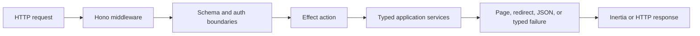

# @popcomputer/web

Effect-native, server-driven web applications on Hono.

`@popcomputer/web` combines the Inertia protocol, Hono routing, Effect programs,
typed request boundaries, optional Better Auth integration, and Drizzle route
model binding. It is designed for applications that want a Laravel-like
request-to-page workflow without giving up explicit dependencies and typed
failures.

```ts
export const showProject = action(
  Effect.gen(function* () {
    const auth = yield* authorize()
    const project = yield* bound('project')

    if (project.userId !== auth.user.id) return yield* notFound('Project')

    return yield* render('Projects/Show', { project })
  })
)
```

## Why this shape

- `setupWeb` is the single application composition boundary. It owns rendering,
  persistence, auth, schemas, middleware, and the shared error policy.
- Actions are ordinary Effect values. They declare only the services and
  failures they use, so small actions stay small and complex workflows compose.
- External data is parsed at the edge. Sessions, request input, route parameters,
  database rows, and cached values can all be checked with Effect Schema before
  application code relies on them.
- Route metadata belongs to a configured Hono app rather than global process
  state. `setupWeb(app, config)` returns it as `routes`, a `RouteRegistry`.
- The package keeps the standard Inertia wire protocol. Existing Inertia clients
  continue to use `X-Inertia`, partial reloads, asset versions, and redirects.

## Installation

```bash
bun add @popcomputer/web effect hono
```

Add only the optional integrations your application uses:

```bash
bun add better-auth                         # Better Auth integration
bun add drizzle-orm                         # Drizzle route model binding
bun add @inertiajs/react react react-dom    # React client
```

Coding agents should read `node_modules/@popcomputer/web/AGENTS.md`, a short
rulebook naming the one API to use for each task. Reference it from the
application's own `AGENTS.md` or `CLAUDE.md`. The same rules ship as a Claude
skill in `skills/popcomputer-web/SKILL.md`; copy that directory into
`~/.claude/skills/` or a project's `.claude/skills/`.

Effect and Hono are peer dependencies so an application owns one Effect runtime
and one Hono type identity. `better-auth` and `drizzle-orm` are optional peers:
an app without them still bundles for Cloudflare Workers. Route model binding
loads `drizzle-orm` when a bound route runs and reports a configuration error
if it isn't installed.
The package supports Effect 4 (`^4.0.0`, tested with 4.0.3), Hono 4.10 or
later 4.x (tested with 4.13.13), Better Auth 1.x (tested with 1.7.7), and
Drizzle ORM 0.30 or later 0.x (tested with 0.45.4). Hono 5 and Drizzle 1.0 are
not supported yet: both change APIs this package uses.

### Upgrading from 0.6

Static pages are now cached at Cloudflare's edge by default; see
[Page caching](#page-caching). Three things to check:

- Bind version metadata in `wrangler.jsonc`
  (`"version_metadata": { "binding": "CF_VERSION_METADATA" }`) so each deploy
  starts from an empty cache.
- Give `cache: false` to routes whose pages change without reading a binding or
  request header, such as pages built from an external `fetch()` or the
  current time.
- Middleware that sets `Cache-Control` on every response, such as a blanket
  `no-store`, now stops pages from being cached. Set it only when the response
  has no `Cache-Control` yet.

Workers builds no longer need `drizzle-orm` installed when the app has no
route model binding.

### Upgrading from 0.5

Effect 4 is now stable, and the package requires it: the `effect` peer range is
`^4.0.0`, which no longer accepts `4.0.0-rc.*` prereleases. Install
`effect@^4.0.0` and apply Effect's own prerelease-to-stable renames in your
application code (for example `SchemaTransformation.transformOrFail` became
`transformEffect`, and `Schema.isLengthBetween` became `isBetweenLength`).

`createTemplate` now renders `<title inertia>`, so `<Head title>` replaces the
template title instead of adding a second `<title>`. Remove any client-side
workaround that deletes the template title.

`vite.script()` and `vite.hmrHead()` accept a dev-server origin as well as a
port, for setups where a local proxy serves Vite under its own hostname:

```ts
const viteServer = 'https://vite.myapp.localhost'
scripts: [vite.script('/src/main.tsx', viteServer)]
head: vite.hmrHead(viteServer)
```

### Upgrading from 0.4

`TestCaptureService.get` is now an Effect value. Replace
`yield* capture.get()` with `yield* capture.get` in custom test layers and helpers.

Numeric form values, numeric route bindings, and persisted cache timestamps
reject non-finite numbers. `nullableString` accepts scalar values and rejects
objects and arrays. `declined` now decodes `0`, `"0"`, `"false"`, `"no"`, and
`"off"` to `false`.

## Quick start

Every type an application uses is declared once, as a value, and the rest of
the application is typed by it: the database client, the Better Auth client,
the signed-in user, route models, pages, shared props and flash data.

### 1. Describe the Worker's bindings

```ts
// src/env.ts
export type Bindings = {
  DATABASE_URL: string
  BETTER_AUTH_SECRET: string
  KV: KVNamespace
}

export type Env = { Bindings: Bindings }
```

### 2. Describe the pages

Each page component's props are an Effect Schema:

```ts
// src/pages.ts
import { Schema as S } from 'effect'

export const Project = S.Struct({
  id: S.String,
  name: S.String,
  userId: S.String,
  createdAt: S.Date,
})

export const ProjectSummary = S.Struct({ id: S.String, name: S.String })

export const Task = S.Struct({ id: S.String, projectId: S.String, title: S.String })

export const pages = {
  'Projects/Index': S.Struct({ projects: S.Array(ProjectSummary) }),
  'Projects/Show': S.Struct({ project: Project }),
  'Auth/Login': S.Struct({}),
  Dashboard: S.Struct({}),
}
```

`render('Projects/Show', props)` accepts only a registered page and props
matching its schema, and encodes the props as JSON through it, so `createdAt`
reaches the browser as an ISO string. The React component takes its props from
the same schema:

```tsx
// src/pages/Projects/Show.tsx
import type { WebPage } from '@popcomputer/web/react'

const Show: WebPage<'Projects/Show'> = ({ project, auth, errors }) => (
  <main>
    <h1>{project.name}</h1>
    <p>Created {new Date(project.createdAt).toLocaleDateString()}</p>
    {auth.user && <p>Signed in as {auth.user.name}</p>}
    {errors.name && <p role="alert">{errors.name}</p>}
  </main>
)

export default Show
```

A renamed prop, a missing page or a `Date` used as a `Date` in the browser is a
type error on the side that drifted.

### 3. Configure the application once, and register it

```ts
// src/app.ts
import { Hono } from 'hono'
import { Schema as S } from 'effect'
import {
  createTemplate,
  createVersion,
  setupWeb,
} from '@popcomputer/web'
import { createAuth } from './auth'
import { createDb } from './db'
import manifest from '../dist/manifest.json'
import type { Env } from './env'
import { pages, Project, Task } from './pages'
import * as schema from './schema'

const AuthSession = S.Struct({
  user: S.Struct({
    id: S.String,
    email: S.String,
    name: S.NullOr(S.String),
    emailVerified: S.Boolean,
    image: S.NullOr(S.String),
    createdAt: S.Date,
    updatedAt: S.Date,
  }),
  session: S.Struct({
    id: S.String,
    userId: S.String,
    expiresAt: S.Date,
    token: S.RedactedFromValue(S.String),
    createdAt: S.Date,
    updatedAt: S.Date,
  }),
})

export const web = setupWeb(new Hono<Env>(), {
  version: createVersion(manifest),
  render: createTemplate({
    title: 'Projects',
    scripts: [manifest['src/main.tsx']?.file].filter(Boolean),
    styles: manifest['src/main.tsx']?.css ?? [],
  }),
  database: (c) => createDb(c.env.DATABASE_URL),
  schema,
  bindings: { project: Project, task: Task },
  pages,
  auth: {
    client: (c, { db, backgroundTasks }) => createAuth({
      db,
      secret: c.env.BETTER_AUTH_SECRET,
      baseURL: new URL(c.req.url).origin,
      advanced: { backgroundTasks },
    }),
    session: AuthSession,
    share: S.Struct({ id: S.String, name: S.NullOr(S.String), image: S.NullOr(S.String) }),
  },
  flash: S.Struct({ success: S.String }),
  errors: { component: 'Error' },
})

declare module '@popcomputer/web' {
  interface Register {
    web: typeof web
  }
}

export const { app, routes } = web
export default app
```

Registering `setupWeb`'s result is the one declaration the rest of the
application reads its types from:

| Declared in `setupWeb` | Types |
| --- | --- |
| `new Hono<Env>()` | `BindingsService`, Effect `Config`, `testEnv`'s bindings |
| `database` | `DatabaseService` and the `db` in `dbQuery`, `dbMutation`, `dbBatch` |
| `schema`, `bindings` | `bound('project')` and its keys |
| `auth.client` | `AuthService` and `betterAuthRedirect`'s `auth` |
| `auth.session` | `authorize()`, `currentUser`, `AuthUserService`, `signedIn` |
| `auth.share` | `auth.user` in `SharedProps` and `WebPage` (default: `id`, `name`, `image`) |
| `pages` | `render`, `jsonOrRender`, `WebPage`, `readPage` |
| `shared`, `flash` | `share(key, value)`, `flash(key, value)`, `SharedProps`, `FlashData` |

Each value reaches the browser encoded through its schema, so a field the
schema does not name, such as the user's email, never leaves the server.
Inertia's own `usePage()` reads the same types from one more declaration:

```ts
// src/inertia.d.ts
import type { FlashData, SharedProps } from '@popcomputer/web/react'

declare module '@inertiajs/core' {
  interface InertiaConfig {
    sharedPageProps: SharedProps
    flashDataType: FlashData
  }
}
```

The configuration is deliberately flat. `setupWeb({ web: { ... } })` would
repeat the framework boundary without clarifying ownership.

Database-backed auth receives the database as an explicit dependency. The
following examples are alternative configurations; choose the shape that
matches the application. None require placeholders or explicit generics.

```ts
const version = createVersion(manifest)
const template = createTemplate({ title: 'Projects' })

// Public application
setupWeb(app, { version, render: template })

// Database without auth
setupWeb(app, {
  version,
  render: template,
  database: (c) => createDb(c.env.DATABASE_URL),
})

// Stateless auth
setupWeb(app, {
  version,
  render: template,
  auth: {
    client: (c, { backgroundTasks }) => createStatelessAuth({
      secret: c.env.BETTER_AUTH_SECRET,
      advanced: { backgroundTasks },
    }),
  },
})
```

The `backgroundTasks` object has Better Auth's
`advanced.backgroundTasks` shape. Passing it through makes session refreshes,
email callbacks, and plugin work part of the request lifecycle: Workers use
`waitUntil`, while local and test runtimes finish the work before teardown.

For application code that calls Better Auth from Effect, wrap the concrete
instance once and keep plugin-added endpoint types:

```ts
import { effectifyBetterAuth } from '@popcomputer/web/auth'

const authEffect = effectifyBetterAuth(auth)
const session = yield* authEffect.api.getSession({ headers })
```

The raw Better Auth instance remains available as `authEffect.raw`. Expected
API failures stay typed in Effect, including cookies Better Auth attached while
processing a rejected request. Better Auth's conditional return-mode overloads
can lose precision when mirrored through the Effect mapped type; use
`authEffect.raw.api` when TypeScript does not retain an `asResponse`,
`returnHeaders`, or `returnStatus` result precisely.

`setupWeb` installs the middleware stack and shared error boundary on the app
and returns `{ app, routes }`. For manual Hono composition, see
[Lower-level composition](#lower-level-composition).

### 4. Write actions and register routes

Each route's path is declared once, and every URL to it is built from that
declaration: the route registration, a server redirect and a client link. The
module holds only data, so server and React code both import it.

```ts
// src/paths.ts
export const paths = {
  projects: '/projects',
  project: '/projects/{project}',
  task: '/projects/{project}/tasks/{task}',
} as const
```

```ts
// src/actions/projects/show.ts
import { Effect } from 'effect'
import {
  action,
  authorize,
  bound,
  notFound,
  render,
} from '@popcomputer/web/effect'

export const showProject = action(
  Effect.gen(function* () {
    const auth = yield* authorize()
    const project = yield* bound('project')

    // Another member's project answers 404, so its existence stays private.
    if (project.userId !== auth.user.id) return yield* notFound('Project')

    return yield* render('Projects/Show', { project })
  })
)
```

```ts
// src/routes.ts
import { routes } from './app'
import { paths } from './paths'
import { showProject } from './actions/projects/show'

routes.get(paths.project, showProject, { name: 'projects.show' })
```

`redirect(paths.project, { project: project.id })` and, in React,
`href(paths.project, { project: project.id })` from `@popcomputer/web/paths` fill
the path's placeholders; the parameters are typed from them, so a renamed
placeholder is a type error at every URL built from it.

`routes` accepts an action only when the setup provides every service the
action uses and the action fails only with the package's errors. Otherwise the
registration is a type error that names the problem, for example
`missingServices: "@popcomputer/web/Database"` when no `database` is
configured, or `unhandledErrors: "PaymentDeclined"` for a domain error the
action has not handled. `routes.provide(layer)` adds services for the routes
registered through it.

`action` does not hide another execution model. It preserves the Effect's
success, error, and requirement channels, while documenting that the program is
an HTTP action.

## Data flow



`setupWeb` builds the request-scoped Effect runtime and provides only the
services configured for that request. A missing database or auth service is
reported as a configuration error rather than being silently replaced with an
untyped value.

## Application services

Services an action needs beyond the framework's go in `setupWeb`'s
`services`, as Effect layers. Their types join the services `routes` accepts.

```ts
// src/services.ts
import { Config, Context, Effect, Layer } from 'effect'

export class Clock extends Context.Service<Clock, {
  readonly today: Effect.Effect<string>
  readonly timeZone: string
}>()('app/Clock') {}

// Config reads the Worker's bindings: here the TIME_ZONE var.
export const ClockLive = Layer.effect(Clock, Effect.gen(function* () {
  const timeZone = yield* Config.String('TIME_ZONE').pipe(Config.withDefault('UTC'))

  return Clock.of({
    today: Effect.sync(() => new Date().toLocaleDateString('en-CA', { timeZone })),
    timeZone,
  })
}))

export class AuditLog extends Context.Service<AuditLog, {
  readonly record: (event: string) => Effect.Effect<void>
}>()('app/AuditLog') {}

export const auditLogFor = (kv: KVNamespace) => Layer.succeed(AuditLog, AuditLog.of({
  record: (event) => Effect.promise(() => kv.put(`audit:${event}`, event)),
}))
```

```ts
setupWeb(app, {
  version,
  render: template,
  services: {
    app: ClockLive,
    request: (c) => auditLogFor(c.env.KV),
  },
})
```

`services.app` is built once, on the first request an isolate serves, and
shared by every later request: configuration, clients that open no connection
until used, in-memory caches. Effect `Config` reads the Worker's bindings in
both kinds of service and in actions, so `Config.Redacted('API_KEY')` reads a
secret; a missing binding fails the request with a configuration error that
names it in development. `services.request` is built for each request from
its context and bindings. Anything holding a request's I/O, such as a D1, KV or
Hyperdrive binding, belongs in `services.request`: Workers forbid using it from
another request. A request service replaces an application service with the
same tag. For services only some routes need, use `routes.provide(layer)`.

## Validation and the database

```ts
import { Effect, Schema as S } from 'effect'
import {
  action,
  authorize,
  dbMutation,
  redirect,
  validateRequest,
} from '@popcomputer/web/effect'
import { alphaDash, requiredString } from '@popcomputer/web/schema'
import { projects } from '../schema'

const CreateProject = S.Struct({
  name: requiredString,
  slug: alphaDash,
  description: S.optional(S.String),
})

export const createProject = action(
  Effect.gen(function* () {
    const auth = yield* authorize()
    const input = yield* validateRequest(CreateProject)

    const [project] = yield* dbMutation((db) =>
      db.insert(projects)
        .values({ ...input, id: crypto.randomUUID(), userId: auth.user.id })
        .returning()
    )

    return yield* redirect(`/projects/${project.id}`)
  })
)
```

`validateRequest` reads route params, query and body, and returns the decoded
input with every key the schema does not declare removed. A key that two
sources provide with different values fails validation, so a body field cannot
replace a route parameter; pass `request: { order: ['body'] }` to read only the
body.

A multipart form's files reach the schema as `File` values. Check them with
`upload({ types: ['image/*'], maxBytes: 5_000_000 })`, or `nullableUpload(...)`
when the file is optional; a file input left empty is no file. Headers and the
raw body, such as an `Idempotency-Key` or a webhook signature, are read from
`RequestService`'s `header()` and `raw()`.

The database operations read the request's client from `DatabaseService` and
give their callback the application's Drizzle client with its own types:

| Operation | Use |
| --- | --- |
| `dbQuery((db) => ...)` | Reads. |
| `dbMutation((db) => ...)` | One write, or writes that need not be atomic. |
| `dbTransaction(effect)` | An Effect whose database operations must succeed together, on a driver with asynchronous transactions (Postgres, MySQL, libsql). |
| `dbBatch((db) => [...])` | Writes that must succeed together on Cloudflare D1, libsql or Neon HTTP: every statement applies, or none. |

Inside `dbTransaction`, `DatabaseService` is the transaction, so every
`dbQuery` and `dbMutation` the Effect runs takes part, including those of the
services it calls. Domain logic between the writes stays ordinary Effect code:
the transaction commits when the Effect succeeds, and rolls back when it fails
with the Effect's own typed error.

```ts
// src/actions/projects/destroy.ts
import { eq } from 'drizzle-orm'
import { Effect } from 'effect'
import {
  action,
  authorize,
  bound,
  dbMutation,
  dbTransaction,
  flash,
  notFound,
  redirect,
} from '@popcomputer/web/effect'
import { projects, tasks } from '../../schema'

export const destroyProject = action(
  Effect.gen(function* () {
    const auth = yield* authorize()
    const project = yield* bound('project')

    if (project.userId !== auth.user.id) return yield* notFound('Project')

    yield* dbTransaction(Effect.gen(function* () {
      yield* dbMutation((db) => db.delete(tasks).where(eq(tasks.projectId, project.id)))
      yield* dbMutation((db) => db.delete(projects).where(eq(projects.id, project.id)))
    }))
    yield* flash('success', 'Project deleted.')

    return yield* redirect('/projects')
  })
)
```

`dbTransaction` is a type error on Cloudflare D1, which rejects interactive
transactions, and on synchronous drivers such as `bun:sqlite`, which commit
before an awaited write runs. On D1, use `dbBatch`. A batch cannot decide
from a read, so a rule such as "at most 100 open tasks" belongs in the write
itself (`INSERT ... SELECT ... WHERE (SELECT count(*) ...) < 100`, then check
the number of rows changed); a count followed by an insert lets concurrent
requests pass the limit together.

A write that breaks a constraint fails with `DatabaseConstraintViolation`,
which names the constraint kind (`unique`, `foreign-key`, `not-null`, `check`)
and, when the driver reports them, its `columns`. Any other failure is a
`DatabaseError`. `uniqueFieldErrors` turns a unique violation into field errors
the form shows:

```ts
yield* dbMutation((db) => db.insert(projects).values(newProject)).pipe(
  uniqueFieldErrors({ slug: 'A project with this slug already exists.' })
)
```

## Route model binding

Register an Effect Schema once, then use Laravel-style route placeholders:

```ts
routes
  .get('/projects/{project}', showProject)
  .get('/projects/{project:slug}', showProjectBySlug)
  .get('/projects/{project}/tasks/{task}', showTask)
```

Inside `showTask`, both models from the nested route are available by name:

```ts
const project = yield* bound('project')
const task = yield* bound('task')
```

The package parses route parameters and database rows before exposing them.
A route loads its models the first time the action calls `bound()`, so a guard
or `authorize()` that runs first decides before any database lookup, and a
signed-out visitor cannot tell an existing record from a missing one. A missing
row fails `bound()` with `NotFoundError`, which renders a 404.
Nested bindings must have a relationship discoverable from Drizzle metadata or
an explicit scope:

```ts
const routeBindings = {
  task: routeBinding(Task, {
    scope: {
      project: { foreignKey: 'projectId' },
    },
  }),
}
```

This fails closed when a child lookup cannot be safely scoped to its parent.
Route model binding is currently Drizzle-specific even though the basic
`DatabaseService` can hold any application database client.

## Auth

The Better Auth helpers cover session loading, authenticated and guest routes,
form actions, logout, and public user projection.

`authorize()` can be called in two ways. Use it without a predicate when the
route only requires a signed-in user:

```ts
const auth = yield* authorize()
```

Pass a predicate when the route has an additional authorization rule. The
helper still returns the parsed `{ user, session }` value when the predicate
succeeds:

```ts
const auth = yield* authorize(
  ({ user }) => user.emailVerified
)
```

If there is no signed-in user, both forms fail with `UnauthorizedError`. If the
predicate returns `false`, the second form fails with `ForbiddenError`.

`auth.session` decodes Better Auth's session response into the signed-in
user, so a dependency response is never trusted because it looks
session-shaped; an application that adds user fields declares them in it, and
`authorize()` and `currentUser` follow. The session token is `Redacted`, so
serializing the auth user never exposes it; read it with `Redacted.value`
where it is needed. `auth.share` names the fields pages receive as
`auth.user`.

### Signing in and out

Sign-in, sign-up and sign-out are ordinary routes on the `routes` setupWeb
returns. `routes.provide(layer)` guards every route registered through it:
`RequireGuestLayer` sends a signed-in member home, and `RequireAuthLayer`
sends a signed-out visitor to `auth.signInPath` (default `/login`), as
`authorize()` does. A sign-in action validates its form like any action, then
calls Better Auth through `betterAuthRedirect`, which answers with a redirect
carrying the session cookie:

```ts
// src/actions/auth.ts
import { Effect, Schema as S } from 'effect'
import { action, intendedUrl, validateRequest } from '@popcomputer/web/effect'
import { betterAuthRedirect } from '@popcomputer/web/auth'
import { email, requiredString } from '@popcomputer/web/schema'

const SignIn = S.Struct({ email, password: requiredString })

export const signIn = action(
  Effect.gen(function* () {
    const input = yield* validateRequest(SignIn)
    const redirectTo = yield* intendedUrl('/projects')

    return yield* betterAuthRedirect(
      (auth, request) =>
        auth.api.signInEmail({ body: input, headers: request.headers, asResponse: true }),
      { redirectTo, errors: (error) => ({ email: error.message }) }
    )
  })
)
```

```ts
// src/auth-routes.ts
import { action, render, RequireAuthLayer, RequireGuestLayer } from '@popcomputer/web/effect'
import { betterAuthLogoutAction } from '@popcomputer/web/auth'
import { routes } from './app'
import { signIn } from './actions/auth'
import { showDashboard } from './actions/dashboard'

routes
  .provide(RequireGuestLayer)
  .get('/login', action(render('Auth/Login')))
  .post('/login', signIn)

routes.provide(RequireAuthLayer).get('/dashboard', showDashboard)

routes.post('/logout', betterAuthLogoutAction({ redirectTo: '/login' }))
```

A signed-out visit to a guarded page goes to the sign-in path with the page as
`?redirect=`, and `intendedUrl(fallback)` returns there after signing in; it
returns only paths on this site. A rejection, such as a wrong password or a
registered email, goes back to the form with the field errors `errors` returns; rate limits and Better Auth
failures stay separate typed errors. Sign-up works the same way with
`auth.api.signUpEmail`, after whatever else the action does with the input.

`betterAuthHandler` forwards a request to Better Auth's own API, for browser
code that calls it directly (Better Auth's client SDK, OAuth callbacks):
`routes.all('/api/auth/*', betterAuthHandler)`. Register it only if the
application needs it: it exposes every endpoint Better Auth and its plugins
define, so user fields declared with `input: true` become settable by anyone
who signs up.

A guard can be any layer that fails. Turn an authorization rule into one for a
group of routes with `Layer.effectDiscard`:

```ts
import { Layer } from 'effect'
import { authorize } from '@popcomputer/web/effect'

const RequireVerified = Layer.effectDiscard(authorize(({ user }) => user.emailVerified))

routes.provide(RequireVerified).get('/billing', showDashboard)
```

An application that authenticates some other way, such as API keys, provides
its own user service through a layer that fails with `UnauthorizedError`:
`routes.provide(ApiKeyAuth)` runs it before the action, so every route
registered through it can read the service.

## Responses and failures

Choose the helper that matches the current action branch. These are alternative
endings, not statements to run in sequence:

| Intent | Action ending |
|---|---|
| Render a page | `return yield* render('Dashboard', { stats })` |
| Redirect | `return yield* redirect('/login')` |
| Return JSON | `return yield* json({ projects })` |
| Return JSON when requested, otherwise render a page | `return yield* jsonOrRender('Projects/Index', { projects })` |
| Fail with `NotFoundError` | `return yield* notFound('Project', projectId)` |
| Fail with `ForbiddenError` | `return yield* forbidden('You cannot edit this project')` |

`yield* flash('success', 'Project saved.')` before any of them hands a value to
the next page the user sees, as Inertia's page `flash` field: the page a
redirect renders, or the page the same request renders.

A form submission that fails validation, whether in `validateRequest` or as a
`ValidationError` the action fails with, redirects back (303) to the page it
came from: its same-origin `Referer`, or `/` without one. A `ValidationError`
with `redirectTo` goes to that page instead, such as a wizard's earlier step. That page renders with all of its own props and the field errors as
`errors`; a form that names an Inertia error bag gets them under its name.
Errors and flash values travel in a short-lived `HttpOnly` cookie that the
next visit reads and clears. A JSON client gets a 422 instead, and invalid
query parameters on a page visit render the error page with 422.

`file(body, { contentType, filename })` answers with a file, such as an export
or a feed: text, bytes, or an Effect `Stream` sent as it is produced. A
`filename` offers it as a download. `json` and `text` take
`{ status, headers }` as well as a status.

Typed failures, defects, Hono exceptions, and not-found responses share the
configured error boundary. Use `EffectErrorObserverService` as the integration
point for Sentry, PostHog, or another reporting system; observation does not
change the failure channel.

## Caching and background work

The data cache keeps computed values in a store, checked against an Effect
Schema when read. Provide a store with `kvCache` in `services.request`:

```ts
import { kvCache } from '@popcomputer/web/cache'

setupWeb(app, {
  version,
  render: template,
  services: { request: (c) => kvCache(c.env.KV) },
})
```

Then wrap a computation in `cache`:

```ts
import { Duration, Effect, Schema as S } from 'effect'
import { action, authorize, render } from '@popcomputer/web/effect'
import { cache } from '@popcomputer/web/cache'

export const listProjects = action(Effect.gen(function* () {
  const auth = yield* authorize()

  const projects = yield* cache(
    `users:${auth.user.id}:projects`,
    Effect.promise(() => loadProjects(auth.user.id)),
    S.Array(ProjectSummary),
    { ttl: Duration.minutes(5), swr: Duration.minutes(1), version: true }
  )

  return yield* render('Projects/Index', { projects })
}))
```

`cache` never fails because of the store: an unreachable store or an entry that
no longer matches the schema computes the value instead, and the failure goes
to `EffectErrorObserverService`. `cacheGet`, `cacheSet`, `cacheInvalidate` and
`cacheInvalidatePrefix` fail with `CacheError`, which renders as 503.
Stale-while-revalidate refreshes in the background when the request has an
execution context and inline otherwise.

For runtime-owned work that must outlive a response, name the work and pass
the Effect. The name identifies the work in error reports:

```ts
yield* background('audit.send', sendAuditEvent(event))
```

### Page caching

Pages are cached at Cloudflare's edge by default. `setupWeb` serves a page from
Cloudflare's Cache API, skipping database, auth and rendering work, when
producing it read nothing request-specific. A page becomes dynamic, and renders
on every request, when it reads:

- a binding on `c.env` (D1, KV, R2, Durable Objects, service bindings, AI,
  Hyperdrive), which covers database queries however they are made;
- a request header or request state through `RequestService` or
  `RequestStateService`;
- a route model binding.

Cached pages are keyed by deploy. Bind the version metadata so each deploy
starts from an empty cache:

```jsonc
// wrangler.jsonc
"version_metadata": { "binding": "CF_VERSION_METADATA" }
```

Without it, pages are keyed by the asset version and expire after five minutes,
so server-only changes still appear.

- Signed-in requests, requests with `Authorization` or app cookies, partial
  reloads, stale Inertia versions and development never use the cache. Analytics
  and Cloudflare cookies such as `_ga` and `__cf_bm` don't count as app cookies.
- Signed-in responses that set no `Cache-Control` get `no-store`, and every
  other response that sets none gets `private, no-cache`: Workers Cache, once
  enabled, would otherwise keep a page rendered per request and serve it to
  other visitors.
- Browsers always revalidate cached pages. A page is stored only if the final
  response, after all middleware, still allows it: no `Set-Cookie`, and no
  other `Cache-Control`.
- The `X-Popweb-Cache` response header reports `HIT`, `MISS`, `DYNAMIC` or
  `BYPASS`.

The framework can't see data a page gets another way, such as an external
`fetch()` or the current time. Give those routes `cache: false`, or call
`markPageDynamic(c)` from Hono middleware. `pageCache: false` in `setupWeb`
turns page caching off.

### Time-based caching with Workers Cache

To cache pages that do read data for a fixed time, set the route's `cache`
option and enable Workers Cache (`"cache": { "enabled": true }` in Wrangler
config). The option emits Workers Cache headers and tags. It does not publicly
cache authenticated, cookie-setting, partial, failed, or mutating responses.

```ts
routes.get('/pricing', showPricing, {
  name: 'pricing.show',
  cache: { maxAge: 300, staleWhileRevalidate: 3600 },
})
```

Pages, meaning HTML documents and Inertia page objects, belong to the deploy
that rendered them: the HTML names that build's hashed assets. For pages the
option sends `Cache-Control: public, max-age=0, must-revalidate`, so browsers
revalidate every visit, and puts `maxAge` and `staleWhileRevalidate` in
`Cloudflare-CDN-Cache-Control`, which only Cloudflare reads. Every cached page
carries the `PAGE_CACHE_TAG` Cache-Tag (`popweb:page`). Workers Cache keys
entries by Worker version, so each deploy starts from an empty cache. If you
enable `cross_version_cache`, purge the tag after each deploy:

```ts
const cache = yield* ResponseCacheService
yield* cache.purge({ tags: [PAGE_CACHE_TAG] })
```

Other cached responses, such as JSON APIs and text, use `maxAge` and
`staleWhileRevalidate` in `Cache-Control` for every cache.

Workers Cache answers a hit before the Worker runs, so cached responses vary
on `Cookie`: visitors without cookies share the cached copy, and a request
with any cookie renders afresh. A signed-in member sees their own `auth.user`,
a form that redirects back keeps its flashed errors, and neither response is
stored. Visitors carrying only analytics cookies also miss the cache, so the
option pays off for traffic that arrives without cookies, such as first visits
and crawlers.

A bound route's cached page carries the Cache-Tag of each record it reads,
`recordCacheTag(table, primaryKey)` such as `projects:project-1`, whichever
column the route looks the record up by. `purges` removes cached entries after
a successful write. `purges: true` purges the records the route's bindings name
and the table of the record it writes, so a write by id purges the page read by
slug, and the table's tag purges an index that declares it:

```ts
routes
  .get('/explore', showPricing, { cache: { maxAge: 300, tags: ['projects'] } })
  .get('/p/{project:slug}', showProjectBySlug, { cache: { maxAge: 300 } })
  .put('/projects/{project}', updateProject, { purges: true })
```

When a record changes outside its routes, such as in a queue consumer, purge
its tag yourself:

```ts
const responseCache = yield* ResponseCacheService
yield* responseCache.purge({ tags: [recordCacheTag('projects', 'project-1')] })
```

## Testing

Test routes through the application itself. `app.request` runs the real
middleware, route and action; `testEnv(layer, bindings)` builds the request
env. Services in the layer replace the ones the request would otherwise get, so
`signedIn(user)` signs the request in without a session cookie and
`Layer.succeed(Service, fake)` swaps a service the application provides. A layer
a route registers with `.provide()` still takes precedence for that route.

```ts
// src/routes.test.ts
import { describe, expect, test } from 'bun:test'
import { signedIn, testEnv } from '@popcomputer/web/testing'
import app from './app'
import './routes'
import { testBindings } from './test-bindings'

describe('GET /projects/{project}', () => {
  test('shows a project to its owner', async () => {
    const res = await app.request(
      '/projects/project-1',
      { headers: { 'X-Inertia': 'true' } },
      testEnv(signedIn({ id: 'user-1' }), testBindings)
    )

    expect(res.status).toBe(200)
    expect(await res.json()).toMatchObject({
      component: 'Projects/Show',
      props: { project: { id: 'project-1' } },
    })
  })

  test("answers 404 for another member's project", async () => {
    const res = await app.request(
      '/projects/project-1',
      {},
      testEnv(signedIn({ id: 'user-2' }), testBindings)
    )

    expect(res.status).toBe(404)
  })
})
```

`testBindings` is the application's test configuration: here, the URL of a
migrated test database with `project-1` owned by `user-1`, an auth secret and a
KV namespace. An `X-Inertia` request returns the page object as JSON, so tests
assert on the component and props rather than HTML.

An action is an Effect, so a test can also run it directly and provide the
services it reads, for example `Effect.provide(signedIn({ id: 'user-1' }))`.

`readPage` reads a page response typed by the page registry, and rejects with
what the response was instead when it is not that page:

```ts
import { readPage, signedIn, testEnv } from '@popcomputer/web/testing'

const res = await app.request(
  '/projects/project-1',
  { headers: { 'X-Inertia': 'true' } },
  testEnv(signedIn({ id: 'user-1' }), testBindings)
)
const page = await readPage(res, 'Projects/Show')

page.props.project.createdAt // a string: the JSON the browser receives
```

### A database for tests

Test against the database family production uses, so transactions, batches
and constraint errors behave the same:

- **Postgres** (including through Hyperdrive): an in-process
  [PGlite](https://pglite.dev) database with `drizzle-orm/pglite`. Apply the
  migrations drizzle-kit generates with `applyMigrations('./drizzle', (sql) =>
  client.exec(sql))`, and pass the Drizzle client as `testEnv`'s `database`. It
  replaces setupWeb's `database` factory for that request, so the database
  operations, route model binding and Better Auth all use it.
- **Cloudflare D1**: Miniflare's real D1 runs under Bun. Create
  `new Miniflare({ modules: true, script: 'export default {}', d1Databases:
  ['DB'] })`, migrate `await miniflare.getD1Database('DB')` with
  `applyMigrations('./drizzle', (sql) => d1.prepare(sql).run())`, and pass it
  as the `DB` binding. `getKVNamespace` and `getR2Bucket` give the other
  bindings the same way. Dispose of Miniflare when the test process ends.

`bun:sqlite` is a synchronous driver: it can stand in for neither, since
`dbTransaction` and `dbBatch` are type errors for it.

```ts
const env = testEnv(signedIn({ id: 'user-1' }), testBindings, { database: testDb })
```

A request built with `testEnv` renders failures with their development
details unless its bindings set `ENVIRONMENT`; pass `ENVIRONMENT: 'production'`
to test the production error page. `services.app` is built once per test
process, from the first request's bindings: replace an application service in
a test with a layer in `testEnv` rather than different bindings. A failed
build is retried by the next request.

## Lower-level composition

Most applications should use `setupWeb`. The lower-level APIs are available
when another composition root owns part of the middleware stack:

```ts
// src/manual-app.ts
import { Hono } from 'hono'
import {
  createTemplate,
  createVersion,
  web,
  webContext,
  webServices,
} from '@popcomputer/web'
import { effectBridge } from '@popcomputer/web/effect'
import manifest from '../dist/manifest.json'
import { createDb } from './db'
import type { Bindings } from './env'

type Env = { Bindings: Bindings }

const app = new Hono<Env>()

app.use('*', web({
  version: createVersion(manifest),
  render: createTemplate({ title: 'Projects' }),
}))
app.use('*', webServices<Env>((c) => ({
  db: createDb(c.env.DATABASE_URL),
})))
app.use('*', effectBridge())

app.use('/admin/*', async (c, next) => {
  const { authUser } = webContext(c)
  if (!authUser) return c.redirect('/login')
  await next()
})
```

Add `pageCache({ version })` before `webServices()` to keep the default page
cache; on a hit it answers before database and auth setup.

Register routes with `effectRoutes(app)`. It cannot see which services the
hand-written middleware provides, so it accepts actions that use any framework
service and reports an unconfigured one at runtime, as a configuration error.
Pass extra service types it should accept as `effectRoutes<Env, Mailer>(app)`.

Plain Hono handlers can render through `c.var.web`:

```ts
app.get('/', (c) => c.var.web.render('Home'))
```

Effect actions normally use the higher-level `render` helper. The underlying
service is available as `PageService` when direct composition is useful.

## Version values

Three different versions may appear around an application:

| Value | Meaning | Change it when | Effect of changing it |
|---|---|---|---|
| npm package version | Version of `@popcomputer/web` | You upgrade the dependency | Selects framework code and public API |
| `setupWeb({ version })` | Inertia asset version | Client assets or their manifest change | The next mismatched GET receives an Inertia location response and reloads the current assets |
| cache `version` | Namespace for one cached value shape | The cached schema or interpretation changes | Reads and writes use a fresh cache key |

`createVersion(manifest)` derives the Inertia asset version from manifest asset
paths. It is unrelated to the npm package version.

## Migrating from `honertia`

The rebrand is a package/API migration; the Inertia protocol does not change.

```diff
- import { setupHonertia } from 'honertia'
- import { action, render } from 'honertia/effect'
+ import { setupWeb } from '@popcomputer/web'
+ import { action, render } from '@popcomputer/web/effect'
```

Setup is flatter:

```diff
- setupHonertia(app, {
-   honertia: {
-     version,
-     render,
-     database,
-     schema,
-     bindings,
-   },
+ setupWeb(app, {
+   version,
+   render,
+   database,
+   schema,
+   bindings,
    auth,
  })
```

Public type and runtime names have direct replacements:

| Former name | Current name |
|---|---|
| `HonertiaDatabaseType`, `HonertiaAuthType`, `HonertiaBindingsType`, `HonertiaAuthUserType`, `HonertiaRouteBindingsType` | One registration of `setupWeb`'s result: `interface Register { web: typeof web }` |
| `HonertiaService` / `HonertiaRenderer` | `PageService` / `PageRenderer` |
| `honertiaContext` / `honertiaServices` | `webContext` / `webServices` |
| `honertia` middleware / `c.var.honertia` | `web` / `c.var.web` |
| `HonertiaConfigurationError` | `ConfigurationError` |
| `HonertiaStructuredError` | `StructuredError` |
| `HEADERS.HONERTIA` | `HEADERS.INERTIA` |
| `HON_*` error codes | `WEB_*` error codes |

The former names are not exported. The old `honertia` npm package remains a
separate published artifact and is not a runtime wrapper, so install only one
framework package in an application.

## Tradeoffs and current limits

- This is a server-driven page architecture. It is not a replacement for a
  client-side router when the browser must own navigation and data fetching.
- Effect is a deliberate application-level dependency. The package is most
  valuable when actions, failures, services, and background work all use the
  same Effect model.
- Route model binding currently relies on Drizzle metadata. Other database
  clients still work through `DatabaseService`, but do not receive automatic
  binding queries.
- Better Auth and Cloudflare-specific caching are optional integrations rather
  than hidden requirements.
- The package does not run database migrations. Use `drizzle-kit` or
  `wrangler d1 migrations` directly.
- Cloudflare D1 has no interactive transactions. `dbBatch` applies several
  writes atomically there; `dbTransaction` needs Postgres, MySQL or libsql,
  and is a type error for synchronous drivers such as `bun:sqlite`.
- Page props cross to the browser as JSON. `Jsonify` describes the result
  (dates and bigints become strings); page schemas should describe plain
  data rather than classes or Effect data types.

## Developing this package

```bash
bun run test
```

After changing `AGENTS.md`, regenerate the skill with
`bun scripts/build-skill.ts`; a test fails while it is stale.

The repository verifies runtime behavior, strict TypeScript and module
augmentation contracts, that every TypeScript example in this README and in
`AGENTS.md` type-checks, and that each built entrypoint imports under plain
Node.

## License

MIT
