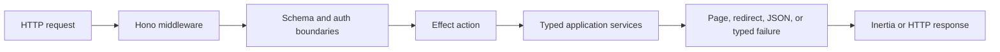

# @popcomputer/web

Effect-native, server-driven web applications on Hono.

`@popcomputer/web` combines the Inertia protocol, Hono routing, Effect programs,
typed request boundaries, optional Better Auth integration, and Drizzle route
model binding. It is designed for applications that want a Laravel-like
request-to-page workflow without giving up explicit dependencies and typed
failures.

```ts
export const showProject = action(
  Effect.gen(function* () {
    const auth = yield* authorize()
    const project = yield* bound('project')

    if (project.userId !== auth.user.id) return yield* notFound('Project')

    return yield* render('Projects/Show', { project })
  })
)
```

## Contents

- [Why this shape](#why-this-shape) · [Installation](#installation) · [Quick start](#quick-start)
- Building: [Application services](#application-services) · [Validation and the database](#validation-and-the-database) · [Route model binding](#route-model-binding) · [Auth](#auth) · [Responses and failures](#responses-and-failures)
- Running: [Caching and background work](#caching-and-background-work) · [Scheduled and queued work](#scheduled-and-queued-work) · [Page caching](#page-caching)
- [Testing](#testing) · [Patterns from real applications](#patterns-from-real-applications)
- Reference: [Lower-level composition](#lower-level-composition) · [Version values](#version-values) · [Upgrading](#upgrading) · [Migrating from `honertia`](#migrating-from-honertia) · [Tradeoffs and current limits](#tradeoffs-and-current-limits)

## Why this shape

- **Declare once; the rest derives.** `setupWeb` takes each of the
  application's declarations as a value: the database factory, the Drizzle
  schema and the tables route models load from, the signed-in user's schema,
  pages, route paths, shared props and flash. Registering its result once
  types everything else: `bound('project')` is the table's row, `render`
  checks a page's props, `redirect` and `href` fill a path's placeholders, and
  a React page's props follow its schema. A renamed column, prop or
  placeholder is a type error wherever it is used.
- **Actions are ordinary Effect values.** They declare only the services and
  failures they use, so small actions stay small and complex workflows
  compose. `routes` accepts an action only when the setup provides its
  services and handles its failures; otherwise the registration is a type
  error naming the missing service or the unhandled error.
- **External data is parsed at the edge.** Sessions, request input, route
  parameters, database rows, cached values and webhook bodies are checked with
  Effect Schema before application code relies on them, and what reaches the
  browser is encoded through the page's schema.
- **Correct by default where it is easy to get wrong:** cached pages vary on
  cookies and are purged by the records they show, failed forms go back to the
  form with their errors, and a record a visitor may not see is a 404.
- **The standard Inertia protocol.** Existing Inertia clients keep using
  `X-Inertia`, partial reloads, asset versions, error bags and redirects.

## Installation

```bash
bun add @popcomputer/web effect hono
```

Add only the optional integrations your application uses:

```bash
bun add better-auth                         # Better Auth integration
bun add drizzle-orm                         # Drizzle route model binding
bun add @inertiajs/react react react-dom    # React client
```

The application's `tsconfig.json` needs the DOM library and JSX for its React
pages, and Cloudflare's types for its bindings (`bun init` writes neither):

```json
{
  "compilerOptions": {
    "target": "ES2022",
    "module": "ESNext",
    "moduleResolution": "bundler",
    "lib": ["ES2022", "DOM"],
    "jsx": "react-jsx",
    "types": ["bun", "@cloudflare/workers-types"],
    "strict": true,
    "skipLibCheck": true
  }
}
```

The examples read a row from `.returning()` as `const [project] = ...`; with
`noUncheckedIndexedAccess` on, guard the row before using it.

Coding agents should read `node_modules/@popcomputer/web/AGENTS.md`, a short
rulebook naming the one API to use for each task. Reference it from the
application's own `AGENTS.md` or `CLAUDE.md`. The same rules ship as a Claude
skill in `skills/popcomputer-web/SKILL.md`; copy that directory into
`~/.claude/skills/` or a project's `.claude/skills/`.

Effect and Hono are peer dependencies so an application owns one Effect runtime
and one Hono type identity. `better-auth` and `drizzle-orm` are optional peers:
an app without them still bundles for Cloudflare Workers. Route model binding
loads `drizzle-orm` when a bound route runs and reports a configuration error
if it isn't installed.
The package supports Effect 4 (`^4.0.0`, tested with 4.0.3), Hono 4.10 or
later 4.x (tested with 4.13.13), Better Auth 1.x (tested with 1.7.7), and
Drizzle ORM 0.30 or later 0.x (tested with 0.45.4). Hono 5 and Drizzle 1.0 are
not supported yet: both change APIs this package uses.

## Quick start

Every type an application uses is declared once, as a value, and the rest of
the application is typed by it: the database client, the Better Auth client,
the signed-in user, route models, pages, shared props and flash data.

### 1. Describe the Worker's bindings

```ts
// src/env.ts
export type Bindings = {
  DATABASE_URL: string
  BETTER_AUTH_SECRET: string
  PAYMENT_WEBHOOK_SECRET: string
  TIME_ZONE?: string
  KV: KVNamespace
}

export type Env = { Bindings: Bindings }
```

### 2. Describe the pages

Each page component's props are an Effect Schema:

```ts
// src/pages.ts
import { Schema as S, Struct } from 'effect'
import { tableSchema } from '@popcomputer/web/schema'
import * as schema from './schema'

// Each page names the columns it shows; the table declares their types.
export const Project = tableSchema(schema.projects).mapFields(
  Struct.pick(['id', 'name', 'userId', 'createdAt'])
)

export const ProjectSummary = tableSchema(schema.projects).mapFields(Struct.pick(['id', 'name']))

export const Task = tableSchema(schema.tasks)

// A page that shows computed values beside columns adds them as fields.
export const ProjectCard = tableSchema(schema.projects).mapFields((fields) => ({
  ...Struct.pick(fields, ['id', 'name']),
  openTasks: S.Number,
}))

export const pages = {
  'Projects/Index': S.Struct({ projects: S.Array(ProjectSummary) }),
  'Projects/Show': S.Struct({ project: Project }),
  'Auth/Login': S.Struct({}),
  Dashboard: S.Struct({}),
}
```

`render('Projects/Show', props)` accepts only a registered page and props
matching its schema, and encodes the props as JSON through it, so `createdAt`
reaches the browser as an ISO string. The React component takes its props from
the same schema:

```tsx
// src/pages/Projects/Show.tsx
import type { WebPage } from '@popcomputer/web/react'

const Show: WebPage<'Projects/Show'> = ({ project, auth, errors }) => (
  <main>
    <h1>{project.name}</h1>
    <p>Created {new Date(project.createdAt).toLocaleDateString()}</p>
    {auth.user && <p>Signed in as {auth.user.name}</p>}
    {errors.name && <p role="alert">{errors.name}</p>}
  </main>
)

export default Show
```

The client resolves each page by name. A map of every page to its component,
typed `{ readonly [Name in PageName]: WebPage<Name> }` (`PageName` from
`@popcomputer/web/effect`), makes a page without a component a type error. The
resolver checks a name with a guard, `(name): name is PageName => name in
components`, and falls back to the error page, which is not a registered page:
`createInertiaApp({ resolve: (name) => (isPage(name) ? components[name] :
ErrorPage) })`. A page component typed `WebPage<'Name'>` is a React function
component; type the error page `WebErrorPage` from `@popcomputer/web/react`.

A component a page renders takes its props from the same declaration:
`PagePropsFor<'Projects/Show'>['project']` from `@popcomputer/web/react` is the
`project` prop as the browser receives it.

A renamed prop, a missing page or a `Date` used as a `Date` in the browser is a
type error on the side that drifted.

A query reads exactly the columns a page shows with `columnsOf`, which takes
them from the page's schema, beside any values it computes:

```ts
import { count, eq } from 'drizzle-orm'
import { columnsOf } from '@popcomputer/web/schema'
import { ProjectCard } from '../pages'
import { tasks } from '../schema'

const projectCards = dbQuery((db) =>
  db.select({ ...columnsOf(projects, ProjectCard), openTasks: count(tasks.id) })
    .from(projects)
    .leftJoin(tasks, eq(tasks.projectId, projects.id))
    .groupBy(projects.id)
)
```

### 3. Configure the application once, and register it

```ts
// src/app.ts
import { Hono } from 'hono'
import { Schema as S, Struct } from 'effect'
import {
  createTemplate,
  createVersion,
  setupWeb,
} from '@popcomputer/web'
import { betterAuthSession } from '@popcomputer/web/auth'
import { tableSchema } from '@popcomputer/web/schema'
import { createAuth } from './auth'
import { createDb } from './db'
import manifest from '../dist/manifest.json'
import type { Env } from './env'
import { pages } from './pages'
import { paths } from './paths'
import * as schema from './schema'

export const web = setupWeb(new Hono<Env>(), {
  version: createVersion(manifest),
  render: createTemplate({
    title: 'Projects',
    scripts: [manifest['src/main.tsx']?.file].filter(Boolean),
    styles: manifest['src/main.tsx']?.css ?? [],
  }),
  database: (c) => createDb(c.env.DATABASE_URL),
  schema,
  bindings: { project: schema.projects, task: schema.tasks },
  pages,
  paths,
  auth: {
    client: (c, { db, backgroundTasks }) => createAuth({
      db,
      secret: c.env.BETTER_AUTH_SECRET,
      baseURL: new URL(c.req.url).origin,
      advanced: { backgroundTasks },
    }),
    // The user's fields are the user table's; pages see only `share`'s.
    session: betterAuthSession(tableSchema(schema.user)),
    share: tableSchema(schema.user).mapFields(Struct.pick(['id', 'name', 'image'])),
  },
  shared: S.Struct({ unreadCount: S.Number }),
  flash: S.Struct({ success: S.String }),
  errors: { component: 'Error' },
})

declare module '@popcomputer/web' {
  interface Register {
    web: typeof web
  }
}

export const { app, routes } = web
export default app
```

Registering `setupWeb`'s result is the one declaration the rest of the
application reads its types from:

| Declared in `setupWeb` | Types |
| --- | --- |
| `new Hono<Env>()` | `BindingsService`, Effect `Config`, `testEnv`'s bindings |
| `database` | `DatabaseService` and the `db` in `dbQuery`, `dbMutation`, `dbBatch` |
| `schema`, `bindings` | `bound('project')`, its keys and the model's row type |
| `auth.client` | `AuthService` and `betterAuthRedirect`'s `auth` |
| `auth.session` | `authorize()`, `currentUser`, `AuthUserService`, `signedIn` |
| `auth.share` | `auth.user` in `SharedProps` and `WebPage` (default: `id`, `name`, `image`) |
| `pages` | `render`, `jsonOrRender`, `WebPage`, `readPage` |
| `paths` | the paths `routes.get(...)` and the other registrations accept |
| `shared`, `flash` | `shareProps(effect)`, `share(key, value)`, `flash(key, value)`, `SharedProps`, `FlashData` |

Each value reaches the browser encoded through its schema, so a field the
schema does not name, such as the user's email, never leaves the server.
Inertia's own `usePage()` reads the same types from one more declaration:

```ts
// src/inertia.d.ts
import type { FlashData, SharedProps } from '@popcomputer/web/react'

declare module '@inertiajs/core' {
  interface InertiaConfig {
    sharedPageProps: SharedProps
    flashDataType: FlashData
  }
}
```

The database and Better Auth come from two small factories. On Postgres,
through Hyperdrive in production:

```ts
// src/db.ts
import type { PgDatabase, PgQueryResultHKT } from 'drizzle-orm/pg-core'
import { drizzle } from 'drizzle-orm/postgres-js'
import postgres from 'postgres'
import * as schema from './schema'

// Drizzle's driver-independent Postgres database: a PGlite client in tests
// has this type too, so testEnv accepts it in place of Hyperdrive's.
export type Database = PgDatabase<PgQueryResultHKT, typeof schema>

export function createDb(url: string): Database {
  return drizzle(postgres(url), { schema })
}
```

```ts
// src/auth.ts
import { betterAuth, type BetterAuthOptions } from 'better-auth'
import { drizzleAdapter } from 'better-auth/adapters/drizzle'
import type { Database } from './db'
import * as schema from './schema'

export interface CreateAuthOptions {
  readonly db: Database
  readonly secret: string
  readonly baseURL: string
  readonly advanced?: BetterAuthOptions['advanced']
}

// Better Auth's tables (user, session, account, verification) belong in
// ./schema: `npx @better-auth/cli generate` writes them.
export function createAuth(options: CreateAuthOptions) {
  return betterAuth({
    database: drizzleAdapter(options.db, { provider: 'pg', schema }),
    secret: options.secret,
    baseURL: options.baseURL,
    advanced: options.advanced,
    emailAndPassword: { enabled: true },
  })
}

export interface CreateStatelessAuthOptions {
  readonly secret: string
  readonly advanced?: BetterAuthOptions['advanced']
}

// Better Auth without a database, for an application without accounts of its own.
export function createStatelessAuth(options: CreateStatelessAuthOptions) {
  return betterAuth({ secret: options.secret, advanced: options.advanced })
}
```

On Cloudflare D1, `createDb` takes the binding instead,
`drizzle(c.env.DB, { schema })` from `drizzle-orm/d1`, and the adapter's
`provider` is `'sqlite'`; `npx @better-auth/cli generate` writes Better Auth's
tables for either. Type the database as `ReturnType<typeof createDb>` or
Drizzle's `DrizzleD1Database<typeof schema>`: either way `dbTransaction` is a
type error on D1, which has no interactive transactions.

The configuration is deliberately flat. `setupWeb({ web: { ... } })` would
repeat the framework boundary without clarifying ownership.

Database-backed auth receives the database as an explicit dependency. The
following examples are alternative configurations; choose the shape that
matches the application. None require placeholders or explicit generics.

```ts
const version = createVersion(manifest)
const template = createTemplate({ title: 'Projects' })

// Public application
setupWeb(app, { version, render: template })

// Database without auth
setupWeb(app, {
  version,
  render: template,
  database: (c) => createDb(c.env.DATABASE_URL),
})

// Stateless auth
setupWeb(app, {
  version,
  render: template,
  auth: {
    client: (c, { backgroundTasks }) => createStatelessAuth({
      secret: c.env.BETTER_AUTH_SECRET,
      advanced: { backgroundTasks },
    }),
  },
})
```

The `backgroundTasks` object has Better Auth's
`advanced.backgroundTasks` shape. Passing it through makes session refreshes,
email callbacks, and plugin work part of the request lifecycle: Workers use
`waitUntil`, while local and test runtimes finish the work before teardown.

For application code that calls Better Auth from Effect, wrap the concrete
instance once and keep plugin-added endpoint types:

```ts
import { effectifyBetterAuth } from '@popcomputer/web/auth'

const authEffect = effectifyBetterAuth(auth)
const session = yield* authEffect.api.getSession({ headers })
```

The raw Better Auth instance remains available as `authEffect.raw`. Expected
API failures stay typed in Effect, including cookies Better Auth attached while
processing a rejected request. Better Auth's conditional return-mode overloads
can lose precision when mirrored through the Effect mapped type; use
`authEffect.raw.api` when TypeScript does not retain an `asResponse`,
`returnHeaders`, or `returnStatus` result precisely.

`setupWeb` installs the middleware stack and shared error boundary on the app
and returns `{ app, routes }`. For manual Hono composition, see
[Lower-level composition](#lower-level-composition).

### 4. Write actions and register routes

Each route's path is declared once, and every URL to it is built from that
declaration: the route registration, a server redirect and a client link. The
module holds only data, so server and React code both import it, and
`setupWeb`'s `paths` takes it, so `routes` registers only on declared paths,
and a path literal given to `redirect`, `back`, `href` or `intendedUrl` must
be one of them or an absolute URL: a misspelled path is a type error. A URL
computed at runtime, such as one `href` built, is a string and passes.

```ts
// src/paths.ts
export const paths = {
  login: '/login',
  logout: '/logout',
  authApi: '/api/auth/*',
  dashboard: '/dashboard',
  billing: '/billing',
  pricing: '/pricing',
  explore: '/explore',
  projects: '/projects',
  project: '/projects/{project}',
  projectBySlug: '/p/{project:slug}',
  task: '/projects/{project}/tasks/{task}',
} as const
```

```ts
// src/actions/projects/show.ts
import { Effect } from 'effect'
import {
  action,
  authorize,
  bound,
  notFound,
  render,
} from '@popcomputer/web/effect'

export const showProject = action(
  Effect.gen(function* () {
    const auth = yield* authorize()
    const project = yield* bound('project')

    // Another member's project answers 404, so its existence stays private.
    if (project.userId !== auth.user.id) return yield* notFound('Project')

    return yield* render('Projects/Show', { project })
  })
)
```

```ts
// src/routes.ts
import { routes } from './app'
import { paths } from './paths'
import { showProject } from './actions/projects/show'

routes.get(paths.project, showProject, { name: 'projects.show' })
```

`redirect(paths.project, { project: project.id })` and, in React,
`href(paths.project, { project: project.id })` from `@popcomputer/web/paths` fill
the path's placeholders; the parameters are typed from them, so a renamed
placeholder is a type error at every URL built from it.

`routes` accepts an action only when the setup provides every service the
action uses and the action fails only with the package's errors. Otherwise the
registration is a type error that names the problem, for example
`missingServices: "@popcomputer/web/Database"` when no `database` is
configured, or `unhandledErrors: "PaymentDeclined"` for a domain error the
action has not handled. `routes.provide(layer)` adds services for the routes
registered through it.

`action` does not hide another execution model. It preserves the Effect's
success, error, and requirement channels, while documenting that the program is
an HTTP action.

Props every page shows, such as a header's unread count, are declared in
`setupWeb`'s `shared` and computed by `shareProps`, provided on the routes
whose pages show them. It runs when a page renders, never for a redirect or a
JSON response, and returns any of the declared props; an action can also set
one with `share(key, value)`. When it fails, such as when the database is
unavailable, the failure is reported to `EffectErrorObserverService` and the
page renders without those props, which pages treat as optional.

```ts
const sharedRoutes = routes.provide(shareProps(Effect.gen(function* () {
  const viewer = yield* currentUser

  return viewer ? { unreadCount: yield* Effect.succeed(3) } : {}
})))
```

## Data flow



`setupWeb` builds the request-scoped Effect runtime and provides only the
services configured for that request. A missing database or auth service is
reported as a configuration error rather than being silently replaced with an
untyped value.

## Application services

Services an action needs beyond the framework's go in `setupWeb`'s
`services`, as Effect layers. Their types join the services `routes` accepts.

```ts
// src/services.ts
import { Config, Context, Effect, Layer } from 'effect'
import { config } from '@popcomputer/web/effect'

export class Clock extends Context.Service<Clock, {
  readonly today: Effect.Effect<string>
  readonly timeZone: string
}>()('app/Clock') {}

// config reads the Worker's bindings, named as src/env.ts declares them:
// here the TIME_ZONE var. A layer setupWeb takes states its type.
export const ClockLive: Layer.Layer<Clock, Config.ConfigError> = Layer.effect(Clock, Effect.gen(function* () {
  const timeZone = yield* config.string('TIME_ZONE').pipe(Config.withDefault('UTC'))

  return Clock.of({
    today: Effect.sync(() => new Date().toLocaleDateString('en-CA', { timeZone })),
    timeZone,
  })
}))

export class AuditLog extends Context.Service<AuditLog, {
  readonly record: (event: string) => Effect.Effect<void>
}>()('app/AuditLog') {}

export const auditLogFor = (kv: KVNamespace) => Layer.succeed(AuditLog, AuditLog.of({
  record: (event) => Effect.promise(() => kv.put(`audit:${event}`, event)),
}))
```

```ts
setupWeb(app, {
  version,
  render: template,
  services: {
    app: ClockLive,
    request: (c) => auditLogFor(c.env.KV),
  },
})
```

`services.app` is built once, on the first request an isolate serves, and
shared by every later request: configuration, clients that open no connection
until used, in-memory caches. `config` from `@popcomputer/web/effect` is
Effect `Config` named by the bindings `src/env.ts` declares, so a misspelled
name is a type error: it reads the Worker's bindings in both kinds of service
and in actions, and `config.redacted('PAYMENT_WEBHOOK_SECRET')` reads a
secret. A missing binding fails the request with a configuration error that
names it in development. `services.request` is built for each request from
its context and bindings. Anything holding a request's I/O, such as a D1, KV or
Hyperdrive binding, belongs in `services.request`: Workers forbid using it from
another request. A request service replaces an application service with the
same tag. For services only some routes need, use `routes.provide(layer)`.

Give every layer passed to `services` its type. `setupWeb`'s type includes its
services, and the types `dbQuery`, `config` and `bound` read come from
`setupWeb`, so a layer whose inferred type depends on them refers to itself and
TypeScript reports `'web' implicitly has type 'any' because it ... is
referenced directly or indirectly in its own initializer` (TS7022), at `web`
rather than at the layer. A layer passed to `routes.provide` is outside
`setupWeb`'s type and needs no annotation.

```ts
import { eq } from 'drizzle-orm'

type Project = typeof projects.$inferSelect

export class Projects extends Context.Service<Projects, {
  readonly ownedBy: (
    userId: string
  ) => Effect.Effect<ReadonlyArray<Project>, DatabaseError, DatabaseService>
}>()('app/Projects') {}

export const ProjectsLive: Layer.Layer<Projects> = Layer.succeed(Projects, Projects.of({
  ownedBy: (userId) =>
    dbQuery((db) => db.select().from(projects).where(eq(projects.userId, userId))),
}))
```

## Validation and the database

```ts
import { Effect, Schema as S } from 'effect'
import {
  action,
  authorize,
  dbMutation,
  redirect,
  validateRequest,
} from '@popcomputer/web/effect'
import { alphaDash, requiredString } from '@popcomputer/web/schema'
import { paths } from '../paths'
import { projects } from '../schema'

const CreateProject = S.Struct({
  name: requiredString,
  slug: alphaDash,
  description: S.optional(S.String),
})

export const createProject = action(
  Effect.gen(function* () {
    const auth = yield* authorize()
    const input = yield* validateRequest(CreateProject)

    const [project] = yield* dbMutation((db) =>
      db.insert(projects)
        .values({ ...input, id: crypto.randomUUID(), userId: auth.user.id })
        .returning()
    )

    return yield* redirect(paths.project, { project: project.id })
  })
)
```

`validateRequest` reads route params, query and body, and returns the decoded
input with every key the schema does not declare removed. A key that two
sources provide with different values fails validation, so a body field cannot
replace a route parameter; pass `request: { order: ['body'] }` to read only the
body.

A multipart form's files reach the schema as `File` values. Check them with
`upload({ types: ['image/*'], maxBytes: 5_000_000 })`, or `nullableUpload(...)`
when the file is optional; a file input left empty is no file. Headers and the
raw body, such as an `Idempotency-Key` or a webhook signature, are read from
`RequestService`'s `header()` and `raw()`.

The database operations read the request's client from `DatabaseService` and
give their callback the application's Drizzle client with its own types:

| Operation | Use |
| --- | --- |
| `dbQuery((db) => ...)` | Reads. |
| `dbMutation((db) => ...)` | One write, or writes that need not be atomic. |
| `dbTransaction(effect)` | An Effect whose database operations must succeed together, on a driver with asynchronous transactions (Postgres, MySQL, libsql). |
| `dbBatch((db) => [...])` | Writes that must succeed together on Cloudflare D1, libsql or Neon HTTP: every statement applies, or none. |

Inside `dbTransaction`, `DatabaseService` is the transaction, so every
`dbQuery` and `dbMutation` the Effect runs takes part, including those of the
services it calls. Domain logic between the writes stays ordinary Effect code:
the transaction commits when the Effect succeeds, and rolls back when it fails
with the Effect's own typed error.

```ts
// src/actions/projects/destroy.ts
import { eq } from 'drizzle-orm'
import { Effect } from 'effect'
import {
  action,
  authorize,
  bound,
  dbMutation,
  dbTransaction,
  flash,
  notFound,
  redirect,
} from '@popcomputer/web/effect'
import { paths } from '../../paths'
import { projects, tasks } from '../../schema'

export const destroyProject = action(
  Effect.gen(function* () {
    const auth = yield* authorize()
    const project = yield* bound('project')

    if (project.userId !== auth.user.id) return yield* notFound('Project')

    yield* dbTransaction(Effect.gen(function* () {
      yield* dbMutation((db) => db.delete(tasks).where(eq(tasks.projectId, project.id)))
      yield* dbMutation((db) => db.delete(projects).where(eq(projects.id, project.id)))
    }))
    yield* flash('success', 'Project deleted.')

    return yield* redirect(paths.projects)
  })
)
```

`dbTransaction` is a type error on Cloudflare D1, which rejects interactive
transactions, and on synchronous drivers such as `bun:sqlite`, which commit
before an awaited write runs. On D1, use `dbBatch`. A batch cannot decide
from a read, so a rule such as "at most 100 open tasks" belongs in the write
itself (`INSERT ... SELECT ... WHERE (SELECT count(*) ...) < 100`, then check
the number of rows changed); a count followed by an insert lets concurrent
requests pass the limit together.

A write that breaks a constraint fails with `DatabaseConstraintViolation`,
which names the constraint kind (`unique`, `foreign-key`, `not-null`, `check`)
and, when the driver reports them, its `columns`. Any other failure is a
`DatabaseError`. `uniqueFieldErrors` turns a unique violation into field errors
the form shows:

```ts
yield* dbMutation((db) => db.insert(projects).values(newProject)).pipe(
  uniqueFieldErrors({ slug: 'A project with this slug already exists.' })
)
```

## Route model binding

Name each model's Drizzle table once, in `setupWeb`'s `bindings`, then use
Laravel-style route placeholders:

```ts
routes
  .get(paths.project, showProject)
  .get(paths.projectBySlug, showProjectBySlug)
  .get(paths.task, showTask)
```

Inside `showTask`, both models from the nested route are available by name:

```ts
const project = yield* bound('project')
const task = yield* bound('task')
```

`bound('task')` is the table's row, checked against the table's columns as it
loads, and a parameter name need not match its table: `bindings: { author:
schema.users }` loads `{author}` from `users`. A JSON column, or a text column
narrowed with `$type<Role>()`, is typed but not checked by its column: name an
Effect Schema for the binding, such as `tableSchema(schema.contacts, { custom:
CustomValues })`, whose overrides check those columns and derive the rest.

The package parses route parameters and database rows before exposing them.
A route loads its models the first time the action calls `bound()`, so a guard
or `authorize()` that runs first decides before any database lookup, and a
signed-out visitor cannot tell an existing record from a missing one. A missing
row fails `bound()` with `NotFoundError`, which renders a 404.
A nested binding is scoped to the binding before it, through a relationship
discoverable from Drizzle metadata or an explicit scope. A scope can name any
earlier binding of the route instead, such as a project's flag under one of
the project's environments, `/projects/{project}/environments/{environment}/flags/{flag:key}`,
with `scope: { project: { foreignKey: 'projectId' } }`:

```ts
import * as schema from '../schema'

const routeBindings = {
  task: routeBinding(schema.tasks, {
    scope: {
      project: { foreignKey: 'projectId' },
    },
  }),
}
```

This fails closed when a child lookup cannot be safely scoped to its parent.

A lookup column must name one record within the route's scope: a slug unique
only within an organization belongs under it, as
`/orgs/{organization:slug}/events/{event:slug}`. When the column matches more
than one row, `bound()` fails (`WEB_RTE_605_BINDING_AMBIGUOUS`) instead of
picking one.

A placeholder without a parser in `bindings` is a plain parameter: the action
reads it with `validateRequest`, as in `/teams/{team}/invites/{token}`, where
`bound('team')` loads the team and `token` arrives with the request's input.

Route model binding is currently Drizzle-specific even though the basic
`DatabaseService` can hold any application database client.

## Auth

The Better Auth helpers cover session loading, authenticated and guest routes,
form actions, logout, and public user projection.

`authorize()` can be called in two ways. Use it without a predicate when the
route only requires a signed-in user:

```ts
const auth = yield* authorize()
```

Pass a predicate when the route has an additional authorization rule. The
helper still returns the parsed `{ user, session }` value when the predicate
succeeds:

```ts
const auth = yield* authorize(
  ({ user }) => user.emailVerified
)
```

If there is no signed-in user, both forms fail with `UnauthorizedError`. If the
predicate returns `false`, the second form fails with `ForbiddenError`.

`auth.session` decodes Better Auth's session response into the signed-in
user, so a dependency response is never trusted because it looks
session-shaped. `betterAuthSession(tableSchema(schema.user))` takes the user
from the `user` table, so a field the application adds, such as a `role`, is
declared in the table, and `authorize()`, `currentUser` and `signedIn`
follow. Better Auth learns of the field from the same table:
`user: { additionalFields: betterAuthFields(schema.user, { role: { input: false } }) }`
in `createAuth` takes each field's type, enum values and whether it is
required from its column, and `input` says whether a visitor may set it at
sign-up. Give a narrowed column an enum, so the session checks its values, and
take it from the Effect schema the application validates input with, so the
role is declared once: `text('role', { enum: Role.literals })` for
`const Role = S.Literals(['admin', 'member'])`. The session token is `Redacted`, so
serializing the auth user never exposes it; read it with `Redacted.value`
where it is needed. `auth.share` names the fields pages receive as
`auth.user`.

Machine clients, such as a door scanner calling a JSON API, authenticate with
Better Auth's `bearer()` plugin: a request with `Authorization: Bearer
<token>` loads its user as a session cookie does, with no setup of the
framework's own.

### Signing in and out

Sign-in, sign-up and sign-out are ordinary routes on the `routes` setupWeb
returns. `routes.provide(layer)` guards every route registered through it:
`RequireGuestLayer` sends a signed-in member home, and `RequireAuthLayer`
sends a signed-out visitor to `auth.signInPath` (default `/login`), as
`authorize()` does. A sign-in action validates its form like any action, then
calls Better Auth through `betterAuthRedirect`, which answers with a redirect
carrying the session cookie:

```ts
// src/actions/auth.ts
import { Effect, Schema as S } from 'effect'
import { action, intendedUrl, validateRequest } from '@popcomputer/web/effect'
import { betterAuthRedirect } from '@popcomputer/web/auth'
import { email, requiredString } from '@popcomputer/web/schema'
import { paths } from '../paths'

const SignIn = S.Struct({ email, password: requiredString })

export const signIn = action(
  Effect.gen(function* () {
    const input = yield* validateRequest(SignIn)
    const redirectTo = yield* intendedUrl(paths.projects)

    return yield* betterAuthRedirect(
      (auth, request) =>
        auth.api.signInEmail({ body: input, headers: request.headers, asResponse: true }),
      { redirectTo, errors: (error) => ({ email: error.message }) }
    )
  })
)
```

```ts
// src/auth-routes.ts
import { action, render, RequireAuthLayer, RequireGuestLayer } from '@popcomputer/web/effect'
import { betterAuthLogoutAction } from '@popcomputer/web/auth'
import { routes } from './app'
import { signIn } from './actions/auth'
import { showDashboard } from './actions/dashboard'
import { paths } from './paths'

routes
  .provide(RequireGuestLayer)
  .get(paths.login, action(render('Auth/Login')))
  .post(paths.login, signIn)

routes.provide(RequireAuthLayer).get(paths.dashboard, showDashboard)

routes.post(paths.logout, betterAuthLogoutAction({ redirectTo: paths.login }))
```

A signed-out visit to a guarded page goes to the sign-in path with the page as
`?redirect=`, and `intendedUrl(fallback)` returns there after signing in; it
returns only paths on this site. A rejection, such as a wrong password or a
registered email, goes back to the form with the field errors `errors` returns; rate limits and Better Auth
failures stay separate typed errors. Sign-up works the same way with
`auth.api.signUpEmail`, after whatever else the action does with the input.

Better Auth writes the new user itself, so records the application creates
for a new user, such as a provider's profile, are a second write: create them
in `redirectTo`'s Effect, which runs after the user exists, and make them
idempotent (`onConflictDoNothing`), or create them on first use, so a failure
between the two writes leaves nothing the next request cannot repair.

A signed-out visitor to a guarded page is redirected with 302 on a page load
and 303 on an Inertia visit, as Inertia requires; a test asserts the
`Location`, `/login?redirect=...`, rather than the status.

`betterAuthHandler` forwards a request to Better Auth's own API, for browser
code that calls it directly (Better Auth's client SDK, OAuth callbacks):
`routes.all(paths.authApi, betterAuthHandler)`, with `authApi: '/api/auth/*'`
among the paths. Register it only if the
application needs it: it exposes every endpoint Better Auth and its plugins
define, so user fields declared with `input: true` become settable by anyone
who signs up.

A guard can be any layer that fails. Turn an authorization rule into one for a
group of routes with `Layer.effectDiscard`:

```ts
import { Layer } from 'effect'
import { authorize } from '@popcomputer/web/effect'

const RequireVerified = Layer.effectDiscard(authorize(({ user }) => user.emailVerified))

routes.provide(RequireVerified).get(paths.billing, showDashboard)
```

An application that authenticates some other way, such as API keys, provides
its own user service through a layer that fails with `UnauthorizedError`:
`routes.provide(ApiKeyAuth)` runs it before the action, so every route
registered through it can read the service.

## Responses and failures

Choose the helper that matches the current action branch. These are alternative
endings, not statements to run in sequence:

| Intent | Action ending |
|---|---|
| Render a page | `return yield* render('Dashboard', { stats })` |
| Redirect | `return yield* redirect(paths.project, { project: project.id })` |
| Redirect to the page the request came from | `return yield* back(paths.project, { project: project.id })`, falling back to that path |
| Redirect from a helper or guard layer, ending the action | `yield* redirectNow(paths.dashboard)` |
| Return JSON | `return yield* json({ projects })` |
| Return JSON declared by a schema, encoded as page props are | `return yield* json(ProjectList, { projects })` |
| Return JSON when requested, otherwise render a page | `return yield* jsonOrRender('Projects/Index', { projects })` |
| Fail with `NotFoundError` | `return yield* notFound('Project', projectId)` |
| Fail with `ForbiddenError` | `return yield* forbidden('You cannot edit this project')` |
| Send a form back with field errors | `return yield* invalid({ name: 'That name is taken.' })` |

`yield* flash('success', 'Project saved.')` before any of them hands a value to
the next page the user sees, as Inertia's page `flash` field: the page a
redirect renders, or the page the same request renders.

A form submission that fails validation, whether in `validateRequest` or as a
`ValidationError` the action fails with, redirects back (303) to the page it
came from: its same-origin `Referer`, or `/` without one. A `ValidationError`
with `redirectTo` goes to that page instead, such as a wizard's earlier step. That page renders with all of its own props and the field errors as
`errors`; a form that names an Inertia error bag gets them under its name.
Errors and flash values travel in a short-lived `HttpOnly` cookie that the
next visit reads and clears. A JSON client gets a 422 instead, and invalid
query parameters on a page visit render the error page with 422, with the
invalid fields as `errors`; `readErrorPage(res)` from `@popcomputer/web/testing`
reads it in a test.

`file(body, { contentType, filename })` answers with a file, such as an export
or a feed: text, bytes, or an Effect `Stream` sent as it is produced. A
`filename` offers it as a download. `json` and `text` take
`{ status, headers }` as well as a status.

Typed failures, defects, Hono exceptions, and not-found responses share the
configured error boundary. Use `EffectErrorObserverService` as the integration
point for Sentry, PostHog, or another reporting system; observation does not
change the failure channel.

A JSON client, one that sends `Accept: application/json` or a JSON body, gets
every failure in one envelope, whatever its status; an API's clients send that
header. An `HttpError` adds its `headers` to the response, as
`HttpError.rateLimited(30)` adds `Retry-After`.

```json
{
  "code": "WEB_VAL_004_SCHEMA_MISMATCH",
  "tag": "ValidationError",
  "message": "This field is required",
  "httpStatus": 422,
  "errors": { "name": "This field is required" }
}
```

A JSON API declares each response as an Effect Schema and answers with
`json(Schema, value)`: the value is checked against the schema and encoded
through its JSON form, so a `Date` leaves as an ISO string, and a test reads
it back with `readJson(res, Schema)` from `@popcomputer/web/testing`. A client
decodes it with the same schema,
`S.decodeUnknownSync(S.toCodecJson(Schema))(await res.json())`, so the shape is
declared once; a schema the client imports is bundled with it, so declare
response schemas apart from the Drizzle tables.

`errors` names each invalid field's message, as a form's page receives them.
`ErrorResponseBody` from `@popcomputer/web/effect` types the envelope, and
`readError(res)` from `@popcomputer/web/testing` reads it in a test.
An `HttpError` with a body adds it as `body`, so a domain error a JSON action
maps with `httpError(409, 'Already checked in.', { code: 'ticket_already_used' })`
reaches the client as `{ ..., "httpStatus": 409, "body": { "code":
"ticket_already_used" } }`. Production replaces the message of a 5xx or an
internal failure with a generic one. Test the envelope a client receives with
`ENVIRONMENT: 'production'` in the test bindings.

The error page is rendered by the boundary, after the action, so it receives
`auth.user` and flash values but not the props `shareProps` computes; give
its layout defaults for them.

## Caching and background work

The data cache keeps computed values in a store, checked against an Effect
Schema when read. Provide a store with `kvCache` in `services.request`; KV
keeps an entry at least 60 seconds, its shortest expiry, and `cache` still
treats it as fresh only for its `ttl`:

```ts
import { kvCache } from '@popcomputer/web/cache'

setupWeb(app, {
  version,
  render: template,
  services: { request: (c) => kvCache(c.env.KV) },
})
```

Then wrap a computation in `cache`:

```ts
import { Duration, Effect, Schema as S } from 'effect'
import { action, authorize, render } from '@popcomputer/web/effect'
import { cache } from '@popcomputer/web/cache'

export const listProjects = action(Effect.gen(function* () {
  const auth = yield* authorize()

  const projects = yield* cache(
    `users:${auth.user.id}:projects`,
    Effect.promise(() => loadProjects(auth.user.id)),
    S.Array(ProjectSummary),
    { ttl: Duration.minutes(5), swr: Duration.minutes(1), version: true }
  )

  return yield* render('Projects/Index', { projects })
}))
```

`cache` never fails because of the store: an unreachable store or an entry that
no longer matches the schema computes the value instead, and the failure goes
to `EffectErrorObserverService`. `cacheGet` and `cacheSet` fail with
`CacheError`, which renders as 503. `cacheInvalidate` and
`cacheInvalidatePrefix`, which follow a write that has already happened,
report a store failure instead of failing the request; the entry stays until
it expires.
Stale-while-revalidate refreshes in the background when the request has an
execution context and inline otherwise.

For runtime-owned work that must outlive a response, name the work and pass
the Effect. The name identifies the work in error reports:

```ts
yield* background('audit.send', sendAuditEvent(event))
```

In a Worker, background work starts at once and runs beside the rest of the
action: the response does not wait for it, and the Worker's execution context
keeps it alive after the response. Without an execution context, as in tests,
it runs where it is called, before the response returns, so a test sees its
effects but not a race between them; pass an execution context as
`app.request`'s fourth argument to test concurrent behaviour.

### Scheduled and queued work

A Cron Trigger or a Queue consumer runs an Effect with the application's
services through `routes.run(effect, env, ctx)`: the database, `services`,
`Config` and `background()` work as they do in an action, and the layers a
builder was given with `provide` apply. It resolves with the Effect's value
and rejects with its failure, so the platform records a failed run.

```ts
import { lt } from 'drizzle-orm'
import { DateTime } from 'effect'
import type { ExecutionContext } from 'hono'
import type { Bindings } from '../env'
import { orders } from '../schema'

const forgetAbandonedOrders = Effect.gen(function* () {
  const cutoff = DateTime.toDateUtc(DateTime.subtract(yield* DateTime.now, { days: 30 }))

  yield* dbMutation((db) => db.delete(orders).where(lt(orders.paidAt, cutoff)))
})

export default {
  fetch: app.fetch,
  scheduled: (_controller: unknown, env: Partial<Bindings>, ctx: ExecutionContext) =>
    routes.run(forgetAbandonedOrders, env, ctx),
}
```

A test runs the job the same way, with `testEnv`'s bindings, so its fakes,
clock and database apply:
`await routes.run(forgetAbandonedOrders, testEnv(time.layer, testBindings))`.

### Page caching

Pages are cached at Cloudflare's edge by default. `setupWeb` serves a page from
Cloudflare's Cache API, skipping database, auth and rendering work, when
producing it read nothing request-specific. A page becomes dynamic, and renders
on every request, when it reads:

- a binding on `c.env` (D1, KV, R2, Durable Objects, service bindings, AI,
  Hyperdrive), which covers database queries however they are made;
- a request header or request state through `RequestService` or
  `RequestStateService`;
- a route model binding.

Cached pages are keyed by deploy. Bind the version metadata so each deploy
starts from an empty cache:

```jsonc
// wrangler.jsonc
"version_metadata": { "binding": "CF_VERSION_METADATA" }
```

Without it, pages are keyed by the asset version and expire after five minutes,
so server-only changes still appear.

- Signed-in requests, requests with `Authorization` or app cookies, partial
  reloads, stale Inertia versions and development never use the cache. Analytics
  and Cloudflare cookies such as `_ga` and `__cf_bm` don't count as app cookies.
- Signed-in responses that set no `Cache-Control` get `no-store`, and every
  other response that sets none gets `private, no-cache`: Workers Cache, once
  enabled, would otherwise keep a page rendered per request and serve it to
  other visitors.
- Browsers always revalidate cached pages. A page is stored only if the final
  response, after all middleware, still allows it: no `Set-Cookie`, and no
  other `Cache-Control`.
- The `X-Popweb-Cache` response header reports `HIT`, `MISS`, `DYNAMIC` or
  `BYPASS` on the pages the default page cache considers; a route with a
  `{param}` placeholder, or with a `cache` option of its own, carries none.
- A test of the default page cache stubs the Cache API
  (`Reflect.set(globalThis, 'caches', { default: store })`) and reads each response's body
  before the next request: a page is stored once its body has streamed. A test
  request signed in with `signedIn` sends no session cookie, so it can be
  served a guest's cached page; send the session cookie a browser would.

The framework can't see data a page gets another way, such as an external
`fetch()` or the current time. Give those routes `cache: false`, or call
`markPageDynamic(c)` from Hono middleware. `pageCache: false` in `setupWeb`
turns page caching off.

### Time-based caching with Workers Cache

To cache pages that do read data for a fixed time, set the route's `cache`
option and enable Workers Cache (`"cache": { "enabled": true }` in Wrangler
config). The option emits Workers Cache headers and tags. It does not publicly
cache authenticated, cookie-setting, partial, failed, or mutating responses.

```ts
routes.get(paths.pricing, showPricing, {
  name: 'pricing.show',
  cache: { maxAge: 300, staleWhileRevalidate: 3600 },
})
```

Pages, meaning HTML documents and Inertia page objects, belong to the deploy
that rendered them: the HTML names that build's hashed assets. For pages the
option sends `Cache-Control: public, max-age=0, must-revalidate`, so browsers
revalidate every visit, and puts `maxAge` and `staleWhileRevalidate` in
`Cloudflare-CDN-Cache-Control`, which only Cloudflare reads. Every cached page
carries the `PAGE_CACHE_TAG` Cache-Tag (`popweb:page`). Workers Cache keys
entries by Worker version, so each deploy starts from an empty cache. If you
enable `cross_version_cache`, purge the tag after each deploy:

```ts
const cache = yield* ResponseCacheService
yield* cache.purge({ tags: [PAGE_CACHE_TAG] })
```

Other cached responses, such as JSON APIs and text, use `maxAge` and
`staleWhileRevalidate` in `Cache-Control` for every cache.

Workers Cache answers a hit before the Worker runs, so cached responses vary
on `Cookie`: visitors without cookies share the cached copy, and a request
with any cookie renders afresh. A signed-in member sees their own `auth.user`,
a form that redirects back keeps its flashed errors, and neither response is
stored. Visitors carrying only analytics cookies also miss the cache, so the
option pays off for traffic that arrives without cookies, such as first visits
and crawlers.

A bound route's cached page carries the Cache-Tag of each record it reads,
`recordCacheTag(table, primaryKey)` such as `projects:project-1`, whichever
column the route looks the record up by. `purges` removes cached entries after
a successful write. `purges: true` purges the records the route's bindings name
and the table of the record it writes, so a write by id purges the page read by
slug, and the table's tag purges an index that declares it:

```ts
routes
  .get(paths.explore, showPricing, { cache: { maxAge: 300, tags: ['projects'] } })
  .get(paths.projectBySlug, showProjectBySlug, { cache: { maxAge: 300 } })
  .put(paths.project, updateProject, { purges: true })
```

`purges: true` names only the route's own records. When an action changes
another record, such as the listing an accepted offer sold, it adds that
record's tag with `purgeCache`. The route purges it after the action
succeeds, together with its own `purges` if it has any, and not at all when
the action fails:

```ts
yield* purgeCache(recordCacheTag('projects', 'project-1'), 'projects')
```

When a record changes outside its routes, such as in a queue consumer, purge
its tag yourself:

```ts
const responseCache = yield* ResponseCacheService
yield* responseCache.purge({ tags: [recordCacheTag('projects', 'project-1')] })
```

## Testing

Test routes through the application itself. `app.request` runs the real
middleware, route and action; `testEnv(layer, bindings)` builds the request
env. Services in the layer replace the ones the request would otherwise get, so
`signedIn(user)` signs the request in without a session cookie and
`Layer.succeed(Service, fake)` swaps a service the application provides. A layer
a route registers with `.provide()` still takes precedence for that route. The
application's own `services` are still built, so the test bindings include the
vars and secrets those layers read even when a fake replaces them.

```ts
// src/routes.test.ts
import { describe, expect, test } from 'bun:test'
import { signedIn, testEnv } from '@popcomputer/web/testing'
import app from './app'
import './routes'
import { testBindings } from './test-bindings'

describe('GET /projects/{project}', () => {
  test('shows a project to its owner', async () => {
    const res = await app.request(
      '/projects/project-1',
      { headers: { 'X-Inertia': 'true' } },
      testEnv(signedIn({ id: 'user-1' }), testBindings)
    )

    expect(res.status).toBe(200)
    expect(await res.json()).toMatchObject({
      component: 'Projects/Show',
      props: { project: { id: 'project-1' } },
    })
  })

  test("answers 404 for another member's project", async () => {
    const res = await app.request(
      '/projects/project-1',
      {},
      testEnv(signedIn({ id: 'user-2' }), testBindings)
    )

    expect(res.status).toBe(404)
  })
})
```

`testBindings` is the application's test configuration: here, the URL of a
migrated test database with `project-1` owned by `user-1`, an auth secret and a
KV namespace. An `X-Inertia` request returns the page object as JSON, so tests
assert on the component and props rather than HTML.

An action is an Effect, so a test can also run it directly and provide the
services it reads, for example `Effect.provide(signedIn({ id: 'user-1' }))`.

`readPage` reads a page response typed by the page registry, and rejects with
what the response was instead when it is not that page:

```ts
import { readPage, signedIn, testEnv } from '@popcomputer/web/testing'

const res = await app.request(
  '/projects/project-1',
  { headers: { 'X-Inertia': 'true' } },
  testEnv(signedIn({ id: 'user-1' }), testBindings)
)
const page = await readPage(res, 'Projects/Show')

page.props.project.createdAt // a string: the JSON the browser receives
```

A form's next page receives its `flash` values and field errors through a
cookie the redirect sets. `followRedirect` requests the redirect's
`Location` as the browser would, sending that cookie. Post with a `Referer`,
as a browser does, so a failed form goes back to it:

```ts
import { followRedirect, readPage, signedIn, testEnv } from '@popcomputer/web/testing'

const env = testEnv(signedIn({ id: 'user-1' }), testBindings)
const failed = await app.request(
  '/projects',
  {
    method: 'POST',
    headers: { 'Content-Type': 'application/json', Referer: 'http://localhost/projects' },
    body: JSON.stringify({ name: '' }),
  },
  env
)
const form = await readPage(await followRedirect(app, failed, env), 'Projects/Index')

form.props.errors.name // 'This field is required'
```

Replace a service that reaches another system, such as a mailer or a payment
provider, with a fake that records what it was asked to do, and give it to
`testEnv` with the signed-in user:

```ts
import { Context, Effect, Layer } from 'effect'
import { signedIn, testEnv } from '@popcomputer/web/testing'

class Mailer extends Context.Service<Mailer, {
  readonly send: (to: string, subject: string) => Effect.Effect<void>
}>()('app/Mailer') {}

const sent: Array<{ readonly to: string; readonly subject: string }> = []
const FakeMailer = Layer.succeed(Mailer, Mailer.of({
  send: (to, subject) => Effect.sync(() => { sent.push({ to, subject }) }),
}))

const env = testEnv(Layer.merge(signedIn({ id: 'user-1' }), FakeMailer), testBindings)
```

A test checks what a write purges by replacing `ResponseCacheService` with a
recorder:

```ts
import { Effect, Layer } from 'effect'
import { ResponseCacheService, type ResponseCachePurgeInput } from '@popcomputer/web/effect'
import { signedIn, testEnv } from '@popcomputer/web/testing'

const purged: ResponseCachePurgeInput[] = []
const RecordPurges = Layer.succeed(ResponseCacheService, {
  isAvailable: true,
  purge: (input) => Effect.sync(() => { purged.push(input) }),
})

const env = testEnv(Layer.merge(signedIn({ id: 'user-1' }), RecordPurges), testBindings)
```

Effect `Config` reads the request's bindings, so a test sets a var or secret
in `testEnv`'s bindings. `services.app` is built once per test process, from
the first request's bindings: a test that needs another value for an
application service gives it a layer in `testEnv` instead.

Rules that depend on the time, such as an invitation that expires after seven
days, read it from Effect's `Clock` (`DateTime.now`, `Clock.currentTimeMillis`)
rather than `new Date()`. `testClock(start)` gives a test one clock that every
request it makes reads, and the test moves it between requests:

```ts
import { Layer } from 'effect'
import { signedIn, testClock, testEnv } from '@popcomputer/web/testing'

const time = await testClock(new Date('2026-03-01T09:00:00Z'))
const env = testEnv(Layer.merge(signedIn({ id: 'user-1' }), time.layer), testBindings)

await time.advance('8 days')
const expired = await app.request('/invites/abc', {}, env)

// A request that waits on the clock, such as a delivery retrying with
// Schedule.exponential: settle moves the clock until it answers.
const delivered = await time.settle(app.request('/webhooks/deliver', { method: 'POST' }, env))
```

Bun runs every test file in one module registry, so a clock or a test
database created at the top of a shared support module is shared by all the
files. A file that moves the clock sets it back in `beforeEach` (`await
time.set(start)`), and a file that writes rows seeds and reads its own.

### A database for tests

Test against the database family production uses, so transactions, batches
and constraint errors behave the same:

- **Postgres** (including through Hyperdrive): an in-process
  [PGlite](https://pglite.dev) database with `drizzle-orm/pglite`. Apply the
  migrations drizzle-kit generates with `applyMigrations('./drizzle', (sql) =>
  client.exec(sql))`, and pass the Drizzle client as `testEnv`'s `database`. It
  replaces setupWeb's `database` factory for that request, so the database
  operations, route model binding and Better Auth all use it.
- **Cloudflare D1**: Miniflare's real D1 runs under Bun. Create
  `new Miniflare({ modules: true, script: 'export default {}', d1Databases:
  ['DB'] })`, migrate `await miniflare.getD1Database('DB')` with
  `applyMigrations('./drizzle', (sql) => d1.prepare(sql).run())`, and pass it
  as the `DB` binding. `getKVNamespace` and `getR2Bucket` give the other
  bindings the same way; their types differ slightly from
  `@cloudflare/workers-types`', so provide a KV store to the data cache as
  `kvCache(kv)` in the test layer rather than as a binding. A Miniflare
  created once at the top of a shared module is disposed of once, in a file
  `bunfig.toml`'s `preload` names: Bun shares modules between test files, so
  an `afterAll` in that module disposes of it while other files still use
  it. A Miniflare each test file creates for itself can use `afterAll`.

`bun:sqlite` is a synchronous driver: it can stand in for neither, since
`dbTransaction` and `dbBatch` are type errors for it.

An application on D1 adds Cloudflare's types to `tsconfig.json`'s
`compilerOptions.types` (`"@cloudflare/workers-types"`, or the file
`wrangler types` writes), or imports a type from them, such as
`import type { D1Database } from '@cloudflare/workers-types'` in `src/env.ts`. Drizzle's D1 results name them, and without them a
result is `any`, which the database operations report as a type error.

```ts
// src/test-db.ts
import { PGlite } from '@electric-sql/pglite'
import { drizzle } from 'drizzle-orm/pglite'
import { applyMigrations } from '@popcomputer/web/testing'
import type { Database } from './db'
import * as schema from './schema'

const client = new PGlite()
await applyMigrations('./drizzle', (sql) => client.exec(sql))

export const testDb: Database = drizzle(client, { schema })
```

```ts
const env = testEnv(signedIn({ id: 'user-1' }), testBindings, { database: testDb })
```

A request built with `testEnv` renders failures with their development
details unless its bindings set `ENVIRONMENT`; pass `ENVIRONMENT: 'production'`
to test the production error page. `services.app` is built once per test
process, from the first request's bindings: replace an application service in
a test with a layer in `testEnv` rather than different bindings. A failed
build is retried by the next request.

## Patterns from real applications

These patterns come from applications built on the package, most of them by
coding agents. Each replaces a first attempt that compiled and then
misbehaved.

### Rules live in services; actions decide what a failure means

Put a business rule in an Effect service whose methods fail with
`Schema.TaggedError` errors, and let the action turn each failure into a
response with `Effect.catchTags`: `invalid(...)` for an error that belongs
beside a form field, `notFound(...)` or `forbidden(...)` for access, and
`flash(...)` then `back(...)` for a refusal the visitor should read. A failure
the action leaves unhandled is a type error at its registration, naming it in
`unhandledErrors`.

The transaction can live in the service, as below, or in the action that
calls several services' methods inside one `dbTransaction`; either way, a
typed failure after a write, such as a rule a later step checks, rolls that
write back.

A limit checked by counting and then inserting lets two concurrent requests
both pass the count. Inside `dbTransaction`, lock the row the limit belongs to
first (`for('update')` on Postgres), so the second request counts after the
first one writes.

```ts
import { count, eq } from 'drizzle-orm'
import type { DatabaseWriteError } from '@popcomputer/web/effect'
import { requiredString } from '@popcomputer/web/schema'
import { tasks } from '../schema'

export class TaskLimitReached extends S.TaggedError<TaskLimitReached>()('TaskLimitReached', {
  limit: S.Number,
}) {}

export class Tasks extends Context.Service<Tasks, {
  readonly add: (
    projectId: string,
    title: string
  ) => Effect.Effect<void, TaskLimitReached | DatabaseWriteError, DatabaseService>
}>()('app/Tasks') {}

export const TasksLive: Layer.Layer<Tasks> = Layer.succeed(Tasks, Tasks.of({
  add: (projectId, title) =>
    dbTransaction(Effect.gen(function* () {
      yield* dbQuery((db) => db.select().from(projects).where(eq(projects.id, projectId)).for('update'))
      const [row] = yield* dbQuery((db) =>
        db.select({ tasks: count() }).from(tasks).where(eq(tasks.projectId, projectId))
      )

      if ((row?.tasks ?? 0) >= 100) return yield* new TaskLimitReached({ limit: 100 })

      yield* dbMutation((db) => db.insert(tasks).values({ id: crypto.randomUUID(), projectId, title }))
    })),
}))

export const addTask = action(Effect.gen(function* () {
  const auth = yield* authorize()
  const project = yield* bound('project')

  if (project.userId !== auth.user.id) return yield* notFound('Project')

  const input = yield* validateRequest(S.Struct({ title: requiredString }))
  const service = yield* Tasks

  return yield* service.add(project.id, input.title).pipe(
    Effect.andThen(redirect(paths.project, { project: project.id })),
    Effect.catchTags({
      TaskLimitReached: (error) => invalid({ title: `A project holds at most ${error.limit} tasks.` }),
    })
  )
}))
```

### Constraints keep invariants that concurrent requests would break

A rule the database can state is safest stated there: a `CHECK (stock >= 0)`
on the stock column, a unique index on an order's idempotency key, a unique
event id for a webhook. A write that would break one fails with
`DatabaseConstraintViolation`, whose `constraint` says which kind
(`'unique'`, `'check'`, `'foreign-key'`, `'not-null'`), and the whole
`dbTransaction`, or the whole `dbBatch` on Cloudflare D1, is undone. The same
action works on both, with no count-then-write race:

```ts
import { eq, sql } from 'drizzle-orm'
import { positiveInt, requiredString } from '@popcomputer/web/schema'
import { orders, products } from '../schema'

const Order = S.Struct({ productId: requiredString, quantity: positiveInt })

export const placeOrder = action(Effect.gen(function* () {
  const auth = yield* authorize()
  const request = yield* RequestService
  const input = yield* validateRequest(Order)
  // The client sends one key per checkout, so a double submit repeats it.
  const idempotencyKey = request.header('Idempotency-Key') ?? crypto.randomUUID()

  return yield* dbTransaction(Effect.gen(function* () {
    yield* dbMutation((db) => db.insert(orders).values({
      id: crypto.randomUUID(),
      userId: auth.user.id,
      idempotencyKey,
      ...input,
    }))
    yield* dbMutation((db) =>
      db.update(products)
        .set({ stock: sql`${products.stock} - ${input.quantity}` })
        .where(eq(products.id, input.productId))
    )
  })).pipe(
    Effect.andThen(flash('success', 'Order placed.')),
    Effect.andThen(redirect(paths.dashboard)),
    Effect.catchTag('DatabaseConstraintViolation', (violation) => Effect.gen(function* () {
      if (violation.constraint === 'check') {
        return yield* invalid({ quantity: 'There are not that many left.' })
      }

      // The first submit already placed this order.
      if (violation.constraint === 'unique') return yield* redirect(paths.dashboard)

      return yield* violation
    }))
  )
}))
```

A handler whose branches end differently, as this one does, branches inside
`Effect.gen`: TypeScript combines the branches of one generator, but not a
plain function that returns a different Effect from each branch.

`columns` names the columns as the database reports them: snake_case SQL
names on D1 (`['idempotency_key']`), which `uniqueFieldErrors` matches against
the schema's camelCase keys too. An index on an expression, such as
`lower(email)`, reports no columns, only its name: `uniqueFieldErrors({ email:
'A contact has this email.' }, { constraints: { contacts_email_lower_unique:
'email' } })` puts it on its field. SQLite and D1 report a constraint by its
columns instead, so name a composite key that belongs on another field by
them: `{ constraints: { 'org_id,user_id': 'email' } }`.

On D1, write the same statements as one `dbBatch((db) => [...])`. A batch
cannot branch on an earlier statement's result, so a write that depends on
one carries its condition in its own `WHERE`: an insert selects its values
from a query that returns no row when the condition fails, every column given
as ``sql`${value}`.as('column')`` or read from the queried table, and an
update adds `WHERE EXISTS (...)`. An inserting statement's `.returning()`, or
an update's `meta.changes`, tells the action whether it applied:

```ts
import { and, eq, lt, sql } from 'drizzle-orm'
import { tasks } from '../schema'

// Adds the task only while its project holds fewer than 100; returns no row otherwise.
const addTaskIfRoom = (projectId: string, title: string) =>
  dbMutation((db) =>
    db.insert(tasks).select(
      db.select({
        id: sql<string>`${crypto.randomUUID()}`.as('id'),
        projectId: projects.id,
        title: sql<string>`${title}`.as('title'),
      })
        .from(projects)
        .where(and(
          eq(projects.id, projectId),
          lt(sql`(select count(*) from ${tasks} where ${tasks.projectId} = ${projects.id})`, 100)
        ))
    ).returning({ id: tasks.id })
  )
```

When a limit cannot be a constraint, a guarded update such as
`UPDATE ... WHERE (SELECT count(*) ...) < 100` that changed no row
(`meta.changes === 0`) is the limit refusing it. A value the database computes, such as the next ticket number in an
organization, belongs in the insert:
``sql`(SELECT coalesce(max(number), 0) + 1 FROM ...)` ``. Write every
statement with the query builder: Drizzle's D1 batch fails at runtime on
`db.run(sql)`, which is a type error there. An insert's select lists every
column the insert writes in the table's order, defaulted ones included. D1
binds at most 100 parameters to a statement, so an `IN (...)` over many ids,
or an insert of many rows, goes in chunks.

### A layer guards a group of routes

A rule every route in a group shares, such as "only the project's owner", is a
layer that fails, provided to the routes it guards. It runs before each
action, may read the route's models with `bound()`, and answers the way the
action would have. A record the visitor may not see answers 404, so its
existence stays private:

```ts
const OwnProject = Layer.effectDiscard(Effect.gen(function* () {
  const auth = yield* authorize()
  const project = yield* bound('project')

  if (project.userId !== auth.user.id) return yield* notFound('Project')
}))

routes.provide(OwnProject).get(paths.project, showProject)
```

A guard that finds something the actions need, such as the visitor's
membership of an organization, provides it as a service instead of discarding
it, so every action in the group, and a `shareProps` provided after it, reads
it without querying again:

```ts
class CurrentProject extends Context.Service<CurrentProject, {
  readonly project: typeof projects.$inferSelect
}>()('app/CurrentProject') {}

const OwnedProject = Layer.effect(CurrentProject, Effect.gen(function* () {
  const auth = yield* authorize()
  const project = yield* bound('project')

  if (project.userId !== auth.user.id) return yield* notFound('Project')

  return CurrentProject.of({ project })
}))

routes.provide(OwnedProject).get(paths.task, action(Effect.gen(function* () {
  const { project } = yield* CurrentProject

  return yield* render('Projects/Show', { project })
})))
```

### Webhooks verify the raw body, then record the event once

A webhook's signature covers the exact bytes sent, so read the raw body with
`RequestService`'s `raw()` rather than `validateRequest` (read
`raw().clone().text()` when `validateRequest` reads the body afterwards),
verify it with Web Crypto (`crypto.subtle.verify` compares in constant time), and only then decode
it. Read the secret with `config.redacted`, which reads the Worker's binding
and keeps it out of logs. Providers retry, so record each event id under a
unique key and treat a duplicate as already handled. On D1, insert the event
id in the same `dbBatch` as the writes it causes, so a replay's unique
violation undoes the whole batch:

```ts
import { eq } from 'drizzle-orm'
import { DateTime, Redacted } from 'effect'
import { orders, webhookEvents } from '../schema'

const PaymentEvent = S.Struct({ id: S.String, orderId: S.String })

async function verifySignature(secret: string, body: string, signature: string) {
  const encoder = new TextEncoder()
  const key = await crypto.subtle.importKey(
    'raw', encoder.encode(secret), { name: 'HMAC', hash: 'SHA-256' }, false, ['verify']
  )
  const bytes = Uint8Array.from(signature.match(/../g) ?? [], (pair) => parseInt(pair, 16))

  return crypto.subtle.verify('HMAC', key, bytes, encoder.encode(body))
}

export const paymentWebhook = action(Effect.gen(function* () {
  const request = yield* RequestService
  const secret = yield* config.redacted('PAYMENT_WEBHOOK_SECRET')
  const body = yield* Effect.promise(() => request.raw().text())
  const signature = request.header('X-Signature') ?? ''

  if (!(yield* Effect.promise(() => verifySignature(Redacted.value(secret), body, signature)))) {
    return yield* json({ error: 'Invalid signature' }, 401)
  }

  const event = yield* S.decodeUnknownEffect(S.fromJsonString(PaymentEvent))(body).pipe(
    Effect.mapError(() => new HttpError({ status: 400, message: 'Malformed event' }))
  )

  const paidAt = DateTime.toDateUtc(yield* DateTime.now)

  return yield* dbTransaction(Effect.gen(function* () {
    yield* dbMutation((db) => db.insert(webhookEvents).values(event))
    yield* dbMutation((db) => db.update(orders).set({ paidAt }).where(eq(orders.id, event.orderId)))
  })).pipe(
    Effect.andThen(json({ received: true })),
    Effect.catchTag('DatabaseConstraintViolation', (violation) => Effect.gen(function* () {
      if (violation.constraint !== 'unique') return yield* violation

      return yield* json({ received: true })
    }))
  )
}))
```

### Other patterns

- **Several forms on one page**, such as approve and reject on each row of an
  inbox: give each Inertia form its own error bag (`useForm` with
  `errorBag: 'reject'`). The request carries `X-Inertia-Error-Bag`, and the
  failed form's errors arrive under `errors.reject`, so only that form shows
  them.
- **State machines**: model a record's states as a `Schema.TaggedUnion`
  (build a state with `.cases.Draft.make(...)`) and its transitions as one
  function returning an Effect that fails with a typed error for an illegal
  one; the action maps that error, and a page schema built from the union
  lets React switch over the states exhaustively.
- **Services that join transactions**: keep `DatabaseService` in a service
  method's requirements (`Effect.Effect<A, E, DatabaseService>`) instead of
  providing it inside the service, so a method called in `dbTransaction`
  takes part in it.
- **Forms built per record**, such as a quiz's answers: build the schema from
  the record (`S.Struct({ answers: S.Tuple(questions.map(answerSchema)) })`)
  and annotate its type, since a tuple built from a runtime array infers as
  empty; errors arrive keyed by position, as `answers.3`. A schema built from
  the validators also serves as a page's props schema, so a filter form's
  query and the page that shows it share one.
- **Lists in forms**: decode a list with `S.Array(Item)`; a failing item's
  errors are keyed by its path, as `items.2.amount`. A step of a wizard that
  fails on another step's data fails with
  `new ValidationError({ errors, redirectTo })` to send the visitor to that
  step.
- **Cursor pagination**: decode the cursor and filters from the query with
  `validateRequest` (`coercedNumber`, `S.optional(...)`), so a malformed
  cursor is a 422 rather than a database error, and render the next cursor
  as a prop.
- **Counts in the header**, such as unread messages: declare them in
  `shared` and compute them with `shareProps`, which runs only when a page
  renders.
- **Public pages that read data**: the `cache` route option, with
  `purges: true` on the routes that change their records, `purgeCache(...)`
  for other records an action changes, and the table's name in an index
  page's `tags`. Signed-in visitors render their own page, so the
  same route serves both.
- **Work after the response**, such as a confirmation email:
  `background('order-email', mailer.send(...))`. Its failure is reported, not
  shown to the visitor, so it must not be the only record of something the
  visitor needs.

## Lower-level composition

Most applications should use `setupWeb`. The lower-level APIs are available
when another composition root owns part of the middleware stack:

```ts
// src/manual-app.ts
import { Hono } from 'hono'
import {
  createTemplate,
  createVersion,
  web,
  webContext,
  webServices,
} from '@popcomputer/web'
import { effectBridge } from '@popcomputer/web/effect'
import manifest from '../dist/manifest.json'
import { createDb } from './db'
import type { Bindings } from './env'

type Env = { Bindings: Bindings }

const app = new Hono<Env>()

app.use('*', web({
  version: createVersion(manifest),
  render: createTemplate({ title: 'Projects' }),
}))
app.use('*', webServices<Env>((c) => ({
  db: createDb(c.env.DATABASE_URL),
})))
app.use('*', effectBridge())

app.use('/admin/*', async (c, next) => {
  const { authUser } = webContext(c)
  if (!authUser) return c.redirect('/login')
  await next()
})
```

Add `pageCache({ version })` before `webServices()` to keep the default page
cache; on a hit it answers before database and auth setup.

Register routes with `effectRoutes(app)`. It cannot see which services the
hand-written middleware provides, so it accepts actions that use any framework
service and reports an unconfigured one at runtime, as a configuration error.
Pass extra service types it should accept as `effectRoutes<Env, Mailer>(app)`.

Plain Hono handlers can render through `c.var.web`:

```ts
app.get('/', (c) => c.var.web.render('Home'))
```

Effect actions normally use the higher-level `render` helper. The underlying
service is available as `PageService` when direct composition is useful.

## Version values

Three different versions may appear around an application:

| Value | Meaning | Change it when | Effect of changing it |
|---|---|---|---|
| npm package version | Version of `@popcomputer/web` | You upgrade the dependency | Selects framework code and public API |
| `setupWeb({ version })` | Inertia asset version | Client assets or their manifest change | The next mismatched GET receives an Inertia location response and reloads the current assets |
| cache `version` | Namespace for one cached value shape | The cached schema or interpretation changes | Reads and writes use a fresh cache key |

`createVersion(manifest)` derives the Inertia asset version from manifest asset
paths. It is unrelated to the npm package version. An application without a
client build yet, or a test, passes a constant (`version: '1'`) and changes it
when the client does; export it so tests send the same `X-Inertia-Version`.

## Upgrading

### Upgrading from 0.7

These steps take an application on the 0.7.0 release to the unreleased
changes that follow it; skip any that name an API the application never
used. The next release declares everything once, in `setupWeb`; the
[changelog](CHANGELOG.md), shipped in the package as
`node_modules/@popcomputer/web/CHANGELOG.md`, lists every change. In order:

1. **Register the setup instead of augmenting.** Replace the
   `WebDatabaseType`, `WebAuthType`, `WebBindingsType`, `WebAuthUserType`,
   `WebRouteBindingsType` and `WebPagesType` augmentations with
   `export const web = setupWeb(new Hono<Env>(), config)` and
   `declare module '@popcomputer/web' { interface Register { web: typeof web } }`.
   Declare the signed-in user in `auth.session`, the public user as the
   `auth.share` schema, and `shared` and `flash` as schemas. A layer in
   `services` that uses the database needs an explicit type.
2. **Declare paths and tables.** Move route paths into `src/paths.ts`, pass it
   as `setupWeb`'s `paths`, and build URLs with `redirect(paths.x, params)`
   (always 303) and `href`. Name each binding's table:
   `bindings: { project: schema.projects }`.
3. **Use the new database operations.** `dbMutation(db, asTrusted(...),
   (tx, values) => ...)` becomes `dbMutation((db) => ...)`; reads use
   `dbQuery`; `dbTransaction` takes an Effect; on D1 use `dbBatch`.
4. **Let failed forms go back.** Remove `errorComponent`: a failed form
   redirects to its page with `errors`. Use `flash` for messages and
   `invalid(...)` for domain errors on a field.
5. **Move auth routes onto `routes`.** `effectAuthRoutes` and
   `betterAuthFormAction` are replaced by ordinary actions that return
   `betterAuthRedirect(...)`, and `betterAuthHandler` for Better Auth's API.
6. **Move services.** `effect: { services }` is `services: { request }`, with
   `services.app` for services built once; the KV data cache is
   `kvCache(c.env.KV)` in `services.request`.
7. **Check caching.** Cache tags name records (`{table}:{primary key}`), cached
   responses vary on `Cookie`, and responses without `Cache-Control` get
   `private, no-cache`.
8. **Update tests** to `testEnv(layer, bindings, { database })`,
   `signedIn(user)`, `readPage(res, 'Page')`, `followRedirect` and
   `testClock()` from `@popcomputer/web/testing`. A field error in
   `readPage(...).props.errors` is a message or an error bag's messages, and
   `signedIn`'s default user is named `Test User`.
9. **Remove handlers for failures that are gone.** `cacheInvalidate` and
   `cacheInvalidatePrefix` no longer fail (they report a store failure), so
   an `Effect.catchTag('CacheError', ...)` on them is a type error.

Run `tsc --noEmit` after each step: the type errors name what is left.

### Upgrading from 0.6

Static pages are now cached at Cloudflare's edge by default; see
[Page caching](#page-caching). Three things to check:

- Bind version metadata in `wrangler.jsonc`
  (`"version_metadata": { "binding": "CF_VERSION_METADATA" }`) so each deploy
  starts from an empty cache.
- Give `cache: false` to routes whose pages change without reading a binding or
  request header, such as pages built from an external `fetch()` or the
  current time.
- Middleware that sets `Cache-Control` on every response, such as a blanket
  `no-store`, now stops pages from being cached. Set it only when the response
  has no `Cache-Control` yet.

Workers builds no longer need `drizzle-orm` installed when the app has no
route model binding.

### Upgrading from 0.5

Effect 4 is now stable, and the package requires it: the `effect` peer range is
`^4.0.0`, which no longer accepts `4.0.0-rc.*` prereleases. Install
`effect@^4.0.0` and apply Effect's own prerelease-to-stable renames in your
application code (for example `SchemaTransformation.transformOrFail` became
`transformEffect`, and `Schema.isLengthBetween` became `isBetweenLength`).

`createTemplate` now renders `<title inertia>`, so `<Head title>` replaces the
template title instead of adding a second `<title>`. Remove any client-side
workaround that deletes the template title.

`vite.script()` and `vite.hmrHead()` accept a dev-server origin as well as a
port, for setups where a local proxy serves Vite under its own hostname:

```ts
const viteServer = 'https://vite.myapp.localhost'
scripts: [vite.script('/src/main.tsx', viteServer)]
head: vite.hmrHead(viteServer)
```

### Upgrading from 0.4

`TestCaptureService.get` is now an Effect value. Replace
`yield* capture.get()` with `yield* capture.get` in custom test layers and helpers.

Numeric form values, numeric route bindings, and persisted cache timestamps
reject non-finite numbers. `nullableString` accepts scalar values and rejects
objects and arrays. `declined` now decodes `0`, `"0"`, `"false"`, `"no"`, and
`"off"` to `false`.

## Migrating from `honertia`

The rebrand is a package/API migration; the Inertia protocol does not change.

```diff
- import { setupHonertia } from 'honertia'
- import { action, render } from 'honertia/effect'
+ import { setupWeb } from '@popcomputer/web'
+ import { action, render } from '@popcomputer/web/effect'
```

Setup is flatter:

```diff
- setupHonertia(app, {
-   honertia: {
-     version,
-     render,
-     database,
-     schema,
-     bindings,
-   },
+ setupWeb(app, {
+   version,
+   render,
+   database,
+   schema,
+   bindings,
    auth,
  })
```

Public type and runtime names have direct replacements:

| Former name | Current name |
|---|---|
| `HonertiaDatabaseType`, `HonertiaAuthType`, `HonertiaBindingsType`, `HonertiaAuthUserType`, `HonertiaRouteBindingsType` | One registration of `setupWeb`'s result: `interface Register { web: typeof web }` |
| `HonertiaService` / `HonertiaRenderer` | `PageService` / `PageRenderer` |
| `honertiaContext` / `honertiaServices` | `webContext` / `webServices` |
| `honertia` middleware / `c.var.honertia` | `web` / `c.var.web` |
| `HonertiaConfigurationError` | `ConfigurationError` |
| `HonertiaStructuredError` | `StructuredError` |
| `HEADERS.HONERTIA` | `HEADERS.INERTIA` |
| `HON_*` error codes | `WEB_*` error codes |

The former names are not exported. The old `honertia` npm package remains a
separate published artifact and is not a runtime wrapper, so install only one
framework package in an application.

## Tradeoffs and current limits

- This is a server-driven page architecture. It is not a replacement for a
  client-side router when the browser must own navigation and data fetching.
- Effect is a deliberate application-level dependency. The package is most
  valuable when actions, failures, services, and background work all use the
  same Effect model.
- Route model binding currently relies on Drizzle metadata. Other database
  clients still work through `DatabaseService`, but do not receive automatic
  binding queries.
- Better Auth and Cloudflare-specific caching are optional integrations rather
  than hidden requirements.
- The package does not run database migrations. Use `drizzle-kit` or
  `wrangler d1 migrations` directly.
- Cloudflare D1 has no interactive transactions. `dbBatch` applies several
  writes atomically there; `dbTransaction` needs Postgres, MySQL or libsql,
  and is a type error for synchronous drivers such as `bun:sqlite`.
- Page props cross to the browser as JSON. `Jsonify` describes the result
  (dates and bigints become strings); page schemas should describe plain
  data rather than classes or Effect data types.
- A table binding checks each column's database type, nullability and enum
  values, but not a narrowing declared only in TypeScript, such as
  `text('role').$type<Role>()`: name an Effect Schema for that binding, or
  give the column an enum.
- Workers Cache answers before the Worker runs, so a page cached with the
  `cache` option is shared only by visitors who send no cookies. Visitors
  with analytics cookies render it afresh; the default page cache, which runs
  in the Worker, ignores those cookies but caches only pages that read no
  data.
- The service-layer cycle: `setupWeb`'s type includes its services and the
  types `dbQuery` and `config` read come from `setupWeb`, so every layer in
  `services` needs an explicit type.

## Developing this package

```bash
bun run test
```

After changing `AGENTS.md`, regenerate the skill with
`bun scripts/build-skill.ts`; a test fails while it is stale.

The repository verifies runtime behavior, strict TypeScript and module
augmentation contracts, that every TypeScript example in this README and in
`AGENTS.md` type-checks, and that each built entrypoint imports under plain
Node.

## License

MIT
