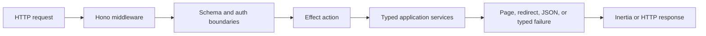

# @popcomputer/web

Effect-native, server-driven web applications on Hono.

`@popcomputer/web` combines the Inertia protocol, Hono routing, Effect programs,
typed request boundaries, optional Better Auth integration, and Drizzle route
model binding. It is designed for applications that want a Laravel-like
request-to-page workflow without giving up explicit dependencies and typed
failures.

```ts
// Only its owner loads a project: anyone else gets the 404 a missing one gets.
const bindings = { project: routeBinding(projects, { ownedBy: 'userId' }) }

export const showProject = action(
  Effect.gen(function* () {
    const project = yield* bound('project')

    return yield* render('Projects/Show', { project })
  })
)
```

## Documentation

The documentation is one short file per task, in [`docs/`](docs/). The package
ships it as `node_modules/@popcomputer/web/docs/`, matching the installed
version. [Which API for which task](docs/which-api.md) names the API for each
task and the file that explains it.

Start here:

- [Which API for which task](docs/which-api.md): the one API for each task
- [Reading the type errors](docs/type-errors.md): what each type error means, and what to do
- [Lint rules](docs/lint-rules.md): what each rule reports, and what to use instead
- [The agent fence](docs/agent-fence.md): the commit gate, the command hook that refuses a bypass and asks before a deploy, and the debt report

Setting up:

- [Installation](docs/installation.md): the demo, the packages, `tsconfig.json`, Oxlint and the supported versions
- [Quick start](docs/setup.md): the bindings, `setupWeb` and its registration, the database, the Worker's entry
- [Vars and secrets](docs/env.md): `defineEnv`, the check when an isolate starts, and `checkEnv` for scripts
- [Deploying](docs/deploying.md): version values, and what the framework does around a deploy

Building:

- [Pages and props](docs/pages.md): page schemas, React pages, shared props, the error page and the page map
- [Forms](docs/forms.md): form schemas, form pages, flash messages, failed forms and error bags
- [Validating input](docs/validation.md): `validateRequest`, the validators, dates, uploads and filters
- [Actions and routes](docs/actions.md): paths, actions, registrations, the response helpers and defects
- [Cookies, files and headers](docs/responses.md): declared cookies, files, polling, the Origin check and security headers
- [JSON clients](docs/json.md): who gets JSON, the error envelope, JSON declared by a schema, and `call`
- [JSON endpoints](docs/endpoints.md): contracts, their actions, `routes.endpoint` and `openApi`
- [Route model binding](docs/route-models.md): `bindings`, `bound()`, and models scoped to their parent
- [Application services](docs/services.md): `web.services`, `config`, and rules in services
- [The database](docs/database.md): `dbQuery`, `dbMutation`, `dbTransaction`, `dbBatch`, migrations and cursors
- [Constraints](docs/constraints.md): invariants concurrent requests would break, D1 batches and `rowOf`
- [Webhooks](docs/webhooks.md): verifying the raw body, and recording each event once

Auth:

- [Auth](docs/auth.md): `authorize()`, the signed-in user, Better Auth's client and limiting password guessing
- [Better Auth's tables](docs/auth-tables.md): on Postgres and on Cloudflare D1
- [Signing in and out](docs/sign-in.md): sign-in and sign-up actions, guest and auth guards, `betterAuthHandler`
- [Better Auth's plugins](docs/auth-plugins.md): two-factor, magic links, organizations and OAuth providers
- [Guards and roles](docs/guards.md): layers that guard routes, and roles on memberships

Running:

- [The data cache](docs/data-cache.md): `cache`, its tags, and an API that authenticates each request
- [Page caching](docs/page-cache.md): the default page cache, Workers Cache and purges
- [Background, scheduled and queued work](docs/background.md): `background`, Cron Triggers and Queues

Testing and reference:

- [Testing](docs/testing.md): requests through the application, the readers, one visitor, fakes and time
- [A database for tests](docs/test-database.md): PGlite for Postgres, and D1 through Miniflare
- [Lower-level composition](docs/lower-level.md): the middleware without `setupWeb`
- [State machines](docs/state-machines.md): what the framework keeps across requests, the rule each keeps, and the models that check them

## Why this shape

- **Declare once; the rest derives.** `setupWeb` takes each of the
  application's declarations as a value: the database factory, the Drizzle
  schema and the tables route models load from, the signed-in user's schema,
  pages, route paths, shared props and flash. Registering its result once
  types everything else: `bound('project')` is the table's row, `render`
  checks a page's props, `redirect` and `href` fill a path's placeholders, and
  a React page's props follow its schema. A renamed column, prop or
  placeholder is a type error wherever it is used.
- **Actions are ordinary Effect values.** They declare only the services and
  failures they use, so small actions stay small and complex workflows
  compose. `routes` accepts an action only when the setup provides its
  services and handles its failures; otherwise the registration is a type
  error naming the missing service or the unhandled error.
- **External data is parsed at the edge.** Sessions, request input, route
  parameters, database rows, cached values and webhook bodies are checked with
  Effect Schema before application code relies on them, and what reaches the
  browser is encoded through the page's schema.
- **Correct by default where it is easy to get wrong:** cached pages vary on
  cookies and are purged by the records they show, failed forms go back to the
  form with their errors, and a record a visitor may not see is a 404.
- **The standard Inertia protocol.** Existing Inertia clients keep using
  `X-Inertia`, partial reloads, asset versions, error bags and redirects.

## Getting started

To start from a complete application, create one from the
[demo](https://github.com/PatrickOgilvie/popcomputer-web-demo):

```bash
bun create PatrickOgilvie/popcomputer-web-demo my-app
```

To add the package to an application of your own:

```bash
bun add @popcomputer/web effect hono
```

[Installation](docs/installation.md) lists the optional integrations, the
`tsconfig.json` and the supported versions, and the [Quick start](docs/setup.md)
sets an application up.

Coding agents should read `node_modules/@popcomputer/web/AGENTS.md`, a short
rulebook naming the one API to use for each task, and the files in
`node_modules/@popcomputer/web/docs/` as a task needs them.
[The agent fence](docs/agent-fence.md) holds them to it with checks: a commit
gate, a hook that refuses a command skipping it and asks the owner before a
deploy, and a count of disable directives that only shrinks.

## Data flow



`setupWeb` builds the request-scoped Effect runtime and provides only the
services configured for that request. A missing database or auth service is
reported as a configuration error rather than being silently replaced with an
untyped value.

## Patterns from real applications

These patterns come from applications built on the package, most of them by
coding agents. Each replaces a first attempt that compiled and then
misbehaved.

Each lives in the file for its task:

- [Rules live in services; actions decide what a failure means](docs/services.md#rules-live-in-services-actions-decide-what-a-failure-means)
- [Constraints keep invariants that concurrent requests would break](docs/constraints.md)
- [A guard guards a group of routes](docs/guards.md#a-guard-guards-a-group-of-routes)
- [Roles belong to memberships, read by a guard](docs/guards.md#roles-belong-to-memberships-read-by-a-guard)
- [Webhooks verify the raw body, then record the event once](docs/webhooks.md)
- User input in, files out: [filters and uploads](docs/validation.md#user-input-in),
  [serving an upload back](docs/responses.md#serving-an-upload-back), and
  [requests from other sites](docs/responses.md#requests-from-other-sites-and-security-headers)
- [Lists page through with a cursor](docs/database.md#lists-page-through-with-a-cursor)
- [Several forms on one page keep their errors apart](docs/forms.md#several-forms-on-one-page-keep-their-errors-apart)
- Other patterns: in [Pages and props](docs/pages.md#other-patterns),
  [Validating input](docs/validation.md#other-patterns),
  [Application services](docs/services.md#other-patterns),
  [Page caching](docs/page-cache.md#other-patterns) and
  [Background work](docs/background.md#other-patterns)

## Upgrading

[`UPGRADING.md`](UPGRADING.md), shipped in the package as
`node_modules/@popcomputer/web/UPGRADING.md`, takes an application on any
earlier release, or on the `honertia` package, to this one. It moves an
application's own code from Effect 3 to Effect 4 too, which most of an upgrade
from `honertia` is, maps every former `Honertia*` name to its replacement,
and lists the changes no type error points at.

## Tradeoffs and current limits

- This is a server-driven page architecture. It is not a replacement for a
  client-side router when the browser must own navigation and data fetching.
- Effect is a deliberate application-level dependency. The package is most
  valuable when actions, failures, services, and background work all use the
  same Effect model.
- Route model binding currently relies on Drizzle metadata. Other database
  clients still work through `DatabaseService`, but do not receive automatic
  binding queries.
- Better Auth and Cloudflare-specific caching are optional integrations rather
  than hidden requirements.
- The package does not run database migrations. Use `drizzle-kit` or
  `wrangler d1 migrations` directly.
- Cloudflare D1 has no interactive transactions. `dbBatch` applies several
  writes atomically there; `dbTransaction` needs Postgres, MySQL or libsql,
  and is a type error for synchronous drivers such as `bun:sqlite`.
- Page props cross to the browser as JSON. `Jsonify` describes the result
  (dates and bigints become strings); page schemas should describe plain
  data rather than classes or Effect data types.
- A table binding checks each column's database type, nullability and enum
  values, but not a narrowing declared only in TypeScript, such as
  `text('role').$type<Role>()`: name an Effect Schema for that binding, or
  give the column an enum.
- Workers Cache answers before the Worker runs, so a page cached with the
  `cache` option is shared only by visitors who send no cookies. Visitors
  with analytics cookies render it afresh; the default page cache, which runs
  in the Worker, ignores those cookies but caches only pages that read no
  data.

## Developing this package

```bash
bun run test
```

After changing `AGENTS.md`, regenerate the skill with
`bun scripts/build-skill.ts`; a test fails while it is stale.

The repository verifies runtime behavior, strict TypeScript and module
augmentation contracts, that every TypeScript example in this README, in
`docs/`, in `AGENTS.md` and in `UPGRADING.md` type-checks, that every link
between them resolves and no file in `docs/` passes 250 lines, and that each
built entrypoint imports under plain Node.

## License

MIT
