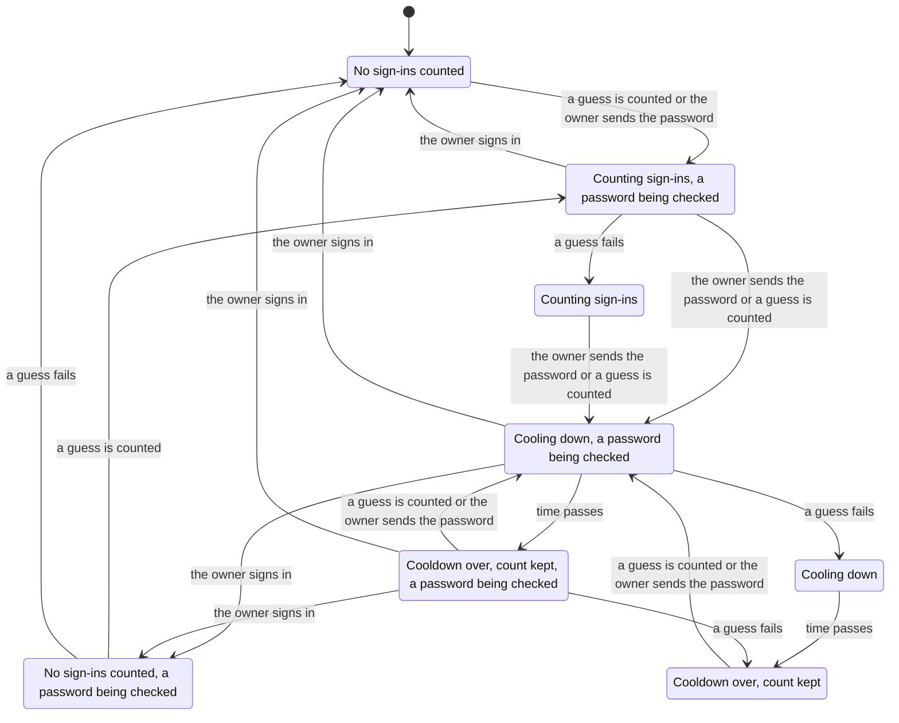

# State machines

Some of what the framework keeps changes over a sequence of requests: a
count, a cookie, a cached value, a one-time token. Each is a state machine,
whether or not its code says so, and each promises something that concurrent
requests, other tabs, prefetches, retries and expiry can break. This page
lists them, says what each promises, and points to the TLA+ models in
[`state-machines/`](state-machines/) that check the promises over every
order of steps within small bounds. The models are checked with TLC through
pstack's `/statechart` skill, which also draws the charts here; the
project's own verify skill, `.claude/skills/verify-state-machines`, says how
to check a change against them.

## The lifecycles

| Lifecycle | Where | States | What moves it |
|---|---|---|---|
| An account's sign-ins | `src/effect/sign-in-limits.ts` `withinSignInLimits`, `sweepSignInFailures` | spent, counting, cooling, cooled: conditions on its `rateLimit` row | a password sign-in, its answer, time, the sweep |
| Inertia's history | `src/middleware.ts` `web()`, `src/page-version.ts` | per tab: its key, its entries, its page's version; per browser: the session cookie and the clear | a page, an answer that ends or starts a session, Back |
| Flash and a failed form's errors | `src/flash.ts` `openFlash` | the cookie's errors, flash values and clear; per request, delivered or not | a redirect, a page, a JSON answer, a prefetch |
| Purges a route owes | `src/effect/response-cache.ts` `makePendingPurges`, `makePendingCacheTags` | open with tags, then taken; a later add is a defect | `purgeCache`, `tagCache`, the route's success |
| `routes.run`, `routes.queue`, `routes.scheduled` | `src/effect/routing.ts` `runJobs`, `failRun`, `run` | registered, done, resolved or rejected; a message acked or retried | the job's exit, its purge |
| Background work of a request | `src/effect/bridge.ts` `createExecutionContextSupervisor` | idle, pending, draining, drained, disposed | `background()`, `waitUntil`, the runtimes' disposal |
| The default page cache | `src/page-cache.ts` | per request: dynamic or not; per URL: stored with a deploy's id | a read of a header, binding or the database; the response |
| The data cache | `src/cache.ts` `cache`, `cacheGet`, `cacheSet`, `invalidateCacheTags` | an entry fresh, stale or expired; a tag's generation | a read, a store, a purge |
| The session lookup | `src/effect/auth.ts` `loadUserMiddleware` | the request's user, set once before the action; renewal cookies | the lookup, a renewal, a revocation |
| An address and its links | `docs/auth.md`, `docs/auth-plugins.md`, `tests/better-auth/app.ts` | none, registered, proven; a link's token unused or used | sign-up, the link's page and button, sign-in, change-email |
| Application cookies | `src/effect/cookies.ts` | the browser's value; a signed one's signature | `set`, `clear`, the next request |
| Guards and bound records | `src/effect/routing.ts`, `src/effect/guard.ts` | per guarded binding: undecided, read, decided | a guard's read, its layer built, `bound()` |

## The models

Each model holds the code as it is, `Design = "code"`, and the code of
release 1.6.0, `Design = "1.6"`, on which every rule breaks: a rule never
seen to fail proves nothing. Each `.cfg` beside a model sets its bounds.

### An account's sign-ins

[`SignInLimits.tla`](state-machines/SignInLimits.tla): three guessers and
the owner, `max` 2, a cooldown of one tick and a window of four.

- **AtMostMaxGuessesAtOnce**: however many guesses arrive together, at most
  `max` reach the password check, unless the owner signs in between them.
- **NoFreshBudgetAfterCooldown**: once the account has cooled down, its count
  starts again from 1 only after a whole window with no guess, counted from
  the end of the cooldown.
- **OwnerSignInClearsCount**: after the owner signs in, only failures after
  that count.

All three hold on the code over 23,529 states. On 1.6, which read the count
before Better Auth's call and wrote it after, three guesses sent together
all reached the check; a guess that failed while the owner's password was
checked stayed counted; and a count past `max` started again a window after
its last failure, its cooldown spent toward the window. The code counts
each sign-in in one conditional upsert before the call, and its row lasts a
window past the end of its cooldown. In the whole graph of a smaller model,
a sign-in during a cooldown is refused and stays there:

The model leaves out the Rate Limiting binding, which only narrows a burst
at each Cloudflare location, and the password hash's cost.

### Inertia's history

[`HistoryClear.tla`](state-machines/HistoryClear.tla): two tabs, Ada and
Grace, eight steps, with `history.encrypt`'s default and with `true`.

- **BackShowsNoOneElsesPage**: Back never shows a member's page from history
  in a tab whose page is now someone else's, or a guest's, without asking the
  server.

It holds on the code in both modes, over 36,831 and 37,951 states. On 1.6,
the one-time clear reached only the tab that showed the first page after a
switch: Ada signs in, tab 1 shows her page, Grace signs in, tab 2 shows a
page and takes the clear, tab 1 shows Grace's page, and Back in tab 1 shows
Ada's. Under `encrypt: true`, a cookie that simply expired cleared nothing.
The code gives a signed-in page a version that names its user, and Inertia
asks the server for an entry whose version is not the current page's.

The model leaves out Inertia's prefetch cache. Back pressed in a tab before
it asks for any page after the session ended elsewhere is still answered
from that tab's history: only the server knows the session ended.

### The data cache

[`DataCache.tla`](state-machines/DataCache.tla): one value under one tag,
and an action that reads the record and gives it to `cacheSet` later.

- **NoReadAfterPurgeReturnsTheOldValue**: once a write's purge has run, no
  read returns the value from before it, but one `cacheSet` stored after the
  purge.
- **CacheSetStoresOnlyCurrentValues** breaks, and stays a known limit:
  `cacheSet` stores against its tags' generations as they are when it runs,
  so a value read before a write whose purge ran before `cacheSet` is stored
  as current.

The first holds on the code over 417 states. On 1.6, `cacheSet` stored no tag
and `cacheGet` read none: a value stored by `cache` or `cacheSet`, its record
written and purged, came back from `cacheGet`. `cache` reads the generations
before it computes, so a purge during its computation leaves the value a
miss. The model leaves out time, so `ttl`, and KV's eventual consistency,
which [the data cache](data-cache.md) describes.

### A magic link

[`MagicLink.tla`](state-machines/MagicLink.tla): the member's link, and a
mail scanner that fetches it and presses no button.

- **OnlyTheMemberSignsIn**: no one but the member signs in with their link.
- **TheMemberSignsIn**: the member who follows an unexpired link is signed in.

Both hold on the code, whose link opens a page whose button posts the token.
On 1.6's template, the scanner's fetch signed it in and left the member's
click on an expired link.

### A failed form's errors

[`Flash.tla`](state-machines/Flash.tla): a form that fails, and another
request from the same browser, a poll or another tab, that renders a page.

- **TheFormShowsItsErrors** breaks, and stays a known limit: the flash
  cookie is one value per browser, so a page the other request renders after
  the form's answer takes the errors, and the form's own page shows none.
  Inertia follows the form's redirect at once, so only a request in flight
  then can take them.

## Known limits

The models found these, or the inventory did, and the framework keeps them:

- A failed form's errors, and flash values, go to the next page the browser
  renders, in whichever tab; a JSON answer drops them.
- A job whose purge fails after its writes committed is retried whole, as
  [background work](background.md) says, so a job must be safe to run twice;
  a queue message is acked before the `background()` work it started settles.
- A value given to `cacheSet` that was read before a write whose purge ran
  before `cacheSet` is stored as current, until its `ttl`.
- A GET that read a record before a write and stores its response after the
  write's purge keeps the old page in Workers Cache until its `maxAge`.
  `cache` refuses such an entry by its tags' generations; Workers Cache
  answers before the Worker runs.
- A promise a request service hands to `waitUntil` as its scope closes,
  after the request's background work has drained, is kept alive, but its
  failure is reported nowhere: the runtime whose observer would report it is
  gone by then.
- A signed application cookie's signature covers its name and value, not its
  expiry, so a copied value stays valid after its `Max-Age`.
